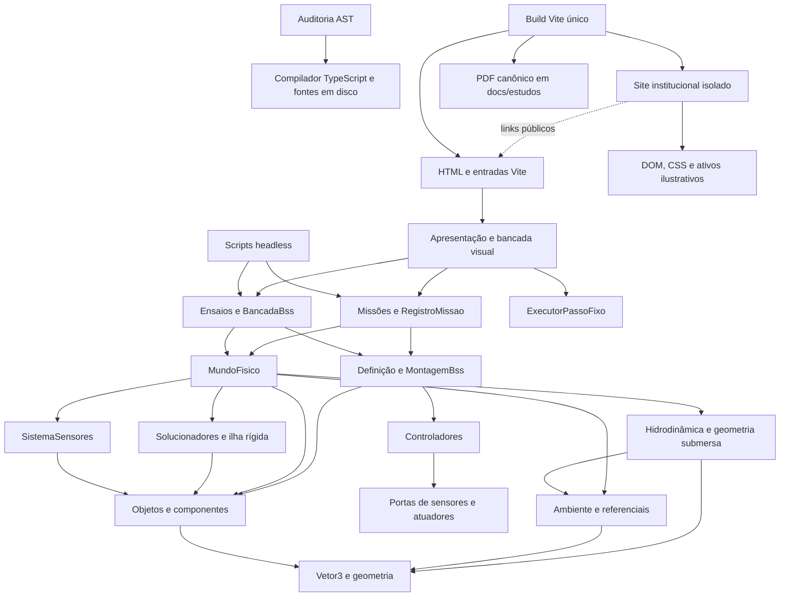
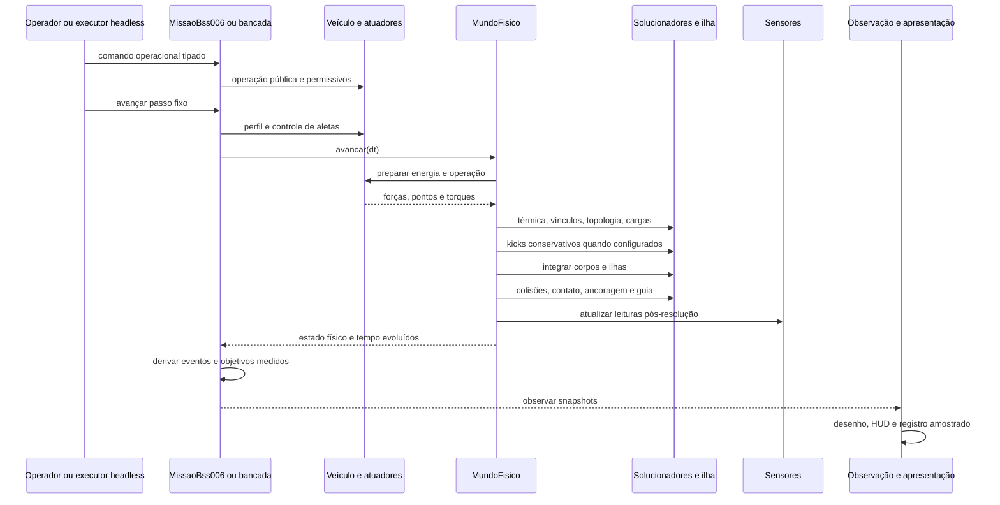
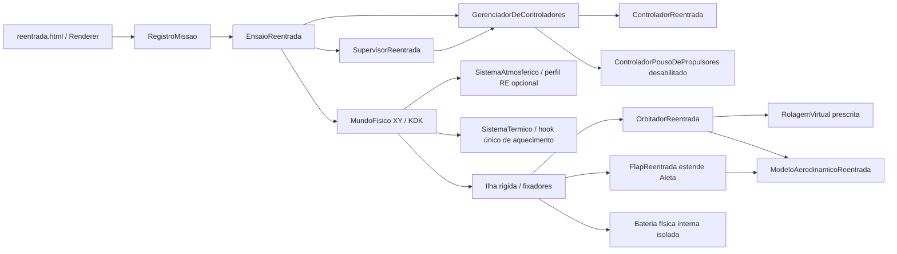

# Mapa do sistema — Black Star Protótipo 2

Referência inicial: `555635b` (M11-P-D). O mapa descreve implementações existentes;
capacidades futuras de AGENTS.md não são capacidades presentes. O catálogo AST
contém o inventário individual de funções e uma seção própria de testes.

A infraestrutura documental formata assinaturas e tipos de retorno inferidos
com aliases do TypeChecker no contexto da declaração. O catálogo não deve
incorporar o caminho absoluto do checkout nos imports de tipos. A regressão
M12-DOC-FIX compara checkouts independentes com Unicode/espaços e executa a CLI
real; `docs:verificar` permanece somente leitura e rejeita artefatos divergentes.

## Árvore de responsabilidades

```text
Protótipo 2
├── site/pages/                      HTML institucional, pesquisa e portal do laboratório
├── site/scripts/                    menu e carrossel; apenas apresentação DOM
├── site/styles/                     identidade visual institucional isolada
├── site/public/                     WebP, favicon e metadados estáticos publicáveis
├── site/build/                      integração Vite de rotas/HTML e PDF canônico
├── src/physics/                      núcleo físico e componentes de domínio
│   ├── MundoFisico                   registros, tempo, receita determinística
│   ├── Vetor3                        álgebra imutável e validação finita
│   ├── ambiente/                     gravidade, referenciais, costa, órbitas
│   ├── agua/                         recorte volumétrico, empuxo, arrasto, entrada
│   ├── geometria/                    caixas orientadas e contato SAT
│   ├── termica/                      capacidades regionais, condução e radiação optantes
│   ├── estruturas/                   ilhas rígidas: massa, G, I e projeção
│   ├── solucionadores/               integração, contato, colisão, esforços, ar/calor
│   ├── conexoes/                      fixadores, fundação, guias, juntas, circuitos
│   ├── objetos/                      corpos, fontes, motores, veículos, mecanismos
│   ├── sensores/                     observação, falhas e leituras de realimentação
│   ├── sistemas de controle/         PID, Fuzzy-PID, guiagem, perfil, arbitragem
│   └── cenarios/                     instalação física de porta/batente
├── src/veiculos/                     definição e montagem compartilhada BSS
├── src/missoes/                      instância, comandos, objetivos, eventos, diário/replay
├── src/cenarios/                     consumidores de ensaios e bancadas BSS/orbital
├── src/simulacao/                    conversão de relógio externo em passos fixos
├── src/apresentacao/missao/          entrada DOM, cena, câmera, Canvas e HUD
├── src/visualizacao/                 câmera de bancada, cabos, trace e diário de bancada
├── src/validacao/                    referências comparativas headless M10
├── src/*.ts                         entradas multipágina e bancada experimental
├── scripts/                         execução, validação e medição sem navegador
├── scripts/documentacao/            análise estática; não participa da simulação
├── docs/planos-codex/                decisões e histórico de marcos
└── docs/validacoes/                  evidências históricas preservadas
```

## Dependências entre camadas

Uma seta significa **usa/importa**, não transferência de autoridade cinemática.
Imports de tipos são distintos de dependências executáveis no inventário AST.



Não há Firebase/Firestore no domínio implementado. `firebase.json` configura
hosting de arquivos estáticos. Não há inventário persistente, carreira,
BSS-007, orbitador, docking, rotação terrestre ou CFD completos implementados.

## Classes, portas e composição

| Responsabilidade | Implementação e composição real |
|---|---|
| Corpo e estado | `Objeto`: geometria, massa instantânea, integridade, estado físico congelado, forças operacionais. A identidade continua individual dentro da ilha. |
| Veículo central | `VeiculoComposto extends Objeto`: corpo com massa positiva, módulos e fixadores; não mantém segunda cinemática dos módulos. `ComputadorDeVoo` recebe portas dos propulsores/sensores. |
| BSS compartilhado | `DefinicaoBss006` fixa parâmetros históricos; `MontagemBss` registra casco, tanques, bateria, painel, motor, pernas, grid fins e vínculos no mundo recebido. Bancada e missão reutilizam a montagem. |
| Propulsão | `Propulsor` e `PropulsorVetorizado`; tanques, linhas, válvulas, bombas, câmara, bocal e atuador de vetorização. Energia e permissivos precedem ignição explícita. |
| Energia e mecanismos | `FonteEletrica`, `Bateria`, `GeradorCA`, `ConexaoEletrica`, resistor/interruptor/contator; cilindros, motor rotacional e conjuntos de porta. Orçamentos por subpasso e forças com reação física. |
| Estrutura | `FixadorEstrutural`, `ConjuntoEstruturalRigido`, `ChumbadorAoSolo`, `GuiaLinear`, `JuntaRotacionalDeBancada`. A topologia determina massa/G/I; ruptura e liberação separam sem apagar corpos. |
| Ambiente | `AmbienteFisico` compõe `CampoGravitacional` e `ReferencialFisico`; `AmbientePlano` legado e `AmbienteTerrestre` central explícito. |
| Solo | `SuperficieFisica` e geometrias plano, esférica, plano local, costeira. Normal/distância/pontos consultados por contato e sensores. |
| Água | `RegiaoAquatica` delimita fluido; `PrismaDeslocador` fornece volume externo exclusivo; `SistemaHidrodinamico` fornece cargas e `EstadoImersao`. Interface livre não é contato rígido. |
| Sensores | `SistemaSensores`, `SensoresVeiculoComposto`, `SwitchFimDeCurso`: observam estados do mundo; GPS/nível idealizados, freeze/atraso/desvio e stale sem dinâmica paralela. |
| Controle | `GerenciadorDeControladores` arbitra recursos; PID/Fuzzy-PID/guia BSS-006 e controle de aletas produzem solicitações, nunca estado cinemático. |
| Missão | `DefinicaoMissao`, `InstanciaMissao<C,O>`, `CicloMissao`, `MissaoBss006`; ambiente/veículo privados, comandos tipados, objetivos e eventos observacionais. |
| Replay | `RegistroMissao` decorador em memória e `reproduzirDiarioBss006` validam configuração, revisão, agenda, resultados e snapshots. Exportar não persiste em rede. |
| Apresentação | `CenaMissao` compõe `EntradaMissao`, `RenderizadorMissao`, `CameraMissao`, `HudMissao` e executor. Snapshots são copiados/congelados por `copiarSnapshot`. |

## Fluxo completo de um passo



`avancar(deltaS)` valida o intervalo, verifica declarações aquáticas e subdivide
por `maxDtS` e pelo limite hidrodinâmico. Impulsos externos só entram no primeiro
subpasso; forças externas valem pela chamada inteira. As filas são limpas em
`finally`, inclusive se ocorrer falha.

`integrarPasso` atualiza vento/tração, prepara todos os orçamentos de energia
antes dos consumidores, atualiza térmica e vínculos, sincroniza ilhas, aplica
impulsos pendentes e carregamentos hidrodinâmicos, reconstrói a topologia se um
fixador romper, integra, resolve colisões/solo, ancora/guia, atualiza sensores
e incrementa tempo. A ordem é parte do contrato determinístico.

No ambiente central, KDK aplica dois meios impulsos de gravidade/empuxo, com
drift e forças dissipativas/operacionais explícitas entre eles. A ilha recebe
lotes de impulsos **sequenciais**, preservando a ordem e arredondamento M11-P.
O legado mantém Euler semi-implícito. Contato usa massa/inércia efetivas e
pontos orientados, não categoria artificial de pouso.

## Fontes da verdade e fronteiras

| Grandeza | Autoridade | Consumidores / restrições |
|---|---|---|
| Posição, velocidade, atitude e taxa | core, estado de `Objeto` | API `atualizarEstadoPeloCore` existe, mas o uso legítimo é restrito ao core; TypeScript não prova essa autoridade |
| Massa/G/I de ilha | objetos conectados + `ConjuntoEstruturalRigido` | caches invalidam por massas individuais e pose; consumo não usa massa nominal |
| Altitude, vertical/tangente e atitude local | `ReferencialFisico` | core/sensores/controladores/telemetria reutilizam serviço; XY orbital |
| Recursos e permissivos | sistemas e componentes | interface solicita ligar/desligar/ignitar; restauração não reignita |
| Contatos e danos | solucionadores e métodos pelo core | eventos/Canvas apenas observam; água não cria piso no nível livre |
| Tempo físico | `MundoFisico.tempoS` | relógio real pertence ao adaptador `ExecutorPassoFixo` |
| Estado/índice operacional | `CicloMissao` | pausa impede passos; objetivos não comandam movimento |
| Água, volume e forças | geografia + hidrodinâmica | Canvas consulta nível/costa e corpos, sem rotação roteirizada |
| Diário e trace | registro de comandos/amostras | navegar trace não rebobina mundo; replay exige mesma revisão/modelo |
| Cobertura documental | auditoria AST | presença/estrutura somente; avaliação semântica é técnica |

## Pontos de entrada e operação

| Entrada | Caminho de execução |
|---|---|
| `/`, `/pesquisa`, `/simulador` | Fontes em `site/pages`; CSS em `site/styles` e menu/carrossel em `site/scripts`. Plugin Vite emite HTML na raiz sem depender de outro repositório. |
| `tests.html` | `src/testes.ts` → `BancadaBss`, seis BSS e ferramentas históricas; comandos, trace, câmera e executor fixo |
| `orbitas.html` | `src/orbitas.ts` → `EnsaioOrbitalInerte`; corpos inertes em vácuo explícito, sem foguete |
| `missao.html` | `src/missao.ts` → `CenaMissao` → missão registrada; terrestre M10 ou ADM aquática M11 |
| `npm run missao:executar` | `scripts/executar-missao.ts` → missão/agenda/replay headless |
| `npm run agua:validar` | `scripts/validar-hidrodinamica.ts` → corpos inertes e comparação analítica |
| `npm run missao:benchmark` | `scripts/benchmark-missao.ts` → instrumentação opt-in; relógio CPU fora do domínio |
| `npm run test` | Vitest, arquivos `*.test.ts`; não é a bancada visual |
| Build/CI | `vite.config.ts` quatro entradas; `.github/workflows/ci.yml` testes/tipos/build |

A M11-P desenha aproximadamente a 30 Hz, atualiza HUD a 10 Hz e mantém
integração a 1/240 s externo, refinada pela água. A fila de tempo preserva passos
e informa atraso. O desenho não define `dt`, nem garante 1× em qualquer máquina.

## Riscos arquiteturais e sobreposições observadas

- `AutotunadorPosicionamentoMotorEletrico.simular` usa um modelo rotacional
  aproximado próprio para pontuar ganhos, sem evoluir o mundo real. Isso duplica
  uma aproximação de dinâmica para calibração; equivalência ao core não deve
  ser presumida. `executar` cede via `setTimeout(0)` dentro do módulo de controle:
  o agendamento não muda seu dt fixo, mas acopla cedência ao ambiente externo.
  Ambos são pontos para discussão futura, sem correção neste marco.
- A finitude não é validada uniformemente em todos os construtores legados;
  contratos exigem configurações físicas válidas, e não se deve presumir que
  todo valor inválido seja rejeitado em toda fronteira existente.
- `src/testes.ts` mistura montagem de ensaios locais e apresentação/entradas. É
  ferramenta provisória; permanece consumidor do mesmo core. Não refatorada.
- `CameraFisica2D` e `CameraMissao` cobrem transformações de observação semelhantes,
  em contratos diferentes. Há oportunidade futura de composição, sem evidência
  de duplicação da dinâmica física.
- Diário/replay legado (`RegistroEnsaioBancada`, `ReproducaoDiarioBss005`) e diário
  de missão usam schemas próprios; compatibilidade histórica exige essa distinção.
  Validação/serialização semelhantes podem divergir; não unificadas neste marco.
- Integração isolada e de ilha repetem relações força/impulso/torque; ilha precisa
  de massa/G/I compostos. Equivalência e ordem numérica estão cobertas pela M11-P.
- `Vetor3` expõe componentes `readonly` pelo TypeScript; o congelamento do
  registro físico é superficial. A invariância dos vetores do core é um contrato
  dos consumidores, não proteção contra casts/JavaScript arbitrário. Os DTOs de
  `copiarSnapshot` recebem cópias com congelamento recursivo. Caches dependem de
  respeitar esse contrato. Nenhum reforço executável foi adicionado aqui.
- `exigirRegistro` valida presença de ID, sem comparar a instância com o registro;
  o chamador deve fornecer o mesmo objeto registrado.
- `avancar` não é transacional: uma exceção depois de subpassos pode conservar
  efeitos parciais; as filas externas são limpas em `finally`.
- Métodos públicos `...PeloCore` expressam autoridade por convenção. A API não
  impede, por tipo, que outro consumidor os invoque; auditar chamadas em mudanças.
- Cache geométrico aquático depende de pose e configuração imóvel. Ondas/correntes
  variáveis futuras precisarão rever a invalidação, não apenas alterar renderer.
- Replay estrito é qualificado no mesmo runtime/revisão; igualdade bit a bit
  entre engines distintas não foi qualificada.
- Penetração histórica de ~34 mm, repouso bilateral contínuo e retorno de 15 km
  continuam pendências físicas antigas, sem correções ou novas promessas aqui.

A análise de dependências e o índice de módulos abaixo são gerados do AST.
Ciclos de importação, se encontrados, são evidência estrutural; não provam
recursão em execução. Imports externos e tipos são apresentados explicitamente.

## Laboratório de reentrada RE-001

`reentrada.html`/`src/reentrada.ts` são apresentação: configuração, execução,
câmera e gráficos por snapshots. `RenderizadorReentrada` projeta a atitude XY
com sinal Canvas invertido; bank modifica a projeção de asas, sem somar rotação.
`EnsaioReentrada` implementa as portas de `InstanciaMissao`, utiliza
`RegistroMissao`, fornece replay e monta corpos reais no `MundoFisico` existente.



O perfil RE é ativado exclusivamente por configuração da fábrica; os padrões
atmosféricos antigos são preservados. Arrasto percorre uma única aplicação no
core. O hook de potência térmica substitui a fração histórica somente em
especializações; a classe-base conserva o cálculo original.
Novos recursos de arbitragem distinguem flaps/rolagem de throttle/gimbal.

Não há RCS ou cadeia propulsiva instalada nesse orbitador de ensaio. Supervisor
exige todos os critérios e mantém pouso bloqueado; portas simuladas em testes
não equivalem a um pouso físico integrado. A rolagem virtual projeta lift por
cos(phi); a componente lateral é omitida e não compensada. Forças no rarefeito,
Mach, fluxo de calor e temperaturas concentradas são indicadores preliminares.
O [relatório](../planos-codex/2026-10-17-reentrada.md) registra hipóteses,
assinaturas/impacto funcional, validações reais e pendências.

<!-- INDICE_AST_INICIO -->
## Índice de módulos próprios (AST)

Ciclos de imports executáveis: **nenhum encontrado**. Incluindo tipos: src/physics/sistemas de controle/ControladorReentrada.ts → src/physics/sistemas de controle/EstrategiaCorredorReentrada.ts.

Escopo: imports/exportações estáticos locais das fontes próprias; chamadas dinâmicas e pacotes externos não são inferidos. A tabela inclui entradas sem funções.

| Módulo | Classes/interfaces e bases | Imports (T = somente tipo) |
|---|---|---|
| [scripts/auditar-documentacao.ts](../../scripts/auditar-documentacao.ts) | funções/entrada | ./documentacao/cli |
| [scripts/benchmark-missao.ts](../../scripts/benchmark-missao.ts) | funções/entrada | node:util, node:fs, node:crypto, node:os, node:perf_hooks, ../src/missoes/ReplayMissaoBss006, ../src/physics/MundoFisico, ../src/physics/agua/SistemaHidrodinamico, ../src/physics/estruturas/ConjuntoEstruturalRigido, ../src/missoes/MissaoBss006, ../src/physics/Vetor3 |
| [scripts/campanha-re002.ts](../../scripts/campanha-re002.ts) | funções/entrada | node:fs, ../src/cenarios/EnsaioReentrada |
| [scripts/comparar-desempenho-missao.ts](../../scripts/comparar-desempenho-missao.ts) | Medicao | node:util, ../src/physics/ambiente/CampoGravitacional, node:fs, T: ../src/missoes/RegistroMissao, T: ../src/missoes/TiposMissaoBss006 |
| [scripts/convergencia-angular-re002.ts](../../scripts/convergencia-angular-re002.ts) | funções/entrada | node:fs, ../src/cenarios/EnsaioReentrada, ../src/physics/estruturas/DiagnosticoAngular |
| [scripts/documentacao/ast.ts](../../scripts/documentacao/ast.ts) | Funcao, Modulo, Analise | typescript |
| [scripts/documentacao/auditoria.ts](../../scripts/documentacao/auditoria.ts) | Cobertura | T: ./ast, ./catalogo |
| [scripts/documentacao/catalogo.ts](../../scripts/documentacao/catalogo.ts) | EntradaEstrutural, Divergencias | node:crypto, T: ./ast |
| [scripts/documentacao/cli.ts](../../scripts/documentacao/cli.ts) | funções/entrada | node:fs, node:path, node:crypto, node:child_process, typescript, ./projeto, T: ./ast, ./catalogo, T: ./catalogo, ./auditoria |
| [scripts/documentacao/projeto.ts](../../scripts/documentacao/projeto.ts) | funções/entrada | node:fs, node:path, typescript, ./ast, T: ./ast |
| [scripts/executar-missao.ts](../../scripts/executar-missao.ts) | funções/entrada | node:util, node:fs, ../src/missoes/ReplayMissaoBss006, ../src/missoes/ExecutorMissao |
| [scripts/site/smoke.ts](../../scripts/site/smoke.ts) | funções/entrada | ../../site/build/pluginInstitucional, node:assert/strict, node:fs, node:os, node:path, T: node:net, node:timers/promises, playwright-core, T: playwright-core, vite |
| [scripts/site/verificar.ts](../../scripts/site/verificar.ts) | funções/entrada | node:crypto, node:fs, node:path, ../../site/build/pluginInstitucional |
| [scripts/smoke-configuracao-re003.ts](../../scripts/smoke-configuracao-re003.ts) | funções/entrada | node:assert/strict, node:fs, node:path, T: node:net, playwright-core, vite, T: ../src/cenarios/EnsaioReentrada |
| [scripts/smoke-reentrada.ts](../../scripts/smoke-reentrada.ts) | funções/entrada | node:assert/strict, node:fs, node:path, T: node:net, playwright-core, vite |
| [scripts/validar-compatibilidade-re003.ts](../../scripts/validar-compatibilidade-re003.ts) | funções/entrada | node:assert/strict, node:fs, node:path, ../src/cenarios/EnsaioReentrada |
| [scripts/validar-hidrodinamica.ts](../../scripts/validar-hidrodinamica.ts) | funções/entrada | node:fs, node:util, ../src/physics/MundoFisico, ../src/physics/objetos/base/Objeto, ../src/physics/Vetor3, ../src/physics/ambiente/AmbienteFisico, ../src/physics/ambiente/GeografiaCosteira, ../src/physics/agua/RegiaoAquatica, ../src/physics/agua/SistemaHidrodinamico |
| [scripts/validar-re002.ts](../../scripts/validar-re002.ts) | funções/entrada | node:fs, ../src/cenarios/EnsaioReentrada |
| [scripts/validar-reentrada.ts](../../scripts/validar-reentrada.ts) | funções/entrada | node:assert/strict, node:fs, node:path, ../src/cenarios/EnsaioReentrada |
| [scripts/validar-termica-re003.ts](../../scripts/validar-termica-re003.ts) | funções/entrada | node:assert/strict, node:fs, ../src/cenarios/EnsaioReentrada |
| [scripts/validar-termica-re004.ts](../../scripts/validar-termica-re004.ts) | funções/entrada | node:assert/strict, node:fs, node:path, ../src/cenarios/EnsaioReentrada, ../src/physics/reentrada/ConfiguracaoTermicaReentrada |
| [scripts/verificar-site.ts](../../scripts/verificar-site.ts) | funções/entrada | ./site/verificar |
| [site/build/pluginInstitucional.ts](../../site/build/pluginInstitucional.ts) | funções/entrada | node:fs, node:path, T: node:http, T: vite |
| [site/scripts/carrossel.ts](../../site/scripts/carrossel.ts) | funções/entrada | — |
| [site/scripts/navegacao.ts](../../site/scripts/navegacao.ts) | funções/entrada | — |
| [src/apresentacao/missao/CameraMissao.ts](../../src/apresentacao/missao/CameraMissao.ts) | CameraMissao | ../../physics/Vetor3, ../../visualizacao/CameraFisica2D, T: ../../missoes/TiposMissaoBss006 |
| [src/apresentacao/missao/CenaMissao.ts](../../src/apresentacao/missao/CenaMissao.ts) | CenaMissao | ../../missoes/ReplayMissaoBss006, T: ../../missoes/TiposMissaoBss006, ../../simulacao/ExecutorPassoFixo, ./EntradaMissao, ./HudMissao, ./RenderizadorMissao |
| [src/apresentacao/missao/EntradaMissao.ts](../../src/apresentacao/missao/EntradaMissao.ts) | AcoesApresentacaoMissao | T: ../../missoes/TiposMissaoBss006 |
| [src/apresentacao/missao/HudMissao.ts](../../src/apresentacao/missao/HudMissao.ts) | funções/entrada | T: ../../missoes/ContratoMissao, T: ../../missoes/TiposMissaoBss006 |
| [src/apresentacao/missao/RenderizadorMissao.ts](../../src/apresentacao/missao/RenderizadorMissao.ts) | RenderizadorMissao | ../../physics/Vetor3, T: ../../missoes/TiposMissaoBss006, ../../visualizacao/ConexoesEletricas, ./CameraMissao, ../../physics/ambiente/ReferencialFisico, ../../physics/ambiente/GeografiaCosteira |
| [src/apresentacao/reentrada/CamposParametrosReentrada.ts](../../src/apresentacao/reentrada/CamposParametrosReentrada.ts) | funções/entrada | T: ../../physics/reentrada/ModeloAerodinamicoReentrada |
| [src/apresentacao/reentrada/RenderizadorReentrada.ts](../../src/apresentacao/reentrada/RenderizadorReentrada.ts) | RenderizadorReentrada | T: ../../cenarios/EnsaioReentrada, ../../visualizacao/CameraFisica2D |
| [src/cenarios/BancadaBss.ts](../../src/cenarios/BancadaBss.ts) | ConfiguracaoBancadaDecolagem: ParametrosMontagemBss | ../physics/ambiente/AmbienteFisico, ../physics/SuperficieEsferica, ../physics/ambiente/ReferencialFisico, ../physics/MundoFisico, ../physics/SuperficiePlano, ../physics/Vetor3, ../veiculos/MontagemBss, ../veiculos/DefinicaoBss006 |
| [src/cenarios/BancadaBss003.ts](../../src/cenarios/BancadaBss003.ts) | funções/entrada | ../physics/MundoFisico, ../physics/objetos/base/Objeto, ../physics/SuperficiePlano, ../physics/SuperficieEsferica, ../physics/ambiente/ReferencialFisico, ../physics/objetos/veiculos/Bss03, ../physics/objetos/fontes-de-energia/TanquePropelente, ../physics/objetos/fontes-de-energia/Bateria, ../physics/objetos/propulsao/PropulsorVetorizado, ../physics/conexoes/FixadorEstrutural, ../physics/Vetor3, T: ./BancadaBss |
| [src/cenarios/EnsaioMissaoBss005.ts](../../src/cenarios/EnsaioMissaoBss005.ts) | ConfiguracaoEnsaioBss005, LeituraMissaoBss005 | T: ../physics/ambiente/AmbienteFisico, ./BancadaBss, T: ../physics/objetos/base/Objeto, ../physics/objetos/fontes-de-energia/TanquePropelente, ../physics/MundoFisico, ../physics/solucionadores/ResolvedorContatoSuperficie, ../physics/Vetor3 |
| [src/cenarios/EnsaioOrbitalInerte.ts](../../src/cenarios/EnsaioOrbitalInerte.ts) | funções/entrada | ../physics/ambiente/AmbienteFisico, ../physics/ambiente/CampoGravitacional, ../physics/ambiente/EstadoInicialLocal, ../physics/ambiente/TelemetriaOrbital, ../physics/MundoFisico, ../physics/objetos/base/Objeto, ../physics/Vetor3, ../physics/SuperficieEsferica |
| [src/cenarios/EnsaioReentrada.ts](../../src/cenarios/EnsaioReentrada.ts) | ConfiguracaoReentrada, EnsaioReentrada: InstanciaMissao&lt;ComandoReentrada, ObservacaoReentrada&gt; | ../physics/reentrada/ConfiguracaoTermicaReentrada, ../missoes/RegistroExtremos, ../physics/ambiente/AmbienteFisico, ../physics/ambiente/ReferencialFisico, ../physics/ambiente/EstadoInicialLocal, ../physics/ambiente/PerfilAtmosfericoReentrada, ../physics/MundoFisico, ../physics/Vetor3, T: ../physics/objetos/base/Objeto, ../physics/objetos/veiculos/OrbitadorReentrada, ../physics/objetos/componentes/FlapReentrada, ../physics/objetos/fontes-de-energia/Bateria, ../physics/conexoes/FixadorEstrutural, ../physics/SuperficieEsferica, ../physics/sensores/SensoresVeiculoComposto, ../physics/sistemas de controle/GerenciadorDeControladores, ../physics/sistemas de controle/ControladorPousoDePropulsores, ../physics/sistemas de controle/ControladorReentrada, ../physics/sistemas de controle/SupervisorReentrada, ../physics/sistemas de controle/SupervisorRecuperacao, ../physics/sistemas de controle/ControladorAproximacao, ../physics/sistemas de controle/FronteiraAproximacao, ../physics/reentrada/ModeloAerodinamicoReentrada, T: ../missoes/ContratoMissao, ../missoes/RegistroMissao, ../missoes/SnapshotMissao, ../physics/estruturas/DiagnosticoAngular |
| [src/cenarios/ReproducaoDiarioBss005.ts](../../src/cenarios/ReproducaoDiarioBss005.ts) | EntradaDiarioBss005, DiarioBss005, EventoReplayBss005, OpcoesReplayBss005, ResultadoReplayBss005 | T: ../physics/ambiente/AmbienteFisico, ./BancadaBss, ./EnsaioMissaoBss005, ../physics/objetos/fontes-de-energia/PainelSolar |
| [src/cenarios/TelemetriaMissaoBss.ts](../../src/cenarios/TelemetriaMissaoBss.ts) | funções/entrada | ../veiculos/TelemetriaBss |
| [src/missao.ts](../../src/missao.ts) | funções/entrada | ./missao.css, ./apresentacao/missao/CenaMissao |
| [src/missoes/AmbienteAmerissagem.ts](../../src/missoes/AmbienteAmerissagem.ts) | funções/entrada | ../physics/ambiente/AmbienteFisico, ../physics/ambiente/GeografiaCosteira, ../physics/agua/RegiaoAquatica, ../physics/MundoFisico, ../physics/SuperficieCosteira, ../physics/Vetor3, ./AmbienteLancamento |
| [src/missoes/AmbienteLancamento.ts](../../src/missoes/AmbienteLancamento.ts) | funções/entrada | ../physics/ambiente/AmbienteFisico, ../physics/MundoFisico, ../physics/SuperficieEsferica, ../physics/Vetor3 |
| [src/missoes/CicloMissao.ts](../../src/missoes/CicloMissao.ts) | CicloMissao | T: ./ContratoMissao |
| [src/missoes/ContratoMissao.ts](../../src/missoes/ContratoMissao.ts) | ResultadoComandoMissao, EventoMissao, ObjetivoMissao, InstanciaMissao, DefinicaoMissao | — |
| [src/missoes/EnsaioAmerissagem.ts](../../src/missoes/EnsaioAmerissagem.ts) | funções/entrada | ../physics/Vetor3, ../veiculos/DefinicaoBss006, ../veiculos/MontagemBss, ../veiculos/HidrodinamicaBss006, ./AmbienteAmerissagem |
| [src/missoes/ExecutorMissao.ts](../../src/missoes/ExecutorMissao.ts) | ComandoAgendado | T: ./ContratoMissao |
| [src/missoes/MissaoBss006.ts](../../src/missoes/MissaoBss006.ts) | MissaoBss006: InstanciaMissao&lt;ComandoBss006, ObservacaoBss006&gt; | ../physics/sistemas de controle/ControladorPerfilVooExperimental, ../veiculos/DefinicaoBss006, T: ../veiculos/MontagemBss, ./SnapshotMissao, ./CicloMissao, ./AmbienteLancamento, ./AmbienteAmerissagem, ../veiculos/HidrodinamicaBss006, ../physics/Vetor3, ./ObservacaoAmerissagem, T: ./ContratoMissao, T: ./TiposMissaoBss006 |
| [src/missoes/ObservacaoAmerissagem.ts](../../src/missoes/ObservacaoAmerissagem.ts) | ObservacaoAmerissagem, MedidasAmerissagem, AcompanhamentoAmerissagem | T: ../physics/agua/SistemaHidrodinamico, ../physics/Vetor3 |
| [src/missoes/RegistroExtremos.ts](../../src/missoes/RegistroExtremos.ts) | ExtremoTemporal, FaixaTemporal, RegistroExtremos | ./SnapshotMissao |
| [src/missoes/RegistroMissao.ts](../../src/missoes/RegistroMissao.ts) | DiarioMissao, RegistroMissao: InstanciaMissao&lt;C, O&gt; | T: ./ContratoMissao, ./SnapshotMissao |
| [src/missoes/ReplayMissaoBss006.ts](../../src/missoes/ReplayMissaoBss006.ts) | funções/entrada | ../veiculos/DefinicaoBss006, ./MissaoBss006, ./RegistroMissao, T: ./TiposMissaoBss006 |
| [src/missoes/SnapshotMissao.ts](../../src/missoes/SnapshotMissao.ts) | funções/entrada | ../physics/Vetor3 |
| [src/missoes/TiposMissaoBss006.ts](../../src/missoes/TiposMissaoBss006.ts) | ConfiguracaoMissaoBss006, CorpoObservado, ObservacaoBss006 | T: ../physics/objetos/base/Objeto, T: ../physics/solucionadores/ResolvedorContatoSuperficie, T: ../veiculos/TelemetriaBss, T: ./ContratoMissao, T: ./ObservacaoAmerissagem, T: ../physics/ambiente/GeografiaCosteira |
| [src/orbitas.ts](../../src/orbitas.ts) | funções/entrada | ./style.css, ./orbitas.css, ./cenarios/EnsaioOrbitalInerte, ./visualizacao/CameraFisica2D, ./physics/Vetor3 |
| [src/physics/MundoFisico.ts](../../src/physics/MundoFisico.ts) | ConfiguracaoMundoFisico, RajadaVento, ForcaExternaPendente, ImpulsoExternoPendente, MundoFisico | ./SuperficiePlano, ./ambiente/AmbienteFisico, ./objetos/base/Objeto, ./conexoes/FixadorEstrutural, ./conexoes/ChumbadorAoSolo, ./SuperficieFisica, ./Vetor3, ./solucionadores/IntegradorFisico, T: ./tipos/ForcaAplicada, ./solucionadores/SistemaAtmosferico, ./solucionadores/SistemaTermico, ./solucionadores/ResolvedorEsforcoEstrutural, ./solucionadores/ResolvedorColisoes, ./solucionadores/ResolvedorContatoSuperficie, T: ./solucionadores/ResolvedorContatoSuperficie, ./estruturas/ConjuntoEstruturalRigido, ./sensores/SwitchFimDeCurso, ./sensores/SistemaSensores, ./sensores/SensoresVeiculoComposto, ./conexoes/GuiaLinear, ./conexoes/JuntaRotacionalDeBancada, ./agua/SistemaHidrodinamico, T: ./agua/RegiaoAquatica, T: ./agua/GeometriaSubmersa, T: ./ambiente/PerfilAtmosfericoReentrada |
| [src/physics/SistemaOperacional.ts](../../src/physics/SistemaOperacional.ts) | SistemaOperacional, GerenciadorDeSistemas | — |
| [src/physics/SuperficieCosteira.ts](../../src/physics/SuperficieCosteira.ts) | SuperficieCosteira: SuperficieEsferica | ./SuperficieEsferica, T: ./ambiente/GeografiaCosteira, ./Vetor3 |
| [src/physics/SuperficieEsferica.ts](../../src/physics/SuperficieEsferica.ts) | SuperficieEsferica: SuperficieFisica | ./SuperficieFisica, ./Vetor3, ./ambiente/CampoGravitacional |
| [src/physics/SuperficieFisica.ts](../../src/physics/SuperficieFisica.ts) | SuperficieFisica | ./Vetor3 |
| [src/physics/SuperficiePlano.ts](../../src/physics/SuperficiePlano.ts) | SuperficiePlano: SuperficieFisica | ./SuperficieFisica, ./Vetor3 |
| [src/physics/SuperficiePlanoLocal.ts](../../src/physics/SuperficiePlanoLocal.ts) | SuperficiePlanoLocal: SuperficieFisica | ./SuperficieFisica, ./Vetor3 |
| [src/physics/Vetor3.ts](../../src/physics/Vetor3.ts) | Vetor3 | — |
| [src/physics/agua/GeometriaSubmersa.ts](../../src/physics/agua/GeometriaSubmersa.ts) | PrismaDeslocador, ElementoSubmerso, GeometriaImersa | T: ../objetos/base/Objeto, ../Vetor3, T: ./RegiaoAquatica |
| [src/physics/agua/RegiaoAquatica.ts](../../src/physics/agua/RegiaoAquatica.ts) | PlanoRecorte, RegiaoAquatica | ../Vetor3, T: ../ambiente/GeografiaCosteira |
| [src/physics/agua/SistemaHidrodinamico.ts](../../src/physics/agua/SistemaHidrodinamico.ts) | EstadoImersao, SistemaHidrodinamico | T: ../objetos/base/Objeto, T: ../tipos/ForcaAplicada, ../Vetor3, ./GeometriaSubmersa, ./RegiaoAquatica |
| [src/physics/ambiente/AmbienteFisico.ts](../../src/physics/ambiente/AmbienteFisico.ts) | AmbienteFisico, AmbientePlano: AmbienteFisico, AmbienteTerrestre: AmbienteFisico | ./CampoGravitacional, ./ReferencialFisico, ../Vetor3 |
| [src/physics/ambiente/CampoGravitacional.ts](../../src/physics/ambiente/CampoGravitacional.ts) | CampoGravitacional, CampoUniforme: CampoGravitacional, CampoCentral: CampoGravitacional | ../Vetor3 |
| [src/physics/ambiente/EstadoInicialLocal.ts](../../src/physics/ambiente/EstadoInicialLocal.ts) | CondicoesIniciaisLocais | T: ../objetos/base/Objeto, ../Vetor3, T: ./ReferencialFisico |
| [src/physics/ambiente/GeografiaCosteira.ts](../../src/physics/ambiente/GeografiaCosteira.ts) | ConfiguracaoCosta, GeografiaCosteira | T: ./ReferencialFisico, ../Vetor3 |
| [src/physics/ambiente/PerfilAtmosfericoReentrada.ts](../../src/physics/ambiente/PerfilAtmosfericoReentrada.ts) | PerfilAtmosferico, AmostraAtmosferaReentrada, PerfilAtmosfericoReentrada: PerfilAtmosferico | — |
| [src/physics/ambiente/ReferencialFisico.ts](../../src/physics/ambiente/ReferencialFisico.ts) | ReferencialFisico, ReferencialPlano: ReferencialFisico, ReferencialEsferico: ReferencialFisico | ../Vetor3, ./CampoGravitacional |
| [src/physics/ambiente/TelemetriaOrbital.ts](../../src/physics/ambiente/TelemetriaOrbital.ts) | funções/entrada | ../Vetor3, ./CampoGravitacional |
| [src/physics/cenarios/EnsaioPortaVertical.ts](../../src/physics/cenarios/EnsaioPortaVertical.ts) | ConfiguracaoEnsaioPorta | ../objetos/fontes-de-energia/GeradorCA, ../conexoes/eletrica/Contator, ../conexoes/ConexaoEletrica, ../MundoFisico, ../objetos/base/Objeto, ../objetos/mecanismos/Porta, ../objetos/mecanismos/TravaPorta, ../objetos/mecanismos/ConjuntoPortaBatente, ../objetos/fontes-de-energia/Bateria, ../sensores/SwitchFimDeCurso, ../conexoes/ChumbadorAoSolo, ../conexoes/GuiaLinear, ../SuperficiePlano, ../Vetor3 |
| [src/physics/conexoes/ChumbadorAoSolo.ts](../../src/physics/conexoes/ChumbadorAoSolo.ts) | DefinicaoChumbadorAoSolo, ChumbadorAoSolo | ../objetos/base/Objeto |
| [src/physics/conexoes/ConexaoEletrica.ts](../../src/physics/conexoes/ConexaoEletrica.ts) | DestinoEletricoRecarregavel, DefinicaoConexaoEletrica, ConexaoEletrica | T: ../objetos/fontes-de-energia/FonteEletrica, ../objetos/base/Objeto, ./eletrica/Interruptor, ./eletrica/Resistor |
| [src/physics/conexoes/FixadorEstrutural.ts](../../src/physics/conexoes/FixadorEstrutural.ts) | DefinicaoFixadorEstrutural, FixadorEstrutural | ../termica/RedeTermica, ../objetos/base/Objeto, ../Vetor3 |
| [src/physics/conexoes/GuiaLinear.ts](../../src/physics/conexoes/GuiaLinear.ts) | GuiaLinear | ../objetos/base/Objeto, ../Vetor3 |
| [src/physics/conexoes/JuntaRotacionalDeBancada.ts](../../src/physics/conexoes/JuntaRotacionalDeBancada.ts) | DefinicaoJuntaRotacionalDeBancada, JuntaRotacionalDeBancada | T: ../tipos/ForcaAplicada, ../Vetor3, T: ../objetos/base/Objeto, T: ../objetos/atuadores/MotorEletricoRotacional |
| [src/physics/conexoes/eletrica/Contator.ts](../../src/physics/conexoes/eletrica/Contator.ts) | Contator | — |
| [src/physics/conexoes/eletrica/Interruptor.ts](../../src/physics/conexoes/eletrica/Interruptor.ts) | Interruptor | — |
| [src/physics/conexoes/eletrica/Resistor.ts](../../src/physics/conexoes/eletrica/Resistor.ts) | Resistor | — |
| [src/physics/estruturas/ConjuntoEstruturalRigido.ts](../../src/physics/estruturas/ConjuntoEstruturalRigido.ts) | ConjuntoEstruturalRigido | T: ../objetos/base/Objeto, ../objetos/base/Objeto, T: ../tipos/ForcaAplicada, ../Vetor3 |
| [src/physics/estruturas/DiagnosticoAngular.ts](../../src/physics/estruturas/DiagnosticoAngular.ts) | DiagnosticoAngular, BalancoAngular | T: ../objetos/base/Objeto, ../Vetor3 |
| [src/physics/geometria/ContatoCaixasOrientadas.ts](../../src/physics/geometria/ContatoCaixasOrientadas.ts) | Ponto2D, CaixaOrientada, ContatoCaixasOrientadas | ../Vetor3 |
| [src/physics/objetos/atuadores/Cilindro.ts](../../src/physics/objetos/atuadores/Cilindro.ts) | EntradasCilindro, DefinicaoCilindro, Cilindro, ComCilindro.[classe-anonima]: Base | — |
| [src/physics/objetos/atuadores/CilindroEletrico.ts](../../src/physics/objetos/atuadores/CilindroEletrico.ts) | DefinicaoCilindroEletrico: DefinicaoCilindro, CilindroEletrico: Cilindro, HasteDeCilindroEletrico: Objeto, CorpoDeCilindroEletrico: ComCilindro(Objeto) | ../../Vetor3, ../../conexoes/ConexaoEletrica, T: ../fontes-de-energia/FonteEletrica, ../base/Objeto, ./Cilindro, T: ./Cilindro |
| [src/physics/objetos/atuadores/MotorEletricoRotacional.ts](../../src/physics/objetos/atuadores/MotorEletricoRotacional.ts) | DefinicaoMotorEletricoRotacional: DefinicaoControladorPosicionamentoMotorEletrico, MotorEletricoRotacional: ControladorPosicionamentoMotorEletrico | ../../conexoes/ConexaoEletrica, ../../Vetor3, ../../sistemas de controle/ControladorPosicionamentoMotorEletrico, T: ../fontes-de-energia/FonteEletrica |
| [src/physics/objetos/base/Objeto.ts](../../src/physics/objetos/base/Objeto.ts) | EstadoFisico, DefinicaoObjeto, ForcaFisicaSolicitada, CondicoesAtmosfericas, JatoTermico, Objeto | ../../termica/RedeTermica, ../../Vetor3, ../componentes/Paraquedas |
| [src/physics/objetos/base/ObjetoTriangularRetangulo.ts](../../src/physics/objetos/base/ObjetoTriangularRetangulo.ts) | DefinicaoObjetoTriangularRetangulo: DefinicaoObjeto, ObjetoTriangularRetangulo: Objeto | ./Objeto, ../../Vetor3 |
| [src/physics/objetos/componentes/AletaAerodinamica.ts](../../src/physics/objetos/componentes/AletaAerodinamica.ts) | DefinicaoAletaAerodinamica, AletaAerodinamica: Objeto | ../../Vetor3, ../../conexoes/ConexaoEletrica, ../base/Objeto, T: ../fontes-de-energia/FonteEletrica |
| [src/physics/objetos/componentes/FlapReentrada.ts](../../src/physics/objetos/componentes/FlapReentrada.ts) | FlapReentrada: AletaAerodinamica | ./AletaAerodinamica, T: ../base/Objeto, ../../reentrada/ModeloAerodinamicoReentrada, ../../Vetor3 |
| [src/physics/objetos/componentes/Paraquedas.ts](../../src/physics/objetos/componentes/Paraquedas.ts) | DefinicaoParaquedas, EstadoParaquedas, Paraquedas | — |
| [src/physics/objetos/componentes/RolagemVirtual.ts](../../src/physics/objetos/componentes/RolagemVirtual.ts) | EstadoRolagemVirtual, RolagemVirtual | — |
| [src/physics/objetos/fontes-de-energia/Bateria.ts](../../src/physics/objetos/fontes-de-energia/Bateria.ts) | DefinicaoBateria: DefinicaoObjeto, Bateria: Objeto | ../base/Objeto |
| [src/physics/objetos/fontes-de-energia/FonteEletrica.ts](../../src/physics/objetos/fontes-de-energia/FonteEletrica.ts) | funções/entrada | T: ../base/Objeto |
| [src/physics/objetos/fontes-de-energia/GeradorCA.ts](../../src/physics/objetos/fontes-de-energia/GeradorCA.ts) | DefinicaoGeradorCA: DefinicaoObjeto, GeradorCA: Objeto | ../base/Objeto |
| [src/physics/objetos/fontes-de-energia/PainelSolar.ts](../../src/physics/objetos/fontes-de-energia/PainelSolar.ts) | DefinicaoPainelSolar: DefinicaoObjeto, PainelSolar: Objeto | ../../conexoes/ConexaoEletrica, ../base/Objeto |
| [src/physics/objetos/fontes-de-energia/TanquePropelente.ts](../../src/physics/objetos/fontes-de-energia/TanquePropelente.ts) | DefinicaoTanquePropelente: DefinicaoObjeto, TanquePropelente: Objeto | ../base/Objeto |
| [src/physics/objetos/mecanismos/BracoArticuladoDeBancada.ts](../../src/physics/objetos/mecanismos/BracoArticuladoDeBancada.ts) | BracoArticuladoDeBancada: Objeto | ../../conexoes/FixadorEstrutural, ../../Vetor3, ../base/Objeto |
| [src/physics/objetos/mecanismos/ConjuntoPortaBatente.ts](../../src/physics/objetos/mecanismos/ConjuntoPortaBatente.ts) | DefinicaoConjuntoPortaBatente, ConjuntoPortaBatente | ../../conexoes/ChumbadorAoSolo, ../../conexoes/FixadorEstrutural, ../../conexoes/GuiaLinear, ../base/Objeto, ./Porta, ./TravaPorta |
| [src/physics/objetos/mecanismos/Porta.ts](../../src/physics/objetos/mecanismos/Porta.ts) | ComandoOperacionalDaPorta, DefinicaoPorta: DefinicaoObjeto, Porta: ComCilindro(Objeto), BatenteDePorta: Objeto | ../base/Objeto, ../atuadores/CilindroEletrico, ../atuadores/Cilindro, ../../conexoes/ConexaoEletrica, ../../conexoes/eletrica/Contator, ../fontes-de-energia/Bateria, ../../sensores/SwitchFimDeCurso, ../../SistemaOperacional, ../../Vetor3 |
| [src/physics/objetos/mecanismos/TravaPorta.ts](../../src/physics/objetos/mecanismos/TravaPorta.ts) | DefinicaoTravaPorta: DefinicaoObjeto, TravaPorta: ComCilindro(Objeto) | ../../conexoes/ConexaoEletrica, ../../Vetor3, ../atuadores/Cilindro, ../base/Objeto |
| [src/physics/objetos/propulsao/Propulsor.ts](../../src/physics/objetos/propulsao/Propulsor.ts) | DefinicaoPropulsor: DefinicaoObjeto, CadeiaBipropelenteDoPropulsor, Propulsor: Objeto | ../base/Objeto, ../../SistemaOperacional, ../fontes-de-energia/TanquePropelente, ../../conexoes/ConexaoEletrica, ../fontes-de-energia/Bateria, ../../Vetor3, ./alimentacao/LinhaDePropelente, ./alimentacao/BombaPropelente, ./combustao/CamaraCombustao, ./combustao/Bocal |
| [src/physics/objetos/propulsao/PropulsorVetorizado.ts](../../src/physics/objetos/propulsao/PropulsorVetorizado.ts) | DefinicaoPropulsorVetorizado: DefinicaoPropulsor, PropulsorVetorizado: Propulsor, ICapacidadeVetorizacao | T: ../base/Objeto, ../../Vetor3, ./Propulsor, ./vetorizacao/AtuadorVetorizacao, T: ./vetorizacao/InterfacesVetorizacao |
| [src/physics/objetos/propulsao/alimentacao/BombaPropelente.ts](../../src/physics/objetos/propulsao/alimentacao/BombaPropelente.ts) | DefinicaoBombaPropelente, CircuitoDeBombeamento, BombaPropelente | ../../../conexoes/ConexaoEletrica, ../../../Vetor3, ./LinhaDePropelente |
| [src/physics/objetos/propulsao/alimentacao/LinhaDePropelente.ts](../../src/physics/objetos/propulsao/alimentacao/LinhaDePropelente.ts) | DefinicaoLinhaDePropelente, LinhaDePropelente | ../../fontes-de-energia/TanquePropelente, ../../../Vetor3, ./ValvulaPropelente |
| [src/physics/objetos/propulsao/alimentacao/ValvulaPropelente.ts](../../src/physics/objetos/propulsao/alimentacao/ValvulaPropelente.ts) | DefinicaoValvulaPropelente, ValvulaPropelente | — |
| [src/physics/objetos/propulsao/combustao/Bocal.ts](../../src/physics/objetos/propulsao/combustao/Bocal.ts) | DefinicaoBocal, Bocal | T: ./CamaraCombustao |
| [src/physics/objetos/propulsao/combustao/CamaraCombustao.ts](../../src/physics/objetos/propulsao/combustao/CamaraCombustao.ts) | DefinicaoCamaraCombustao, ResultadoCombustao, CamaraCombustao | — |
| [src/physics/objetos/propulsao/vetorizacao/AtuadorVetorizacao.ts](../../src/physics/objetos/propulsao/vetorizacao/AtuadorVetorizacao.ts) | AtuadorVetorizacao: IAtuadorVetorizacao | T: ./InterfacesVetorizacao |
| [src/physics/objetos/propulsao/vetorizacao/InterfacesVetorizacao.ts](../../src/physics/objetos/propulsao/vetorizacao/InterfacesVetorizacao.ts) | ComandoVetorizacao, EstadoVetorizacao, DefinicaoSistemaVetorizacao, IAtuadorVetorizacao, ICapacidadeVetorizacao | — |
| [src/physics/objetos/veiculos/Bss03.ts](../../src/physics/objetos/veiculos/Bss03.ts) | DefinicaoBss03: DefinicaoVeiculoComposto, Bss03: VeiculoComposto | T: ./VeiculoComposto, ./VeiculoComposto, T: ../../sistemas de controle/ControladorPouso, T: ../../sistemas de controle/ControladorDesaceleracao, T: ./ComputadorDeVoo |
| [src/physics/objetos/veiculos/Bss04.ts](../../src/physics/objetos/veiculos/Bss04.ts) | funções/entrada | T: ../base/Objeto, ../../Vetor3, ../base/Objeto |
| [src/physics/objetos/veiculos/ComputadorDeVoo.ts](../../src/physics/objetos/veiculos/ComputadorDeVoo.ts) | FonteTelemetriaDoCasco, IPropulsorControlavelPeloComputador, ResultadoComandoPropulsor, ComputadorDeVoo | T: ../../sensores/SensoresVeiculoComposto, ../../sensores/SensoresVeiculoComposto, T: ../../sistemas de controle/ControladorPouso, ../../sistemas de controle/ControladorInclinacaoDePropulsores, ../../sistemas de controle/ControladorPousoDePropulsores, ../../sistemas de controle/ControladorDesaceleracaoDePropulsores, ../../sistemas de controle/ControladorGimbalDescidaDePropulsores, ../../sistemas de controle/ControladorDescidaFuzzyPidDePropulsores, T: ../../sistemas de controle/ControladorDesaceleracao, ../../sistemas de controle/GerenciadorDeControladores, T: ../propulsao/vetorizacao/InterfacesVetorizacao |
| [src/physics/objetos/veiculos/OrbitadorReentrada.ts](../../src/physics/objetos/veiculos/OrbitadorReentrada.ts) | OrbitadorReentrada: Objeto | T: ../../ambiente/ReferencialFisico, ../../ambiente/PerfilAtmosfericoReentrada, ../../reentrada/ModeloAerodinamicoReentrada, ../base/Objeto, ../componentes/RolagemVirtual, ../../Vetor3 |
| [src/physics/objetos/veiculos/VeiculoAlado.ts](../../src/physics/objetos/veiculos/VeiculoAlado.ts) | DefinicaoVeiculoAlado: DefinicaoVeiculoTerrestre, VeiculoAlado: VeiculoTerrestre | T: ../base/Objeto, ./VeiculoTerrestre, ../../Vetor3 |
| [src/physics/objetos/veiculos/VeiculoComposto.ts](../../src/physics/objetos/veiculos/VeiculoComposto.ts) | DefinicaoVeiculoComposto: DefinicaoObjeto, VeiculoComposto: Objeto | ../../conexoes/FixadorEstrutural, ../../MundoFisico, ../../Vetor3, ../base/Objeto, ../propulsao/Propulsor, ./ComputadorDeVoo, ../../sensores/SensoresVeiculoComposto, T: ../../sistemas de controle/GerenciadorDeControladores, T: ../../sistemas de controle/ControladorPouso, T: ../../sistemas de controle/ControladorDesaceleracao, T: ../../sistemas de controle/ControladorDescidaFuzzyPidDePropulsores |
| [src/physics/objetos/veiculos/VeiculoTerrestre.ts](../../src/physics/objetos/veiculos/VeiculoTerrestre.ts) | DefinicaoVeiculoTerrestre: DefinicaoObjeto, VeiculoTerrestre: Objeto | ../base/Objeto, ../../Vetor3 |
| [src/physics/reentrada/ConfiguracaoTermicaReentrada.ts](../../src/physics/reentrada/ConfiguracaoTermicaReentrada.ts) | ConfiguracaoTermicaReentrada | ../termica/RedeTermica |
| [src/physics/reentrada/ModeloAerodinamicoReentrada.ts](../../src/physics/reentrada/ModeloAerodinamicoReentrada.ts) | CargasReentrada | ../ambiente/ReferencialFisico, T: ../ambiente/PerfilAtmosfericoReentrada, T: ../objetos/base/Objeto, ../Vetor3 |
| [src/physics/sensores/SensoresVeiculoComposto.ts](../../src/physics/sensores/SensoresVeiculoComposto.ts) | LeiturasVeiculoComposto, AmostraFisica: LeiturasVeiculoComposto, GpsIdealizado, SensorNivelInterno, SensoresVeiculoComposto | ../ambiente/AmbienteFisico, T: ../ambiente/ReferencialFisico, ../objetos/base/Objeto, ../Vetor3 |
| [src/physics/sensores/SistemaSensores.ts](../../src/physics/sensores/SistemaSensores.ts) | SistemaSensores | ../geometria/ContatoCaixasOrientadas, ../estruturas/ConjuntoEstruturalRigido, ../objetos/base/Objeto, ../SuperficieFisica, ./SwitchFimDeCurso, T: ./SensoresVeiculoComposto |
| [src/physics/sensores/SwitchFimDeCurso.ts](../../src/physics/sensores/SwitchFimDeCurso.ts) | DefinicaoSwitchFimDeCurso, SwitchFimDeCurso | ../Vetor3, T: ../geometria/ContatoCaixasOrientadas, ../objetos/base/Objeto |
| [src/physics/sistemas de controle/AutotunadorPosicionamentoMotorEletrico.ts](../../src/physics/sistemas%20de%20controle/AutotunadorPosicionamentoMotorEletrico.ts) | ProgressoAutotunePosicionamentoMotorEletrico, ResultadoAutotunePosicionamentoMotorEletrico, AutotunadorPosicionamentoMotorEletrico | T: ./ControladorPosicionamentoMotorEletrico |
| [src/physics/sistemas de controle/ControladorAletasAerodinamicas.ts](../../src/physics/sistemas%20de%20controle/ControladorAletasAerodinamicas.ts) | ControladorAletasAerodinamicas | ../objetos/componentes/AletaAerodinamica |
| [src/physics/sistemas de controle/ControladorAproximacao.ts](../../src/physics/sistemas%20de%20controle/ControladorAproximacao.ts) | ControladorAproximacao: ControladorDeVoo | T: ./GerenciadorDeControladores, T: ../sensores/SensoresVeiculoComposto |
| [src/physics/sistemas de controle/ControladorDesaceleracao.ts](../../src/physics/sistemas%20de%20controle/ControladorDesaceleracao.ts) | ConfiguracaoControleDesaceleracao, ComandoDesaceleracao, ControladorDesaceleracao | T: ../sensores/SensoresVeiculoComposto |
| [src/physics/sistemas de controle/ControladorDesaceleracaoDePropulsores.ts](../../src/physics/sistemas%20de%20controle/ControladorDesaceleracaoDePropulsores.ts) | ControladorDesaceleracaoDePropulsores: ControladorDeVoo | T: ../sensores/SensoresVeiculoComposto, ./ControladorDesaceleracao, T: ./GerenciadorDeControladores |
| [src/physics/sistemas de controle/ControladorDescidaFuzzyPidDePropulsores.ts](../../src/physics/sistemas%20de%20controle/ControladorDescidaFuzzyPidDePropulsores.ts) | ConfiguracaoDescidaFuzzyPid, ComandoDescidaFuzzyPid, ControladorDescidaFuzzyPidDePropulsores: ControladorDeVoo | T: ../sensores/SensoresVeiculoComposto, ../sensores/SensoresVeiculoComposto, T: ./GerenciadorDeControladores |
| [src/physics/sistemas de controle/ControladorGimbalDescidaDePropulsores.ts](../../src/physics/sistemas%20de%20controle/ControladorGimbalDescidaDePropulsores.ts) | ControladorGimbalDescidaDePropulsores: ControladorDeVoo | T: ../sensores/SensoresVeiculoComposto, ./ControladorInclinacaoPid, T: ./GerenciadorDeControladores |
| [src/physics/sistemas de controle/ControladorGuiaPousoBss06.ts](../../src/physics/sistemas%20de%20controle/ControladorGuiaPousoBss06.ts) | LeiturasGuiaPousoBss06, MotorDaGuiaPouso, DiagnosticoGuiaPouso, ControladorGuiaPousoBss06: ControladorDeVoo | T: ../objetos/componentes/AletaAerodinamica, T: ../objetos/propulsao/vetorizacao/InterfacesVetorizacao, T: ../sensores/SensoresVeiculoComposto, T: ./GerenciadorDeControladores, ../Vetor3, ./ControladorAletasAerodinamicas |
| [src/physics/sistemas de controle/ControladorInclinacaoDePropulsores.ts](../../src/physics/sistemas%20de%20controle/ControladorInclinacaoDePropulsores.ts) | ControladorInclinacaoDePropulsores: ControladorDeVoo | T: ../sensores/SensoresVeiculoComposto, ./ControladorInclinacaoPid, T: ./GerenciadorDeControladores |
| [src/physics/sistemas de controle/ControladorInclinacaoPid.ts](../../src/physics/sistemas%20de%20controle/ControladorInclinacaoPid.ts) | ControladorInclinacaoPid | — |
| [src/physics/sistemas de controle/ControladorPerfilVooExperimental.ts](../../src/physics/sistemas%20de%20controle/ControladorPerfilVooExperimental.ts) | ControladorPerfilVooExperimental | — |
| [src/physics/sistemas de controle/ControladorPosicionamentoMotorEletrico.ts](../../src/physics/sistemas%20de%20controle/ControladorPosicionamentoMotorEletrico.ts) | DefinicaoControladorPosicionamentoMotorEletrico: DefinicaoObjeto, GanhosControladorPosicionamentoMotorEletrico, ModeloAutotunePosicionamentoMotorEletrico, ControladorPosicionamentoMotorEletrico: Objeto | ../objetos/base/Objeto |
| [src/physics/sistemas de controle/ControladorPouso.ts](../../src/physics/sistemas%20de%20controle/ControladorPouso.ts) | ConfiguracaoControlePouso, ComandoControlePouso, ControladorPouso | T: ../sensores/SensoresVeiculoComposto, ../sensores/SensoresVeiculoComposto |
| [src/physics/sistemas de controle/ControladorPousoDePropulsores.ts](../../src/physics/sistemas%20de%20controle/ControladorPousoDePropulsores.ts) | ControladorPousoDePropulsores: ControladorDeVoo | T: ../sensores/SensoresVeiculoComposto, ./ControladorPouso, T: ./GerenciadorDeControladores |
| [src/physics/sistemas de controle/ControladorReentrada.ts](../../src/physics/sistemas%20de%20controle/ControladorReentrada.ts) | TelemetriaControleReentrada, CorredorReentrada, ControladorReentrada: ControladorDeVoo | ./EstrategiaCorredorReentrada, ../ambiente/ReferencialFisico, T: ../sensores/SensoresVeiculoComposto, T: ./GerenciadorDeControladores, ../reentrada/ModeloAerodinamicoReentrada |
| [src/physics/sistemas de controle/EstrategiaCorredorReentrada.ts](../../src/physics/sistemas%20de%20controle/EstrategiaCorredorReentrada.ts) | funções/entrada | T: ./ControladorReentrada |
| [src/physics/sistemas de controle/FronteiraAproximacao.ts](../../src/physics/sistemas%20de%20controle/FronteiraAproximacao.ts) | ConfiguracaoFronteiraAproximacao, EstadoFronteiraAproximacao, RequisitoAproximacao | ../ambiente/ReferencialFisico |
| [src/physics/sistemas de controle/GerenciadorDeControladores.ts](../../src/physics/sistemas%20de%20controle/GerenciadorDeControladores.ts) | SolicitacaoDeAtuador, SolicitacaoArbitrada: SolicitacaoDeAtuador, ControladorDeVoo, GerenciadorDeControladores | T: ../sensores/SensoresVeiculoComposto |
| [src/physics/sistemas de controle/SupervisorRecuperacao.ts](../../src/physics/sistemas%20de%20controle/SupervisorRecuperacao.ts) | SupervisorRecuperacao | ./GerenciadorDeControladores, ./FronteiraAproximacao |
| [src/physics/sistemas de controle/SupervisorReentrada.ts](../../src/physics/sistemas%20de%20controle/SupervisorReentrada.ts) | EstadoTransferenciaPouso, LimitesTransferencia, RequisitoTransferencia, SupervisorReentrada | ./GerenciadorDeControladores |
| [src/physics/solucionadores/IntegradorFisico.ts](../../src/physics/solucionadores/IntegradorFisico.ts) | IntegradorFisico | T: ../objetos/base/Objeto, ../objetos/base/Objeto, T: ../tipos/ForcaAplicada, ../Vetor3 |
| [src/physics/solucionadores/ResolvedorColisoes.ts](../../src/physics/solucionadores/ResolvedorColisoes.ts) | ContextoResolvedorColisoes, ResolvedorColisoes | ../conexoes/FixadorEstrutural, ../geometria/ContatoCaixasOrientadas, ../estruturas/ConjuntoEstruturalRigido, ../objetos/base/Objeto, ../Vetor3, ./ResolvedorEsforcoEstrutural |
| [src/physics/solucionadores/ResolvedorContatoSuperficie.ts](../../src/physics/solucionadores/ResolvedorContatoSuperficie.ts) | ContextoResolvedorContatoSuperficie, ContatoSuperficieFisico, ResolvedorContatoSuperficie | ../conexoes/FixadorEstrutural, ../estruturas/ConjuntoEstruturalRigido, ../objetos/base/Objeto, ../SuperficieFisica, ../Vetor3, ./ResolvedorEsforcoEstrutural |
| [src/physics/solucionadores/ResolvedorEsforcoEstrutural.ts](../../src/physics/solucionadores/ResolvedorEsforcoEstrutural.ts) | ResolvedorEsforcoEstrutural | ../conexoes/FixadorEstrutural, ../objetos/base/Objeto, ../Vetor3, T: ../tipos/ForcaAplicada, T: ../estruturas/ConjuntoEstruturalRigido |
| [src/physics/solucionadores/SistemaAtmosferico.ts](../../src/physics/solucionadores/SistemaAtmosferico.ts) | SistemaAtmosferico | ../ambiente/ReferencialFisico, ../objetos/base/Objeto, ../Vetor3, T: ../ambiente/PerfilAtmosfericoReentrada |
| [src/physics/solucionadores/SistemaTermico.ts](../../src/physics/solucionadores/SistemaTermico.ts) | SistemaTermico | ../objetos/base/Objeto, ./SistemaAtmosferico |
| [src/physics/termica/RedeTermica.ts](../../src/physics/termica/RedeTermica.ts) | RegiaoTermica, LigacaoTermica, DefinicaoRedeTermica, RedeTermica | — |
| [src/physics/tipos/ForcaAplicada.ts](../../src/physics/tipos/ForcaAplicada.ts) | ForcaAplicada | ../Vetor3 |
| [src/reentrada.ts](../../src/reentrada.ts) | funções/entrada | ./physics/reentrada/ConfiguracaoTermicaReentrada, ./physics/reentrada/ModeloAerodinamicoReentrada, ./apresentacao/reentrada/CamposParametrosReentrada, ./style.css, ./reentrada.css, ./cenarios/EnsaioReentrada, ./simulacao/ExecutorPassoFixo, ./apresentacao/reentrada/RenderizadorReentrada |
| [src/simulacao/ExecutorPassoFixo.ts](../../src/simulacao/ExecutorPassoFixo.ts) | LimiteExecucaoPassos, ExecutorPassoFixo | — |
| [src/testes.ts](../../src/testes.ts) | CenárioVisual, OpcoesQueda, ProjetoSandboxSalvo, PerfilPidPersistido, CanalTrace | ./cenarios/BancadaBss003, T: ./physics/SuperficieFisica, ./cenarios/BancadaBss, ./physics/objetos/fontes-de-energia/GeradorCA, ./physics/objetos/mecanismos/TravaPorta, ./style.css, ./visualizacao/ConexoesEletricas, ./physics/MundoFisico, ./physics/objetos/base/Objeto, ./physics/objetos/base/ObjetoTriangularRetangulo, ./physics/SuperficiePlano, ./physics/objetos/veiculos/VeiculoTerrestre, ./physics/objetos/veiculos/VeiculoAlado, ./physics/objetos/veiculos/VeiculoComposto, ./physics/objetos/propulsao/Propulsor, ./physics/objetos/propulsao/PropulsorVetorizado, ./physics/objetos/fontes-de-energia/TanquePropelente, ./physics/objetos/fontes-de-energia/Bateria, ./physics/objetos/fontes-de-energia/PainelSolar, ./physics/conexoes/ConexaoEletrica, ./physics/objetos/propulsao/alimentacao/ValvulaPropelente, ./physics/objetos/propulsao/alimentacao/LinhaDePropelente, ./physics/objetos/propulsao/alimentacao/BombaPropelente, ./physics/objetos/propulsao/combustao/CamaraCombustao, ./physics/objetos/propulsao/combustao/Bocal, ./physics/conexoes/FixadorEstrutural, ./physics/conexoes/ChumbadorAoSolo, ./physics/objetos/componentes/Paraquedas, ./physics/objetos/componentes/AletaAerodinamica, ./physics/Vetor3, ./physics/objetos/atuadores/CilindroEletrico, ./physics/sensores/SwitchFimDeCurso, ./physics/conexoes/GuiaLinear, ./physics/conexoes/JuntaRotacionalDeBancada, ./physics/objetos/atuadores/MotorEletricoRotacional, ./physics/objetos/mecanismos/BracoArticuladoDeBancada, ./physics/objetos/mecanismos/Porta, ./physics/cenarios/EnsaioPortaVertical, ./visualizacao/TracePLC, ./visualizacao/RegistroEnsaioBancada, ./physics/sistemas de controle/AutotunadorPosicionamentoMotorEletrico, ./simulacao/ExecutorPassoFixo |
| [src/validacao/ReferenciaBancadaM10.ts](../../src/validacao/ReferenciaBancadaM10.ts) | ReferenciaCasoM10 | ../physics/objetos/fontes-de-energia/Bateria, node:crypto, T: ../cenarios/BancadaBss, T: ../missoes/TiposMissaoBss006 |
| [src/veiculos/DefinicaoBss006.ts](../../src/veiculos/DefinicaoBss006.ts) | funções/entrada | T: ../physics/MundoFisico, T: ../physics/SuperficieFisica, ./MontagemBss |
| [src/veiculos/HidrodinamicaBss006.ts](../../src/veiculos/HidrodinamicaBss006.ts) | funções/entrada | T: ../physics/MundoFisico, ../physics/Vetor3, T: ../physics/agua/GeometriaSubmersa, T: ./MontagemBss |
| [src/veiculos/MontagemBss.ts](../../src/veiculos/MontagemBss.ts) | ParametrosMontagemBss | ../physics/MundoFisico, ../physics/objetos/base/Objeto, ../physics/objetos/veiculos/VeiculoComposto, ../physics/objetos/veiculos/Bss04, ../physics/objetos/propulsao/PropulsorVetorizado, ../physics/objetos/fontes-de-energia/TanquePropelente, ../physics/objetos/fontes-de-energia/Bateria, ../physics/objetos/fontes-de-energia/PainelSolar, ../physics/objetos/propulsao/alimentacao/ValvulaPropelente, ../physics/objetos/propulsao/alimentacao/LinhaDePropelente, ../physics/objetos/propulsao/alimentacao/BombaPropelente, ../physics/objetos/propulsao/combustao/CamaraCombustao, ../physics/objetos/propulsao/combustao/Bocal, ../physics/conexoes/FixadorEstrutural, ../physics/objetos/componentes/AletaAerodinamica, ../physics/sistemas de controle/ControladorAletasAerodinamicas, ../physics/sistemas de controle/ControladorGuiaPousoBss06, ../physics/Vetor3, ../physics/objetos/atuadores/CilindroEletrico, ../physics/conexoes/GuiaLinear, ./TelemetriaBss, T: ../physics/SuperficieFisica |
| [src/veiculos/TelemetriaBss.ts](../../src/veiculos/TelemetriaBss.ts) | funções/entrada | ../physics/ambiente/CampoGravitacional, ../physics/ambiente/TelemetriaOrbital, ../physics/ambiente/ReferencialFisico, ../physics/MundoFisico, ../physics/objetos/veiculos/VeiculoComposto, ../physics/objetos/fontes-de-energia/TanquePropelente, ../physics/objetos/propulsao/Propulsor, ../physics/objetos/propulsao/combustao/Bocal |
| [src/visualizacao/CameraFisica2D.ts](../../src/visualizacao/CameraFisica2D.ts) | CameraFisica2D | ../physics/Vetor3 |
| [src/visualizacao/ConexoesEletricas.ts](../../src/visualizacao/ConexoesEletricas.ts) | AlvoSwitchEletrico | T: ../physics/objetos/base/Objeto, T: ../physics/conexoes/ConexaoEletrica, ../physics/Vetor3 |
| [src/visualizacao/RegistroEnsaioBancada.ts](../../src/visualizacao/RegistroEnsaioBancada.ts) | EntradaEnsaioBancada, RegistroEnsaioBancada | — |
| [src/visualizacao/TracePLC.ts](../../src/visualizacao/TracePLC.ts) | EscalaTracePLC, CanalTracePLC, AmostraTracePLC, TracePLC | — |
| [vite.config.ts](../../vite.config.ts) | funções/entrada | node:path, vite, ./site/build/pluginInstitucional |
<!-- INDICE_AST_FIM -->

## Modelos locais que não devem ser generalizados silenciosamente

A junta rotacional de bancada calcula reação de peso em +Y com 9,80665 m/s²;
a trava de porta calcula suporte por Y/gravidade padrão e envelope vertical
próprio. A aderência do veículo terrestre também limita tração com massa×g0,
ainda que o eixo longitudinal acompanhe sua orientação. São mecanismos locais
existentes, não serviços gerais de vertical/gravitacional para uma missão em
qualquer ponto da Terra curva. Os contratos junto às funções explicitam essa
fronteira. Adaptá-los requer marco de implementação/regressão próprio; a M12
não altera seus algoritmos, constantes ou resultados históricos.

O gráfico PLC legado usa índice da amostra para posição horizontal e tempos
extremos para a régua. Como a coleta inclui mudanças imediatas e omite repetições
muito próximas, seus pontos podem ter intervalos temporais irregulares. Portanto,
não se deve medir um intervalo preciso apenas pela distância horizontal nesse
gráfico; consulte `tempoS` das amostras/diário. O renderer também pode registrar
trace ao desenhar: esse efeito é observacional, sem força ou integração adicional.
Alguns critérios de término arquivados ainda usam meia altura fixa ou apenas dano,
sem provar repouso orientado de todos os corpos. Permanecem registrados como
limites históricos, sem alteração executável nesta auditoria.

## RE-002B — diagnóstico de conservação

`DiagnosticoAngular` consulta L intrínseco/orbital, I e torque de gradiente dos membros. `BalancoAngular` registra quadratura e resíduos, sem integrar nem corrigir estados. O conjunto rígido reconstrói L com velocidades relativas a Vg; o KDK translacional permanece compartilhado. O marco B introduziu `intrinseca-relativa-2`; a consolidação usa `intrinseca-relativa-3`, mantendo também a associatividade exata entre impulsos individuais e em lote. Detalhes e evidências em [RE-002](../planos-codex/2026-10-18-re002.md).

## RE-002C/D/E — instrumentação e fronteira de aproximação

O laboratório RE usa parâmetros de instância, redução de extremos/eventos por
passo e diagnósticos de torques efetivamente integrados. `FronteiraAproximacao`
é análise pura de candidatura sob hipóteses; `SupervisorRecuperacao` governa
a posse RE→aproximação. `ControladorAproximacao` é protótipo sem atuação e a
fábrica declara propulsão/integração operacional ausentes. O antigo
`SupervisorReentrada` permanece histórico, sem governar o fluxo nominal RE.
Pouso direto é bloqueado e a fase de pouso não foi desenvolvida neste marco.

O [projeto RE-002E](../planos-codex/RE002E-INTEGRACAO-PROPULSIVA.md) especifica
como reutilizar tanques, linhas, válvulas, bombas, câmara, bocal, propulsores,
energia, sensores e gerenciador. Hardware, TPS em camadas e esforços completos
continuam futuros. Candidatura A não autoriza B e não demonstra alcance do alvo.
Referências numéricas antigas M10/M11 permanecem preservadas, com revisão de
requalificação pendente; não são substituídas pelo candidato experimental.

## RE-003 — aplicação explícita da configuração

A bancada de reentrada lê todos os campos atuais antes do início ou passo manual,
mesmo sem evento de edição. `validarConfiguracaoExplicitaReentrada` exige campos
completos e delega às validações de domínio; a fábrica parcial existente continua
disponível aos consumidores anteriores. Preparar constrói uma nova instância e
somente a substitui após sucesso. Configuração aplicada vem da identificação do
registro retornado pelo domínio e permanece congelada no ensaio.

Edição em pausa é separada da configuração aplicada: continuar o ensaio anterior
ou preparar um novo exige escolha explícita. Exportar conserva o diário aplicado
e informa a pendência; não reescreve a receita por valores ainda não aplicados.
O chaveamento inicial possui campo separado do comando operacional. Nenhuma
lei física, integração ou revisão de material foi alterada. Contrato e evidências:
[RE-003](../planos-codex/2026-10-18-re003.md).

O seletor de tempo da reentrada oferece 1×, 10×, 60× e 120×. Todas as opções
reutilizam o executor de passo fixo; a escala solicitada conserva o dt físico
e fica sujeita ao orçamento de processamento existente. Contrato:
[Reentrada 120×](../planos-codex/2026-10-18-reentrada-120x.md).

## Recuperação de configuração rejeitada na reentrada

A configuração mecânica rejeitada identifica chave, valor e limite. Uma cena
sem ensaio válido apresenta aviso visível. **Restaurar configuração padrão**
redefine explicitamente todos os campos, inclusive os parâmetros de engenharia
e limiares térmicos, e prepara novo ensaio no tempo zero sem executar.
Nenhuma tolerância física ou configuração alternativa automática foi criada.
Contrato e diagnóstico: [recuperação da reentrada](../planos-codex/2026-10-18-reentrada-recuperacao.md).

## RE-004 — capacidades térmicas por região

`physics/termica/RedeTermica` compõe `Objeto` somente por opt-in explícito.
`SistemaTermico` aplica fluxo aero uma vez na superfície, conduz e irradia;
`MundoFisico` finaliza dano regional depois das trocas nos fixadores. A rede
não acrescenta massa mecânica. `temperaturaC` é estrutural no optante e mantém
seu significado concentrado nos consumidores legados.

Corpo/flaps: superfície → estrutura → interior/articulação. Bateria: nó
independente, ligado ao interior por condutância física interrompida ao separar.
Fixadores optantes trocam os mesmos joules entre portas e informam fluxo; os
legados mantêm o modelo anterior. Dano do revestimento aumenta condutância
explicitamente declarada; mecanismo limita atuação por sua própria integridade.

Receitas `sem-tps` e `tps-experimental` são hipóteses editáveis, sem materiais
certificados. UI registra configuração completa RE-004-r1, gráficos por região,
potências e balanços; receita ausente mantém RE-003. Replay valida ambas as
revisões sem conversão implícita de históricos. Ver [contrato RE-004](../planos-codex/2026-10-18-re004.md).
