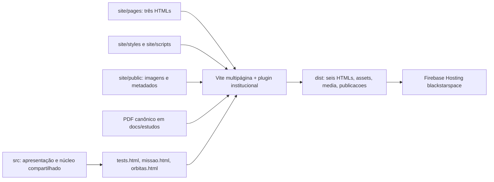

# Site institucional e simuladores em um único repositório

Referência de inspeção: `b88d3d2`, branch `codex/m12-doc-fix`, checkout limpo.
Destino único: `evertaraujo-lgtm/blackstarprototipo2`; Firebase `blackstarspace`.
Migração única da apresentação existente em `../Starship`, somente leitura.

## CONTRATO DE IMPACTO FUNCIONAL

Objetivo: um build/deploy produz site institucional e simuladores nativos, sem
dependência do repositório anterior e sem cópias compiladas do P2.

| Funções / assinaturas | Ação, responsabilidade, dependências e efeitos |
|---|---|
| `site/scripts/navegacao.ts::{definirMenu(aberto: boolean), atualizarCabecalho(), alternarMenu(), fecharComEscape(evento: KeyboardEvent), fecharPorLink(evento: MouseEvent), adequarMenu()}: void` | Migrar as seis funções do site existente, tipadas e com JSDoc. Alteram somente classes, rótulos acessíveis e foco do DOM institucional. Dependem de elementos HTML e matchMedia; nenhuma regra nova de navegação. |
| `site/scripts/carrossel.ts::iniciarCarrossel(raiz: HTMLElement): void` | Migrar inicialização existente: listeners, IntersectionObserver e timer exclusivo da apresentação. Não toca relógio da missão. |
| `site/scripts/carrossel.ts::iniciarCarrossel::{suspenderTroca(), atualizarReproducao(), avancarAutomaticamente(), anterior(), proximo(), alternarReproducao()}: void` | Migrar pausa/agendamento visual de 7 s e comandos. Dependem apenas do DOM, preferência de movimento e visibilidade; preservam comportamento. |
| `site/scripts/carrossel.ts::iniciarCarrossel::mostrarSlide(novoIndice: number, anunciar?: boolean): Promise<void>` | Migrar decodificação, descarte de pedido superado, classes, contador e anúncios acessíveis. Falha de imagem mantém a anterior; não altera texto/CTAs. |
| `site/build/pluginInstitucional.ts::pluginInstitucional(raiz: string): Plugin` | Nova integração Vite para fontes em site/pages, saídas HTML na raiz e PDF canônico. Usa Node fs/path e hooks Vite; não importa domínio físico. |
| `pluginInstitucional::{configureServer(server: ViteDevServer), configurePreviewServer(server: PreviewServer)}: void` | Novos hooks: URLs institucionais explícitas no dev/preview e 404 real em recurso ausente. Registram middleware somente no servidor local. |
| `pluginInstitucional::atenderInstitucional(req: IncomingMessage, res: ServerResponse, next: NextFunction): void` | Novo middleware: mapeia rotas permitidas a HTMLs de fonte em dev e serve o PDF original com MIME; delega assets/rotas existentes sem fallback de HTML. Leitura FS/resposta HTTP, sem gravar fontes. |
| `pluginInstitucional::generateBundle(options, bundle): void` | Novo hook: realoca somente os três HTMLs institucionais e emite cópia pública do PDF canônico. Escreve apenas saída de build por API Vite/Rollup, recusa colisões. |
| `scripts/site/verificar.ts::verificarDistribuicao(raiz: string): Resultado` | Nova verificação: seis HTMLs, links/âncoras/imagens/PDF, ausência de runtime P1/vendor/fontes internas e coerência do Hosting. Somente leitura; falha lança Error. |
| `scripts/site/verificar.ts::{listarArquivos(pasta: string): string[], resolverRecurso(dist: string, caminho: string): string, hashArquivo(caminho: string): string}` | Novos auxiliares determinísticos de enumeração, resolução confinada ao dist e SHA-256; sem escrita ou execução do simulador. |
| `scripts/documentacao/projeto.ts::listarFontes(raiz: string): readonly string[]` e auxiliar `percorrer(pasta: string): void` | Modificar escopo para incluir TypeScript próprio de site/ quando presente. Reutilizar ordenação/IDs/TypeChecker; não reduzir exigência documental. |
| `scripts/documentacao/projeto.ts::carregarProjeto`, `ast.ts::analisarFontes`, `catalogo.ts::{gerarCatalogo, ancoraFuncao, estrutura}`, `auditoria.ts::verificarDocumentacao` | Reutilizar sem mudança para inventário, assinaturas, âncoras e contratos novos. Leem AST/FS; não executam física. |
| `src/home-carousel.ts::{showSlide(index: number), stopAutoplay(), startAutoplay()}: void` | Remover somente apresentação substituída pela migração. `src/main.ts` deixa de ser entrada e é removido junto do import desse carrossel; sem consumidor de simulação. |

O smoke em `scripts/site/smoke.ts` terá os contratos `executarSmokeSite(raiz:
string): Promise<ResultadoSmoke>` (coordena preview, Chrome e fluxos; fecha recursos
em finally), `abrirPagina(browser: Browser, largura: number, altura: number,
erros: string[], falhas: string[]): Promise<Page>` (registra observação de
console/HTTP) e `conferirImagens(page: Page): Promise<void>` (rolagem/lazy loading,
decode e overflow, sem modificar física). Reutiliza `vite.preview` para iniciar
servidor de produção local em porta livre, sem processo de deploy. Exercita também
as três interfaces nativas em viewport móvel (390 × 844), por seus controles
existentes, sem correções de layout ou mudanças de estado fora do domínio. O entrypoint
`scripts/verificar-site.ts` chama somente `verificarDistribuicao` e imprime JSON.
Necessidade de ferramenta: `playwright-core` somente como dependência
de desenvolvimento, para testes de navegador exigidos pelo pedido; sem download
de navegador nem biblioteca gráfica no runtime. Chrome instalado ou CHROME_BIN.

Invariantes: nenhum arquivo físico/controle/missão alterado; HTML sem geração
integral em JS; aparência/ativos preservados; sem P1, vendor, submódulo ou sync;
PDF editável único em docs/estudos; saídas de produção somente dist; 404 real;
projeto Firebase e domínio inalterados; nenhum deploy executado.

Validação: typecheck geral/missões, suíte completa explicitamente solicitada,
auditoria AST/documentação, build, testes específicos de integração, smoke
Chrome desktop/mobile, recursos inexistentes/rotas diretas, build limpo sem
diretório vizinho e comparação SHA-256 do código físico protegido.

## Diagnóstico e decisões

- P2 possui entradas nativas tests.html, missao.html e orbitas.html; serão
  compiladas pela configuração multipágina existente, sem copiar bundles.
- A apresentação atual do site anterior está pronta, incluindo carrossel;
  somente fontes HTML/CSS/scripts, imagens e metadados serão migrados.
- O P2 já contém os dez PNGs originais e o mesmo artigo (hash idêntico). Não
  criar outra fonte editável nem importar originais duplicados.
- `site/pages` guarda os três HTMLs; `site/scripts` e `site/styles` isolam o
  runtime institucional; `site/public` agrupa WebP, favicon, robots e sitemap.
- O plugin Vite mapeia fontes de site/pages às saídas index/pesquisa/simulador
  na raiz e oferece os mesmos endereços no dev. PDF é servido da fonte no dev
  e emitido no build com caminho estável. Sem preparação manual de HTMLs.
- Firebase terá somente rewrites explícitos /pesquisa e /simulador. Nenhuma
  regra global responderá HTML a JS/CSS/imagem/PDF ausente.
- Hook predeploy do Hosting executará typecheck, auditoria, build novo e
  verificação de recursos. Assim, CLI direta ou npm run deploy não usam dist
  antigo silenciosamente; o hook será validado sem chamar deploy.

## Estrutura e fontes da verdade

| Caminho | Responsabilidade |
|---|---|
| `site/pages/{index,pesquisa,simulador}.html` | Conteúdo HTML semântico, SEO, navegação e entradas institucionais. |
| `site/styles/site.css` | Aparência institucional preservada da versão anterior. |
| `site/scripts/{navegacao,carrossel}.ts` | Menu acessível e carrossel; nenhum acesso à física ou ao relógio da missão. |
| `site/public/media/` | Dez imagens institucionais, incluindo o emblema, em 19 arquivos WebP. Copiadas pelo Vite, sem transformação manual. |
| `img/` | Dez PNGs originais já presentes no P2, preservados como fontes; não publicados pelo publicDir. |
| `site/public/{404.html,robots.txt,sitemap.xml,favicon.ico}` | Arquivos públicos estáticos. 404 não substitui erro HTTP por homepage. |
| `site/build/pluginInstitucional.ts` | Adaptador Vite: URLs locais, realocação dos HTMLs emitidos e publicação do PDF. |
| `docs/estudos/Artigo_Cientifico_BlackStar_BSS_Pouso_Propulsivo.pdf` | Única fonte canônica do artigo. |
| `tests.html`, `missao.html`, `orbitas.html`, `src/` | Entradas nativas e implementação do simulador, preservadas. |
| `scripts/site/`, `scripts/verificar-site.ts` | Auditoria de distribuição e smoke de navegador. |
| `dist/` | Resultado descartável do build; único diretório publicado pelo Hosting. |



Não existe importação de outro checkout, submódulo, sincronização ou cópia de
bundle de simulador. O plugin usa os hooks do próprio build Vite; a apresentação
institucional não depende do domínio da simulação.

## Desenvolvimento local

Requisito: Node compatível com Vite 7 (Node 20.19+ ou 22.12+) e npm.

```bash
npm ci
npm run dev
```

Abrir a raiz informada pelo Vite. `/pesquisa`, `/simulador` e as entradas nativas
funcionam diretamente, inclusive após recarga. O middleware serve o PDF da fonte
canônica no desenvolvimento, sem criar uma cópia editável em public/.

```bash
npm run build
npm run preview
```

O preview serve o mesmo dist de produção. `appType: 'mpa'` e o mapeamento explícito
das três rotas institucionais evitam o fallback de uma aplicação SPA.

## Imagens e conteúdo

Editar texto e metadados diretamente no HTML da página correspondente. O conteúdo
não é reconstruído por JavaScript. Para imagens novas, conservar a fonte original
em `img/`, gerar variantes WebP proporcionais e colocá-las em `site/public/media/`.
Usar `/media/nome.webp` em src/srcset, informar dimensões, texto alternativo e
lazy loading quando fora da primeira tela. Validar a composição desktop/mobile.
A migração preservou os bytes dos WebPs e do CSS existentes; não recriou imagens,
nem alterou o cânone narrativo.

As 19 variantes otimizadas representam as dez imagens da apresentação anterior;
o carrossel continua com cinco cenas, intervalo de 7 segundos, navegação por
teclado, pausa, retomada, suspensão fora da tela e preferência de movimento reduzido.
Os avisos de ficção e ilustração permanecem discretos no conteúdo/rodapé.

## Publicações científicas

Para atualizar este artigo, substituir somente o PDF canônico em docs/estudos,
preservando o endereço público se a publicação continuar sendo a mesma. O build
emite seus bytes em `dist/publicacoes/pouso-propulsivo-bss-2026.pdf`; o verificador
compara SHA-256 e assinatura `%PDF-`. `.gitattributes` trata PDF como binário.

Para uma nova publicação, adicionar a fonte documental, declarar explicitamente
seu caminho público no adaptador de build/dev, incluir links em pesquisa.html e
ampliar os testes de recursos/PDF. Atualizar o contrato de impacto, JSDoc e o
catálogo conforme AGENTS.md. Não copiar a pasta docs inteira para o Hosting.
Não há CMS, Firestore ou autenticação nesta arquitetura.

## Rotas e build

| URL | Fonte / saída |
|---|---|
| `/` ou `/index.html` | `site/pages/index.html` → `dist/index.html` |
| `/pesquisa` ou `/pesquisa.html` | `site/pages/pesquisa.html` → `dist/pesquisa.html` |
| `/simulador` ou `/simulador.html` | `site/pages/simulador.html` → `dist/simulador.html` |
| `/tests.html` | Bancada nativa compilada pelo Vite |
| `/missao.html` | Missões nativas compiladas pelo Vite |
| `/orbitas.html` | Simulação orbital nativa compilada pelo Vite |
| `/publicacoes/pouso-propulsivo-bss-2026.pdf` | Cópia de build do único PDF canônico |

Uma execução de `npm run build` processa as seis entradas e seus módulos. O plugin
realoca somente os três HTMLs institucionais de `site/pages/` para a raiz do
bundle, depois do processamento HTML do Vite; recusa colisões ou entradas ausentes.
Os chunks compartilhados dos simuladores continuam sendo gerados normalmente,
sem duplicação de um dist prévio. publicDir aponta exclusivamente a site/public.
Não são publicados fontes TS, testes, relatórios internos ou mapas de código.

## Validação e manutenção

```bash
npm run typecheck
npm run typecheck:missoes
npm test -- --maxWorkers=1
npm run test:documentacao
npm run docs:verificar
npm run build
npm run site:verificar
npm run site:smoke
```

O smoke exige Chrome instalado (`/usr/bin/google-chrome` por padrão; configurar
`CHROME_BIN` para outro caminho). Playwright Core é somente ferramenta de teste,
sem download de navegador ou dependência de runtime. O teste abre preview local
em porta livre e fecha seus recursos; `SITE_URL` permite testar um dev/Hosting já
ativo. Capturas e downloads ficam em /tmp, ou no diretório SCREENSHOT_DIR.

Os testes específicos usam o Vite real em fixtures temporárias: seis entradas,
HTMLs na raiz, URL direta/recarga, PDF idêntico, 404 e rejeição de distribuição
corrompida. O smoke exercita autoplay/pausa/teclado, menu/Escape/âncoras, imagens,
PDF aberto e baixado, navegação portal→missão, controles de missão, água, bancada
e órbitas. O site é verificado em larguras 1440, 768, 390 e 320 px; as três
interfaces nativas são operadas em desktop e 390 px. Não se reestilizam interfaces
nativas durante essa verificação.

A auditoria AST passou a incluir site/ opcionalmente, mantendo compatibilidade
com fixtures anteriores. Novas funções possuem JSDoc e @contract. Para modificá-las:
atualizar primeiro este contrato e executar docs:gerar seguido de docs:verificar.
O CI existente ganhou verificação dos recursos e smoke após o build. O resultado
remoto só poderá ser confirmado depois de enviar as alterações; não foi declarado
aprovado nesta execução local.

## Publicação somente pelo P2

```bash
cd blackstarprototipo2
npm ci
npm run build
npm run deploy
```

`npm run deploy` publica somente Hosting no projeto já associado blackstarspace.
O hook `hosting.predeploy` chama `preparar:deploy`: typecheck → auditoria documental
→ build novo → verificação de recursos. Qualquer falha interrompe a publicação.
O mesmo hook protege a chamada direta do Firebase CLI. O build limpa/recria dist;
a ausência de uma compilação atual não é resolvida reutilizando silenciosamente
um dist anterior. Para testar o preparo sem publicar: `npm run preparar:deploy`.

A configuração publica apenas dist, mantém .firebaserc/projeto/domínio e possui
somente rewrites /pesquisa e /simulador. Recursos ausentes mantêm HTTP 404; não há
rewrite global. Os assets com hash têm cache imutável; imagens têm cache de uma
hora; PDF tem MIME application/pdf e nosniff.

**Nenhum deploy foi executado nesta consolidação.**

## Componentes deliberadamente abandonados

O Protótipo 1 e `/starship_v1.html` não são migrados; links institucionais ao legado
foram removidos. Não existem vendor/prototipo2, scripts de sincronização, manifestos
de builds externos ou plugins de cópia de simuladores. A antiga homepage do P2 e
seu carrossel de três funções foram substituídos pela apresentação migrada; suas
entradas sem consumidores foram removidas.

A leitura do repositório institucional anterior foi uma **migração única**, não
um procedimento periódico. Ele permanece intocado e não deve mais realizar
deploy no mesmo Firebase. Apenas blackstarprototipo2 é necessário para clonar,
desenvolver, instalar, compilar, testar e publicar a Black Star Space.

## Evidências desta execução

Ambiente local: Linux x86_64, Intel Core i3-4005U (4 threads), Node 20.20.0,
Vite 7.3.6, TypeScript 5.9.3 e Chrome instalado. Não houve atualização do motor
físico ou das versões existentes do compilador/test runner.

| Verificação | Resultado |
|---|---|
| Checkout inicial | Limpo em b88d3d2, branch codex/m12-doc-fix |
| `npm run typecheck` | Aprovado, incluindo site, scripts e configuração Vite |
| `npm run typecheck:missoes` | Aprovado; camada de missão permanece sem APIs de navegador |
| `npm test -- --maxWorkers=1` | 553 testes aprovados em 85 arquivos; 1.563,30 s; zero falhas, exclusões ou enfraquecimento de testes anteriores |
| `npm run preparar:deploy` | Aprovado: tipos, auditoria, build e recursos; nenhum envio |
| `npm ci` em cópia isolada em /tmp | Aprovado, sem node_modules/dist inicial ou repositório vizinho |
| Build isolado versus checkout | 43 arquivos / 3.923.763 bytes, SHA-256 idêntico para cada saída |
| Distribuição | 6 páginas, 10 imagens, 123 referências verificadas, PDF idêntico |
| Auditoria AST | 1.484 funções de produção com JSDoc e contrato; zero lacunas ou divergências |
| Smoke do preview de produção | Aprovado, sem erros de console/HTTP |
| Smoke do dev | Aprovado em desktop/mobile, inclusive controles das três interfaces nativas |
| Smoke final do emulador Hosting | Aprovado em desktop/mobile, zero erros de console/HTTP, PDF aberto e baixado |
| Emulador Hosting | 7 URLs públicas com HTTP 200; 8 URLs ausentes/internas/legadas com HTTP 404 |
| Preservação do simulador | 209 arquivos protegidos com SHA-256 original, incluindo HTMLs nativos e .firebaserc |
| Preservação visual | CSS e 19 WebPs idênticos às fontes; inspeção de capturas desktop/mobile |
| CI remoto | Pendente de envio; workflow atualizado, sem alegação de sucesso remoto |
| Deploy | Não executado |

A cópia isolada fica fora da árvore de projetos, sem acesso relativo ao repositório
institucional antigo. O teste instalou dependências normalmente com npm ci e
compilou as entradas nativas do mesmo código-fonte. O PDF público tem 605.400 bytes,
SHA-256 `b52348d7eef7df272517236c73e0b99cd0f106eb301961d3c9652f3f0f602e3a`.
As capturas e logs completos ficam temporariamente em /tmp; o repositório contém
os testes reproduzíveis e este resumo, sem bundles ou evidências volumosas.

A suíte completa inclui os seis casos novos de integração Vite/rastreabilidade
institucional. Passaram também as campanhas BSS históricas, comparação legado/
central, equivalência exata de missão/bancada, replay, dinâmica orbital,
hidrodinâmica, costa e preservação exata da trajetória anterior à M11-P.

Contrato de impacto atendido: alterações restritas à apresentação institucional,
integração de build/Hosting, auditoria e testes/documentação. Os arquivos de física,
controle, missão e interfaces nativas permanecem idênticos. Não foram feitas
correções físicas ou mudanças de parâmetros para obter aprovação.

Limitação restante: resultado do CI remoto pendente de envio das alterações.
Os testes locais foram confirmados; não houve deploy, push ou modificação do
repositório institucional anterior. Seus arquivos/código legado não fazem parte
da distribuição nova.
