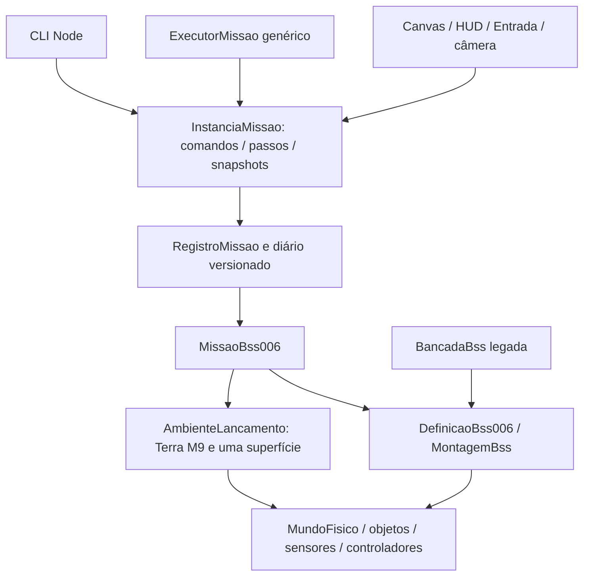

# M10 — Missões independentes e primeira cena do jogo

Data: 2026-10-13. Base auditada: 00db5fe, main limpa e sincronizada. Complexidade estimada 8/10. Execução autônoma A–G; sem deploy. Mesmos parâmetros da M9, sem BSS-007.

## M10-A — Diagnóstico e decisões

| Módulo atual | Responsabilidade / dependência | Decisão |
|---|---|---|
| MundoFisico / Objeto | Estado cinemático, gravidade, integração, danos, contato; sem navegador | Preservar integralmente |
| VeiculoComposto / ComputadorDeVoo | Composição, sensores, controladores e arbitragem; interfaces dos motores | Preservar APIs e ordem de registro |
| Propulsor / alimentação / fontes / fixadores | Permissivos, consumo, força e vínculos reais | Reutilizar, sem novos parâmetros |
| BancadaBss | Monta casco, CH4/O2, bateria, painel, motor, pernas, grid fins; também cria mundo/solo e formata UI/trace | Extrair montagem/coordenação operacional; manter adaptador experimental |
| BSS-005 / BSS-006 | Duplicam configuração de tanques, motor, energia, pernas; 006 acrescenta fins/guiagem | Uma configuração compartilhada, fábricas de domínio |
| EnsaioMissaoBss005 | Executor determinístico consome fábrica da bancada, guarda classificação histórica M5/M7 | Preservar relatório antigo, compatibilidade pela mesma montagem |
| TelemetriaMissaoBss | Consulta somente core, mas localizada na pasta de cenários | Mover para domínio; reexportar caminho antigo |
| EnsaioOrbitalInerte | Factory independente, condições iniciais, mundo, metadados | Referência de isolamento, preservar testes inertes |
| ExecutorPassoFixo | Converte tempo externo em dt constante, sem DOM | Reutilizar apenas no adaptador de apresentação; executor automatizado por contagem de passos |
| src/testes.ts | Renderer e controles experimentais grandes | Não refatorar por tamanho; continuar consumindo BancadaBss |

Protótipo 1 inspecionado: mission_state.js, mission_runtime.js, mission_simulation.js. Separação de serviços/telemetria é referência funcional; uso de window, DOM, estado global, Math.random e cinemática paralela impede migração direta. Nenhum arquivo do P1 será modificado.

Nova direção de dependências: apresentação → missão → montagem de veículo / ambiente → core. A montagem recebe mundo e superfície já construídos (para consultas dos controladores), não depende de missão/cenário/UI. Bancada → mesma montagem. Telemetria é snapshot derivado, não segundo estado físico.

Missão: definição/configuração imutável; instância privada com mundo e veículo; porta tipada de comandos, avanço fixo, snapshots de observação e eventos. Interfaces pequenas, sem framework de entidades. Não expor objetos mutáveis à UI. Objetivos separados da física: observar subida, transição aos 300m e tentativa de retorno, sem fabricar sucesso. Pausa e início pertencem à instância; relógio real/RAF só na apresentação.

Ambiente de lançamento: AmbienteTerrestre XY sem rotação, atmosfera padrão M9, uma superfície esférica existente com material histórico do solo. Plataforma inicial é a região demarcada desse terreno, não outra superfície sobreposta. Torre visual sem massa/colisão. Solo físico curvo, câmera local; cenário costeiro decorativo não declara água física.

Contato inicial, contato de retorno, repouso geométrico, apoio bilateral sustentado e segurança estrutural devem ter estados separados. Proximidade/emApoio ou um impulso positivo isolado não comprovam sustentação contínua. Critérios M9 preservados; apoio bilateral não homologado. Não encerrar voo por horizonte do executor; horizonte é orçamento de observação, não resultado físico.

## Sequência e validação prevista

A: auditoria/documentação. B: montagem independente/configuração BSS-005/006 e adaptador. C: portas de missão/executor genérico. D: voo BSS006_VOO_EXPERIMENTAL e observação. E: campanha determinística, equivalência bancada/missão em comandos idênticos, alvos 0/±34,7m, vento ±5m/s, sem ignição e perdas de alimentação. F: registro/reexecução versionados e expansão por interfaces. G: missao.html, entrada/render/câmera separados; smoke desktop/mobile e regressões das quatro páginas.

Cada marco: testes pertinentes, typecheck e build; commit específico. Suíte completa ao concluir, mantendo regressões M9. Comparação exige igualdade de estados/consumo/integridade/controladores/contatos, não só resultado visual. Registrar parâmetros, passo 1/240s, comandos por índice de passo, vento determinístico e revisão. Nenhum ajuste de tolerância/veículo para aprovar.

## Pendências anteriores preservadas

Apoio bilateral contínuo M9/M7 não qualificado, penetração histórica ~34mm, diário manual 15km M5-B/C e contingências M8-B incompletos. Atmosfera acima de 20km simplificada, vácuo a 25km, Terra sem rotação, sem reentrada/inclinação 3D. M10 não qualifica veículo real, 15km ou órbita.

## Evidências e estado

M10-A: auditoria concluída; fontes examinadas acima. Validação: 5 testes (ExecutorPassoFixo/TelemetriaMissaoBss) aprovados; typecheck e build aprovados. Base pré-extração adicional coletada em 00db5fe com 1 teste, quatro montagens e 480 passos cada (2s), para comparação exata na M10-B. CI remoto será consultado se disponível; execução local não equivale a aprovação do CI.

### M10-B — Montagem independente

MontagemBss (src/veiculos) recebe MundoFisico/SuperficieFisica e monta os mesmos objetos/controladores, sem criar ambiente ou UI. DefinicaoBss006 concentra configuração histórica compartilhada com BSS-005; TelemetriaBss é domínio e o caminho antigo reexporta. BancadaBss mantém descrição, trace e controles experimentais e delega montagem/coordenação. Ordem dos objetos/fontes/sensores e fórmulas preservadas. Sem mudança no core físico.

14 testes em três arquivos aprovados (160,39s), incluindo voos da bancada com alvo/vento, sem ignição, falha elétrica e regressão exata dos snapshots pré-extração de 00db5fe. Referência imutável em docs/validacoes/2026-10-13-m10-base-m9.json. Typecheck e build aprovados. Parâmetros: 600kg CH4/2400kg O2, 120kN, Isp350s, bateria1MJ, duas grid fins e pernas históricas.

### M10-C — Portas e execução

ContratoMissao separa definição, instância, comandos, eventos e objetivos. CicloMissao mantém apenas execução/pausa e índice; tempo pertence ao core. ExecutorMissao agenda comandos na fronteira do passo e opera qualquer InstanciaMissao<C,O>, sem conhecimento de veículo/ambiente. Rejeita orçamento/ordem inválidos antes de avançar; pausa não fabrica tempo. Horizonte do executor não encerra fisicamente uma missão.

Dois testes com corpo orbital inerte (outro consumidor da mesma porta), retomada e agenda aprovados; typecheck e build aprovados. Nenhuma dependência de DOM/Canvas/Firebase/RAF/data real na camada.

### M10-D — BSS006_VOO_EXPERIMENTAL

AmbienteLancamento cria Terra XY estática, atmosfera M9, vento local projetado e uma única superfície esférica, com material da bancada. MissaoBss006 mantém mundo/montagem privados; aceita sistemas, ignição explícita com permissivos, corte elétrico do motor conforme API histórica, throttle manual, alvo local (bloqueado após decolagem), modo/atitude e falhas reais de cabos/linhas. Perfil automático observa altitude física e seleciona Pouso aos 300m; não altera cinemática. Objetivos e eventos são observações das ações/core.

ObservacaoBss006 inclui corpos/geometry, telemetria, atuadores/arbitragem, energia/consumo, integridade, contatos/normal/impulso e classificações separadas. SnapshotMissao copia e congela dados para não ceder referências do core à UI. Sem encerramento artificial; reinício cria instância nova. Apoio bilateral exige reação normal positiva em ambas as sapatas no mesmo passo por 3s, quietude e motor cortado; proximidade isolada não é aprovação. Segurança estrutural exige também limites de toque e ausência de dano/ruptura.

Quatro testes aprovados: preparação/ignição negada, voo com empuxo/vazão/consumo positivos, pausa/reinicialização, isolamento de snapshots e sítio em outro ponto terrestre. Typecheck/build aprovados. Primeira execução do teste de metadados usava chave ambiente inexistente; corrigida a expectativa para a API real achatada do MundoFisico (nenhuma mudança física).

## Inicialização e fronteiras finais



A bancada continua possuindo comandos de manutenção e observação dos objetos. A nova apresentação recebe somente a porta e snapshots; não recebe mundo/veículo mutáveis. Ela não importa a bancada, e a missão não importa apresentação/cenários. A extração generaliza somente a montagem efetivamente compartilhada pelos BSS, sem framework de jogo.

Exemplo TypeScript sem navegador (mesma definição que a página):

```ts
import { criarMissaoBss006Registrada } from './src/missoes/ReplayMissaoBss006';
import { executarMissaoAtePasso } from './src/missoes/ExecutorMissao';
const missao = criarMissaoBss006Registrada({ alvoPousoLocalM: 34.7, ventoTangencialMps: 0 });
for (const sistema of ['elétrico', 'hidráulico', 'combustível', 'controle'] as const)
  missao.receberComando({ tipo: 'sistema', sistema, ligar: true });
missao.receberComando({ tipo: 'throttle', valor: 0.65 });
missao.receberComando({ tipo: 'ignicao' });
missao.iniciar();
executarMissaoAtePasso(missao, 90 * 240);
const leitura = missao.observar();
const diario = missao.exportar();
```

CLI: `npm run missao:executar -- --segundos 90 --alvo=-34.7 --vento=5 --saida /tmp/voo.json`. Reexecução: `npm run missao:executar -- --replay /tmp/voo.json --saida /tmp/replay.json`. O vite-node já é fornecido pelo Vitest no lockfile; nenhuma dependência/motor novo. O CLI é adaptador Node, e não parte do domínio. dt sempre 1/240s; orçamento arredondado a um número inteiro de passos. Perfil padrão automático300m; outra definição pode instanciar MissaoBss006 com outro id e configuração, usando a mesma montagem. Executor aceita qualquer implementação da porta (teste com corpo orbital inerte).

### Observação e encerramento

- Contato inicial: geometria do veículo na superfície no carregamento; não conta como retorno.
- Toque de retorno: primeiro impulso normal positivo em casco/pernas/sapatas após descida. Leituras de velocidade/atitude do passo anterior são usadas nos limites de toque.
- Repouso geométrico: geometria a <=1mm da superfície, casco <=0,05m/s, todos os componentes <=0,1m/s e taxa <=0,01rad/s, empuxo zero, durante3s.
- Apoio bilateral observado: bit emApoio em ambas as sapatas, inclui proximidade do core, não prova sustentação.
- Apoio bilateral sustentado: reações normais positivas em ambas as sapatas no mesmo passo, quietude/motor cortado durante3s; duração distinta, sem flexibilização.
- Pouso estruturalmente seguro: também requer toque radial/tangencial <0,2m/s, atitude/taxa <0,01, alvo <1m, integridade1 e nenhum vínculo rompido. Não inferir a partir de screenshot/repouso geométrico.

Não existe watchdog físico no jogo. A missão permanece observável após toque/dano/repouso; pausa só por comando do operador. O horizonte dos testes/CLI é orçamento de coleta e não um evento de conclusão fabricado.

### M10-E — Campanha independente e equivalência

Nove referências completas da bancada em Terra esférica, coletadas em instâncias independentes, aprovadas (351,41s incluindo um teste de serialização). Dez testes de missão/observação aprovados (335,17s): alvos0/±34,7m, ventos±5m/s, sem ignição, falhas reais de cabo elétrico/linha CH4/linha O2 e determinismo com diferentes frequências de observação. Todas as assinaturas SHA-256 dos estados físicos nos passos amostrados e os estados finais completos coincidiram exatamente com a bancada. Cada assinatura inclui todos os estados dos componentes, massa/integridade/temperatura, sensores, energia elétrica, empuxo/vazão/throttle/ignição, gimbal/grid fins, arbitragem, contatos/impulsos e fixadores; o estado final também é comparado campo a campo. Nenhum parâmetro/ganho/tolerância do veículo mudou.

Primeira campanha pareada (dois mundos no mesmo teste) excedeu120s de tempo de execução. Mantido o timeout de120s, a comparação foi dividida em rodadas completas independentes com referências verificáveis; critérios físicos permaneceram iguais. Um erro do coletor usava a primeira FonteEletrica (painel solar idealizado com energia infinita) ao procurar bateria, gerando null na serialização. Corrigido para Bateria explícita, acrescentada rejeição de números não finitos nas assinaturas e todas as referências foram coletadas novamente. Isso corrigiu instrumentação, não física. As referências M9 e todos os resultados históricos foram preservados.

Cinco casos nominais: apogeu≈381,99–383,88m, integridade1 e repouso geométrico3s. Segurança com apoio bilateral sustentado continua não qualificada; medição tem critério distinto de emApoio/proximidade. Sem ignição: 3000kg de propelentes restantes, empuxo0, sem decolagem/toque de retorno. Nas três perdas de alimentação houve corte de empuxo, queda e dano/ruptura reais (integridade mínima0), reproduzidos exatamente nos dois contextos.

Referências: docs/validacoes/2026-10-13-m10-referencia-bancada.json. Resultados: docs/validacoes/2026-10-13-m10-missoes.json. ControladorPerfilVooExperimental na pasta de controladores recebe altitude compartilhada e solicita somente uma transição operacional; não calcula vertical nem modifica cinemática. Snapshot inclui ligações elétricas reais para apresentação das fontes expostas. Typecheck e build aprovados.
