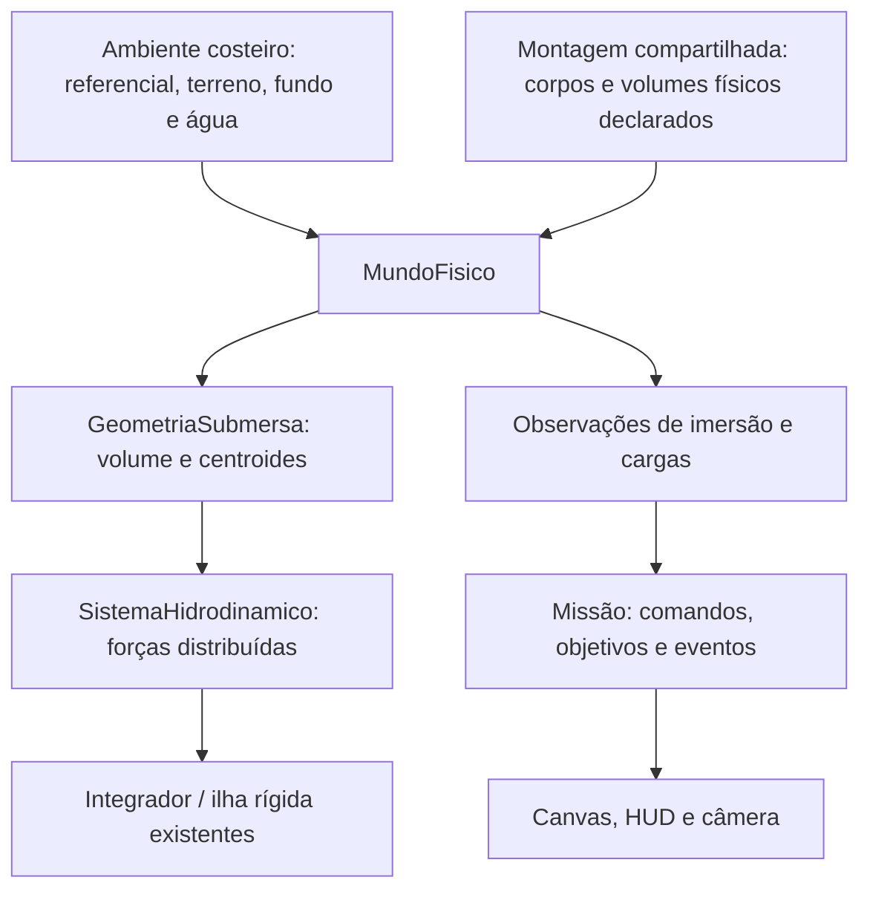

# M11 — Hidrodinâmica, oceano físico e amerissagem

Data: 2026-10-13. Base real: `1d74cfa`, `main` limpa e sincronizada com a referência local de `origin/main` no início. Complexidade estimada: **9/10**. Leitura integral das 2.306 linhas de `AGENTS.md` realizada antes de alterações. Execução incremental, commits locais; sem push ou deploy.

## Escopo recebido e estado

O pedido inicial chegou interrompido em `6. Profundidade fin`. A auditoria foi registrada em `ef634ce` antes da implementação. A especificação completa M11-A–H foi recebida posteriormente, com autorização autônoma. Este é o documento canônico solicitado; o primeiro relatório permanece como registro da auditoria inicial.

**M11-A concluída. M11-B em implementação; C–H pendentes.** A física histórica permanece em variante legada, sem migração silenciosa. Constantes de cenário e propriedades aquáticas novas serão hipóteses explícitas, nunca ajustes das massas/dimensões históricas.

## M11-A — Inventário do núcleo existente

| Módulo / ponto de entrada | Situação encontrada | Integração necessária / risco |
|---|---|---|
| `src/physics/MundoFisico.ts`, `integrarPasso` e `integrarCorpos` | Prepara sistemas, térmica e vínculos; sincroniza ilhas; integra forças; resolve colisões e solo; atualiza sensores. Não registra regiões aquáticas. | Registrar o meio separadamente das superfícies. Gerar cargas hidrodinâmicas por subpasso e somá-las às forças dos corpos/ilhas; manter uma única integração. |
| `src/physics/solucionadores/IntegradorFisico.ts`, `integrarObjeto` | Usa massa instantânea, soma forças e `(ponto - posição) × força`, integra velocidades linear/angular e posição/orientação por Euler semi-implícito. | Reutilizar forças em pontos reais. Qualificar passo temporal para entrada e arrasto denso; não mudar globalmente o integrador para disfarçar instabilidade. |
| `src/physics/estruturas/ConjuntoEstruturalRigido.ts`, `integrar` | Uma massa, centro de massa e inércia por ilha; soma momentos de todas as forças em torno do centro composto. Projeta a geometria rígida com rotação em Z. Recalibra referências quando a massa muda. | Empuxo e resistência de cada região exposta devem atuar na mesma ilha, respeitando centros e braços. Nunca integrar cada módulo conectado independentemente. |
| `src/physics/objetos/base/Objeto.ts` | Dimensões XYZ, polígono XY de colisão, massa variável, integridade e API de dano energético. Não há volume estanque, permeabilidade, área molhada ou propriedade hidrodinâmica. | Declarar geometria deslocadora e parâmetros do meio explicitamente. Caixa de colisão não prova estanqueidade. Não aplicar água silenciosamente a todos os objetos. |
| `src/physics/SuperficieFisica.ts` | Material `agua` existe na enumeração, mas todas as instâncias seguem o contrato rígido de distância, normal, projeção, impacto e atrito. | O oceano não deve herdar esse comportamento. Preservar compatibilidade de superfícies históricas; não apresentá-las como água funcional. |
| `src/physics/SuperficieEsferica.ts` | Contato radial em secção circular XY, candidaturas por vértices e segmentos. Material concreto. `contemProjecao` herdado retorna verdadeiro em toda parte. | Limitar o terreno aos domínios sólidos; criar fundo real separado e com profundidade explícita. Não deixar esta esfera ao nível da água na área oceânica. |
| `src/physics/SuperficiePlanoLocal.ts` | Face superior plana finita; contém projeções por largura tangencial e inclui cruzamentos das bordas na geometria de contato. | Preservar para infraestrutura local. Evitar laje sobreposta ao terreno que duplique impulsos. Não usar como interface livre. |
| `src/physics/solucionadores/ResolvedorContatoSuperficie.ts` | Processa TODAS as superfícies registradas; corrige penetração, aplica impulso normal/atrito, dano e esforços nos vínculos. Não há exceção hidrodinâmica para `agua`. | Restringir a sólidos, inclusive fundo e costa. Interface livre nunca participa desse resolvedor. Tolerâncias de contato existentes permanecem. |
| `src/physics/solucionadores/ResolvedorColisoes.ts` | Colisões entre objetos, ignora membros da mesma ilha, aplica impulsos/torques, dano e esforços internos. | Preservar para colisões entre destroços e sólidos submersos. Água não é um corpo de colisão. |
| `src/physics/solucionadores/ResolvedorEsforcoEstrutural.ts` | Distribui esforço axial de impulso de contato por pontes da topologia; calcula todas as cargas antes de registrar rupturas. Não é um resolvedor geral de cargas distribuídas/flexão. | Investigar transmissão de cargas aquáticas contínuas e de entrada. Reaproveitar topologia, não converter artificialmente toda resistência da água em impacto rígido. |
| `src/physics/conexoes/FixadorEstrutural.ts` | Força operacional declarada e registros de tração/compressão podem romper o vínculo; mundo reconstrói ilhas. | Forças do fluido devem produzir esforço observável quando transmitidas. Preservar estado pós-ruptura e não fazer volume separado continuar pertencendo à ilha anterior. |
| `src/physics/ambiente/AmbienteFisico.ts`, `AmbienteTerrestre` | Campo central, Terra esférica estática e referencial inercial XY. Não conhece costa, fluido ou batimetria. | Reutilizar campo e referencial; geografia é composição do ambiente da missão, sem condicionais por nome de foguete. |
| `src/physics/ambiente/ReferencialFisico.ts` | Altitude radial, tangente/radial local, coordenadas por arco e conversões disponíveis em uma única API. | Definir costa, nível, profundidade e corrente nesses referenciais. Não voltar a tratar Y absoluto como altura em todos os locais. |
| `src/physics/solucionadores/SistemaAtmosferico.ts` | Arrasto sobre cada corpo pelo centro/centro de pressão; altitude negativa é limitada a zero no perfil atmosférico. | Um corpo submerso ainda receberia ar de nível do mar. Particionar exposição ao ar/água, evitando dois arrastos integrais simultâneos. |
| `src/physics/solucionadores/SistemaTermico.ts` | Convecção e aquecimento por arrasto do ar, jatos e calor de atrito; não consulta imersão. | Não representar água com densidade atmosférica. Separar exposição dos meios e contabilizar energia dissipada. Convecção aquática precisa de parâmetros próprios caso entre no escopo. |
| `src/veiculos/MontagemBss.ts` | Mesma fábrica para bancada e missão, 12 corpos no BSS-006; dimensões/massas históricas. Vínculos em estrela. Consulta um solo para o corte por sapatas. | Preservar montagem compartilhada; adicionar definição de exposição/deslocamento sem três veículos diferentes ou alteração de massa/dimensão. |
| `src/veiculos/DefinicaoBss006.ts` | Uma configuração de referência, sem propriedades aquáticas. | Versionar hipóteses de casco/tanques/peças expostas; não presumir que motor e grid fins deslocam a caixa envolvente inteira. |
| `src/missoes/AmbienteLancamento.ts` | Uma esfera rígida cobre todo o lançamento; plataforma é demarcação do mesmo solo. | Um ambiente costeiro novo precisa retirar terreno oceânico ao nível do mar, definir fundo e região fluida sem contatos redundantes. |
| `src/missoes/MissaoBss006.ts` | Perfil aos 300 m, eventos de toque por impulso rígido, repouso geométrico e apoio bilateral terrestre. Mundo privado, comandos sem escrita cinemática, observações congeladas. | Acrescentar eventos e observações aquáticos próprios. Toque na água, flutuação e contato com fundo são coisas distintas. Não converter apoio terrestre em sucesso de amerissagem. |
| `src/veiculos/MontagemBss.ts`, `configuracaoPousoBss04` | Altitude-alvo do casco 4,8 m; corte terminal BSS-006 retido por apoio bilateral nas sapatas. | A água não fornece esse apoio. Adaptar o domínio de retorno/corte por operações/sensores explícitos, sem inventar contato rígido. A versão terrestre deve preservar seu comportamento. |
| Controles de atitude, Fuzzy-PID, guia BSS-006, arbitragem | Produzem comandos/forças por permissivos e referencial local; não conhecem flutuação. | Investigar autoridade após entrada. Desligamento explícito precisa retirar empuxo; não adicionar torque para impor orientação. Controle ativo deve aparecer separadamente de estabilidade passiva. |
| Sensores e `src/veiculos/TelemetriaBss.ts` | Observam mundo, contato sólido e grandezas locais/orbitais. | Expor imersão pelo core; contato de água não deve acionar sensores de apoio sólido. Preservar leituras atrasadas/congeladas e integridade. |
| `src/missoes/TiposMissaoBss006.ts`, `RegistroMissao.ts`, `ReplayMissaoBss006.ts` | DTOs físicos e diário versionado com reexecução estrita. | Registrar parâmetros aquáticos, revisão, comandos e observações. Preservar diário M10 e caminho legado; física aquática muda a revisão. |
| `src/apresentacao/missao/RenderizadorMissao.ts`, `terreno` | Terreno desenha toda a esfera; água é faixa decorativa a 160 pixels da base. Não corresponde a limite geográfico em metros. | Desenhar costa, fundo, interface e objetos imersos a partir do ambiente/snapshots. Manter Canvas sem acesso a mundo mutável. |
| `CameraMissao`, `CenaMissao`, `EntradaMissao`, `ExecutorPassoFixo`, `ExecutorMissao` | Apresentação/tempo externos separados do domínio; executores usam passos fixos. | Preservar arquitetura. Só adaptar conteúdo de observação/controles quando necessário; câmera deve acompanhar queda/imersão sem parar na altitude zero. |

Módulos preserváveis: campo gravitacional M9, transformações compartilhadas, operações de forças/impulsos, composição de massa, integração rígida, colisões entre corpos, superfícies terrestres locais, permissivos de motor, alimentação e controladores existentes para seus envelopes terrestres, portas de missão, executor genérico e isolamento do navegador. Hidrodinâmica não justifica duplicar esses serviços.

### Evidência da montagem real

A fábrica compartilhada foi instanciada em Node sem navegador ou bancada, sem avançar o tempo nem modificar parâmetros. Evidência em `docs/validacoes/2026-10-13-m11-auditoria-montagem.json`:

- 12 corpos físicos; massa inicial total **5.349,1660309923745 kg**.
- Centro de massa inicial `(0,005234460818335352; 9,559970638541285; 0)` m no sítio de arco zero.
- Soma dos volumes das caixas geométricas: **108,532 m³**, antes de retirar sobreposições ou volumes permeáveis.
- Essa soma **não é volume deslocado validado**. Caixa envolve material/vazios; perna/sapata e peças conectadas podem ocupar regiões comuns. Não pode virar empuxo total automaticamente.
- Casco: caixa 3,2 × 6 × 2,4 m; tanques escalados pelo fator linear `cbrt(5)`, separados acima do casco; painel lateral existente torna o centro de massa ligeiramente assimétrico. Nenhuma dessas características será alterada para produzir tombamento.

Ainda não é possível afirmar que esse BSS flutua, afunda ou se estabiliza numa orientação específica: faltam propriedades físicas do volume que efetivamente exclui água. O diagnóstico deverá separar conclusão do modelo parametrizado de qualificação do veículo real.

### Referência do Protótipo 1

Inspecionados `../Starship/src/js/core/physical_core.js`, `getWaterForces`, e `../Starship/src/js/mission/mission_simulation.js`, ramo `waterLanding`.

O P1 calcula um ângulo-alvo horizontal, aceleração angular proporcional ao erro desse alvo e amortecimento parametrizado; o empuxo usa massa do veículo multiplicada por gravidade e fator dependente da atitude, além de correção proporcional da altura para um centro de flutuação escolhido. Esse caminho não calcula volume deslocado/centro de empuxo e contradiz as proibições da M11. Serve como referência de observações operacionais, não como implementação física reutilizável. Nenhum arquivo do P1 foi alterado.

## Arquitetura proposta

1. **Região aquática**: contrato de meio volumétrico separado de `SuperficieFisica`; identidade, domínio geográfico, nível livre, densidade kg/m³, fundo/profundidade e velocidade do fluido m/s consultáveis em posição/tempo simulado. Campos e leis determinísticos; sem relógio real. Nenhum valor concreto de profundidade/nível/densidade ainda escolhido nesta auditoria.
2. **Geometria deslocadora**: volumes exclusivos ligados a objetos reais, transformados pela pose atual. Para a dinâmica XY, polígonos/células extrudados por espessura física Z permitem volume m³ e centro de empuxo; não ampliar para dinâmica 3D. Declarar material estanque/permeável e regiões excluídas, sem contar duas vezes o mesmo fluido. Um componente desprendido mantém sua geometria associada ao próprio objeto.
3. **Geometria submersa**: interseção com o domínio real do fluido, não apenas um teste do centro ou dos vértices. Calcular volume, primeiro momento, fração, extensão molhada e pontos para aplicação das cargas. Tratar a interface radial terrestre. Se for usada aproximação tangente local, declarar seu domínio e provar convergência/erro de curvatura antes de qualificá-la; não transformar um plano infinito em oceano global.
4. **Sistema hidrodinâmico**: calcula empuxo hidrostático e resistência distribuída usando velocidade no ponto, incluindo rotação. Devolve `ForcaAplicada[]` ao core. Não atualiza pose, não usa ângulo-alvo e não produz torque de tombamento independente das forças.
5. **Estado de imersão**: observação imutável por objeto/região e agregado conectado, calculada pelo mundo. Expõe volume deslocado, centro de empuxo, forças, momentos, velocidade relativa e energia dissipada; entrada/saída não são contato rígido. Flutuação é janela de equilíbrio observada, afundamento é movimento/imersão observado, sem restrição cinemática.
6. **Missão costeira**: compõe sólidos e fluido; recebe a mesma definição BSS-006. Versão terrestre M10 e bancada permanecem disponíveis para reprodução. Apresentação usa configuração física e snapshots, inclusive geometria da linha costeira em metros; não fabrica trajetória.

Preferir registro explícito de propriedades aquáticas para objetos que participam do meio. A ausência de configuração deve ser diagnosticada, não interpretada como um casco estanque universal. Os parâmetros já fornecidos de resistência térmica do BSS permanecem; novos objetos físicos só poderão usar parâmetros declarados, conforme `AGENTS.md`.

### Equações e unidades

Para densidade uniforme e gravidade aproximadamente uniforme na escala do corpo:

`Vsub = integral sobre volume excluído de água e submerso de dV` (m³).

`B = integral(p * dV) / Vsub` (m), definido somente quando `Vsub > 0`.

`Femp = -rhoAgua * Vsub * agrav(B)` (N); gravidade vem do campo compartilhado, não de `g0` do impulso específico. Variação espacial relevante exige distribuição/integral, não uma direção global fixa.

`tauG = soma[(pAplicacao - G) × F]` (N·m), usando G e a massa/inércia da ilha. O peso já existe no core e não será reaplicado pelo sistema aquático.

`vrel(p) = vCM + omega × (p - G) - vAgua(p,t)` (m/s).

`Fd = -0,5 * rhoAgua * Cd * Aproj * |vrel| * vrel` (N) é uma aproximação quadrática com coeficiente/área declarados. Para resistência rotacional, distribuir elementos molhados e usar sua velocidade local; uma força única no centro não captura a dissipação do giro.

`Pdiss = -soma(Fd · vrel) >= 0` (W) para água estacionária e resistência passiva. Corrente pode transferir energia ao corpo; distinguir potência relativa dissipada de trabalho inercial. Registrar o destino energético no modelo, sem afirmar que toda a energia aquece o objeto.

Equilíbrio de flutuação requer forças e momentos resultantes nulos. A condição necessária de capacidade estática é `rhoAgua * Vmax >= massa`, mas não prova estabilidade. Para casos analíticos de pequena inclinação e superfície plana, usar `GM = KB + IlinhaAgua / Vsub - KG` e comparar o sinal do momento restaurador. Não usar GM como torque imposto nem como fórmula geral para toda orientação. Estabilidade deve emergir da mudança de B com a imersão.

Fontes técnicas de consulta: [MIT — Stability and Trim](https://ocw.mit.edu/courses/2-017j-design-of-electromechanical-robotic-systems-fall-2009/feba89aba74b6dbf71ead4f18284ccb5_MIT2_017JF09_stability.pdf), [MIT — Hydrostatics and Buoyancy](https://ocw.mit.edu/courses/1-060-engineering-mechanics-ii-spring-2006/resources/lecture4/), [NASA — Drag Equation](https://www1.grc.nasa.gov/beginners-guide-to-aeronautics/drag-equation/). A equação de arrasto é uma forma paramétrica; os coeficientes aerodinâmicos existentes não constituem calibração hidrodinâmica.

### Entrada na água, dano e vínculos

Empuxo e arrasto quase-estacionário não são, por si, um modelo completo de impacto de entrada/slamming. A M11 não pode declarar amerissagem rápida qualificada apenas porque o corpo desacelerou. Identificar separadamente volume emergente, velocidade normal de entrada, carga transitória, massa adicionada se modelada e distribuição de esforços.

A API atual `aplicarDanoPorImpacto(J)` usa resistência energética por evento; aplicar a energia de arrasto a cada subpasso como se fossem impactos independentes cria dependência de dt e pode esconder dano ao subdividir. A solução deve identificar o evento/carga física, justificar sua energia estrutural e testar convergência. Não reaproveitar restituição rígida ou remover toda velocidade ao cruzar a interface.

As cargas contínuas da água também precisam transmitir esforço nos vínculos. O resolvedor existente é axial e orientado a impulsos de contato, não flexão geral: essa limitação deve permanecer explícita. Ruptura não pode deixar a região deslocadora presa ao agregado antigo nem retirar destroços do mundo.

### Geografia e compatibilidade

Definir terra/oceano por coordenadas do referencial compartilhado, com partição coerente. Restringir candidatos de contato do terreno à terra; adicionar geometria nas bordas quando o casco atravessar a costa, para não depender só dos vértices. Fundo marinho é sólido real abaixo da interface livre; se existir limite lateral do domínio, não deve parecer uma parede invisível de água.

Plataforma deve apoiar no terreno sem segunda face coincidente. Linha costeira e fundo desenhados são a mesma geometria observada pelo core, não offsets de pixels. A especificação do item de profundidade e dos demais requisitos depende da continuação do pedido.

Preservar ausência de água como caminho legado e metadados antigos; cenário costeiro novo declara revisão e configurações aquáticas. Não editar resultados/diários M0–M10. Não misturar a pendência histórica de penetração ~34 mm ou apoio bilateral terrestre com uma tolerância nova do oceano.

## Riscos e limitações

| Risco | Consequência | Mitigação / evidência exigida |
|---|---|---|
| Volume de caixa tratado como volume estanque | Flutuabilidade fictícia, especialmente motor, fins e vazios | Geometria deslocadora explicitamente declarada e teste de volumes exclusivos |
| Sobreposição de módulos | Empuxo duplicado | Partição/unificação geométrica e teste com peças parcialmente sobrepostas |
| Esfera ao nível do mar sob oceano | Piso invisível, apoio nas sapatas e impossibilidade de afundar | Partição geográfica e corpo inerte que cruza a interface sem contato rígido |
| Arrasto aplicado só no centro | Giro persistente ou amortecimento angular improvisado | Elementos distribuídos, velocidade por ponto, potência passiva e teste de rotação pura |
| Passo explícito em água densa | Inversão de velocidade, ganho de energia ou explosão numérica | Envelope por massa/velocidade/geometria; comparar dt, subpassos e integração estável sem mudar Cd para aprovar |
| Controle terrestre tentando sustentar 4,8 m | Motor continua ligado ou estabilização ativa confundida com flutuação passiva | Política operacional e corte explícito observáveis; teste após desligamento real |
| Pressão de entrada ausente | Impacto destrutivo sem dano | Modelo de entrada e orçamento de energia/evento qualificados separadamente |
| Hidrocargas fora do resolvedor de esforços | Fixadores indestrutíveis na água | Testes de ruptura e topologia com cargas físicas transmitidas |
| Ar e água sobre todo o mesmo corpo | Resistência/aquecimento duplicados | Exposição consistente entre meios no mesmo passo e observações |
| Perturbação artificial para demonstrar tombamento | Resultado roteirizado | Simetria exata permanece simétrica quando aplicável; testes separados com perturbações iniciais declaradas ±theta e assimetrias existentes |
| Critério só de velocidade baixa | Fundo/afundamento confundidos com flutuação | Observar imersão, forças, momentos, apoio no fundo, integridade e janela temporal |
| Diário antigo reproduzido com água nova | Falsa equivalência histórica | Revisão/configuração e seleção explícita de ambiente; fixture M10 preservada |

Limitações a manter visíveis: dinâmica XY, espessura Z para volume e inércia apenas, Terra sem rotação. Ondas, ar aprisionado, inundação, cavitação, sloshing e convecção aquática não serão declarados disponíveis sem implementação/validação específica. Não prometer estabilidade real do BSS a partir de caixas aproximadas ou propriedades de estanqueidade assumidas.

## Estratégia de testes proposta

1. Geometria independente: seco, totalmente imerso, imersão parcial analítica, rotações 0/±45/90°, atravessamento da costa e da região limitada, sobreposições, centro fora da água com parte imersa e vice-versa; valores finitos, volume entre zero e máximo, convergência geométrica.
2. Hidrostática com corpos inertes: volume conhecido e empuxo de Arquimedes; corpo denso afunda, leve emerge até deslocar sua massa; estabilidade restauradora de bloco baixo e divergente de corpo alto, ambos com perturbações iniciais de sinais opostos; simetria sem torque espúrio. Sem necessidade de foguete/ignição.
3. Resistência: translação, rotação pura e corrente, sinal do trabalho relativo; velocidade terminal analítica em regime totalmente imerso; nenhum arrasto sem imersão. Comparação de passos e convergência sem amortecimento ou limites alterados para aprovar.
4. Ilha rígida: duas peças com centros de empuxo distintos, massa/inércia compostas, consumo de propelente, ruptura, separação e destroços; invariância da força/momento para subdivisão geométrica equivalente.
5. Costa: plataforma sólida, corpo cruzando água sem impulso rígido, fundo real na profundidade declarada, transição terra/água e ausência de contatos duplicados; regiões em dois locais radiais diferentes da Terra.
6. Entrada e limites: baixa/alta velocidade, inclinação, motor operando e desligamento, água insuficiente para flutuar, perda de sistema/vínculo. Caso destrutivo com dano mensurável e convergência do evento frente a dt.
7. BSS-006: registrar massa, volume/carga por componente, G/B, atitude, forças/momentos, consumo, integridade e eventos durante entrada/corte. Demonstrar orientação resultante sem impor horizontalidade. Configuração/perturbações claramente identificadas; flutuação/afundamento são resultados possíveis.
8. Compatibilidade: casos diretamente afetados de forças, fixadores, contato e colisão; ambiente sem água da M10; diário estrito e testes M9 orbitais se o caminho de integração for modificado. Referências históricas não serão regravadas para aceitar diferenças.
9. Apresentação: teste de fumaça de `missao.html` com costa em metros, entrada real, acompanhamento submerso, comandos, telemetria, pausa e reinício sem resíduo; preservação de `tests.html`, `orbitas.html` e landing page.

As tolerâncias hidrodinâmicas quantitativas serão definidas pelo erro analítico/convergência requerido, não por resultados convenientes. O passo padrão do voo continua 1/240 s; isso não constitui qualificação automática para qualquer velocidade de entrada. Build/typechecks e casos determinísticos pertinentes a cada mudança precedem seus commits.

## Sequência recomendada, sujeita aos requisitos faltantes

A auditoria recebida pode ser encerrada primeiro em commit somente documental. Em seguida: geometria/regionais com corpos inertes; forças e integração compartilhada; costa/fundo; propriedades explícitas do BSS e operações de retorno; observações/replay; demonstração visual e campanha comparativa. Essa ordem é uma proposta de dependências, não atribuição inventada de nomes M11-C em diante.

Antes de parametrizar o oceano/veículo, incorporar a continuação do pedido: profundidade finita e eventuais valores, geometria da costa, hipóteses de estanqueidade, correntes/ondas, danos/falhas exigidos, marcos restantes, caminhos de documentação e critérios finais. Não é necessário pedir nova autorização para etapas já autorizadas quando esses requisitos forem conhecidos.

## Validação desta auditoria

Coleta da montagem diretamente pela fábrica: aprovada, 12 corpos, tempo inicial zero e nenhuma alteração física. Evidência JSON dedicada; script transitório em `/tmp`, sem módulo de execução concorrente no projeto.

Validação local confirmada, todas as saídas zero:

- `npm test -- src/physics/conexoes/FixadorEstrutural.test.ts --maxWorkers=1`: **4 testes aprovados**, incluindo torque por força fora do centro, ruptura e dano da massa composta em contato.
- `npm run typecheck`: aprovado.
- `npm run typecheck:missoes`: aprovado, domínio sem APIs do navegador.
- `npm run build`: aprovado, 109 módulos e as quatro páginas existentes, 12,43 s.
- `git diff --check`: aprovado.

Nenhum teste aquático foi executado, pois hidrodinâmica ainda não foi implementada. Nenhuma experiência visual aquática foi declarada concluída. A suíte completa histórica não foi repetida neste marco documental, conforme seção 65 de `AGENTS.md`; os testes pertinentes acima verificam os mecanismos auditados.

CI da base exata `1d74cfae935e0440796351927dad0460413e06e2` consultado via GitHub: execução [38460625103](https://github.com/evertaraujo-lgtm/blackstarprototipo2/actions/runs/38460625103), `completed/success`. Evidência normalizada em `docs/validacoes/2026-10-13-m11-auditoria-validacao.json`. CI remoto desta auditoria local depende do push do operador; o resultado da base M10 não aprova código hidrodinâmico ainda inexistente.

## Pendências anteriores preservadas

Apoio bilateral contínuo terrestre não qualificado; penetração histórica ~34 mm; diário manual 15 km M5-B/C e contingências M8-B incompletos; pequena diferença de grandeza orbital derivada entre runtimes Chrome/Node no replay estrito M10; alta atmosfera/reentrada/rotação não qualificadas. M11 não altera relatórios anteriores nem desenvolve BSS-007/orbitador.

## M11-B — Geografia costeira

`GeografiaCosteira` define uma baía finita pelo arco terrestre: praia inicial, rampa, fundo e segunda praia. `SuperficieCosteira` usa altitude radial e gradiente do perfil para contato sólido, inclui as quebras da costa nos candidatos de contato e projeta por iteração geométrica. Não existe face rígida no nível do mar na baía. A futura água terá interface no raio do nível declarado e domínio restrito à baía. A plataforma continuará sobre o solo terrestre existente.

Configuração inicial dos ensaios: costa a +60 m da base, rampa de 50 m, fundo a -50 m por 2.000 m, segunda rampa de 50 m, nível 0 m. São condições explícitas de uma baía de estudo, não batimetria medida do litoral paulista. Nenhuma missão histórica passou a usar essa geografia automaticamente.

Quatro testes aprovados: praia/fundo/normal/projeção em arco zero e a 1.000 km; corpo que atravessa o nível do mar sem impulso rígido, mas toca o fundo; corpo que ocupa terra e água e inclui a quebra costeira entre vértices. Tolerância de projeção 1 µm verificada. O gradiente fornece distância normal local de primeira ordem, com projeção iterativa; em penetrações profundas atravessando uma quebra, a resposta ainda é uma aproximação do resolvedor de sólidos existente.

## M11-C — Volume e empuxo

`RegiaoAquatica` é um meio separado do solo. `GeometriaSubmersa` recorta prismas orientados em células por três regiões disjuntas da baía; integra área e primeiro momento em coordenadas relativas ao corpo e extruda em Z. Interface livre radial é aproximada pelo plano tangente na escala do corpo, não por um plano global. Erro vertical máximo de curvatura de uma forma de extensão D é aproximadamente D²/(8R); para 20 m, <8 µm. Marés/ondas ausentes. Recorte do fundo/próximo das praias usa a aproximação tangente local e precisa dos testes de refinamento específicos.

`SistemaHidrodinamico` rejeita regiões aquáticas e geometrias deslocadoras inicialmente sobrepostas. Componentes internos devem declarar região exclusiva ou deslocamento zero, sem duplicação do volume externo. As formas permanecem associadas ao objeto real após separação. Sobreposições transitórias entre destroços ainda dependem do resolvedor de colisões de sólidos; não há união booleana dinâmica de destroços interpenetrados.

O mundo registra formas explicitamente e soma empuxo no centro do volume imerso às forças do corpo ou da ilha existente. Usa a gravidade local de M9 e massa instantânea existente. Sem água, preserva o caminho e metadados anteriores. Observações aquáticas são consultas de forças/geometria, não estado cinemático paralelo.

Seis testes aprovados: seco/parcial/total em dois locais terrestres, rotação ±45°/90°, rejeição de sobreposição, integração real sem piso e independência do empuxo em relação à massa. Comparação de volume com solução analítica a 1e-6 m³; força com Arquimedes e campo local. Typecheck, typecheck de missões e build aprovados. Arrasto/entrada são os próximos marcos, não capacidades validadas neste commit.

## M11-D — Resistência distribuída e integração

Arrasto quadrático por elemento imerso, com velocidade translacional + omega×braço e corrente tangencial local. Área projetada do prisma é ponderada pela fração volumétrica de cada elemento: aproximação de resistência distribuída, não resolução de pressão em cada face. Cd declarado por forma. Esta ponderação mantém resistência contínua na entrada/saída, mas não representa slamming ou ar preso. Dissipação rotacional vem das forças locais; nenhum amortecimento angular constante.

Ar atmosférico, forças aerodinâmicas de componentes e convecção do ar recebem apenas a fração geométrica emersa. A fração molhada das formas permeáveis é geométrica, distinta do volume efetivamente deslocado. Convecção aquática detalhada não implementada. Cache geométrico usa apenas pose imutável e não altera o estado.

Além do dt máximo do mundo, a água impõe subpassos pela rigidez hidrostática e pela derivada de resistência translacional/angular. Limite da variação local de carga de 1% por passo; nenhuma velocidade é truncada. Inicialmente, o teste a 50 m/s mostrou diferença de 11,59 cm entre 1/240 e 1/480 s. O refinamento automático de precisão corrigiu o caso mantendo orçamento de erro de 5 cm. O bloco em equilíbrio ainda oscilava 6,34 mm aos 60 s com arrasto quadrático; prolongou-se a observação a 120 s, mantendo limite de 5 mm e Cd/massa/volume.

14 testes aquáticos aprovados: Arquimedes/geometria, resistência v²/área orientada, giro passivo, corrente, estabilidade com inclinações espelhadas, calado analítico a 5 mm (2% de 0,25 m), corpo denso afundando, exposição do ar e determinismo/refinamento. Typechecks e build aprovados. Testes não equivalem à qualificação de entrada rápida/dano, que pertence à M11-F.
