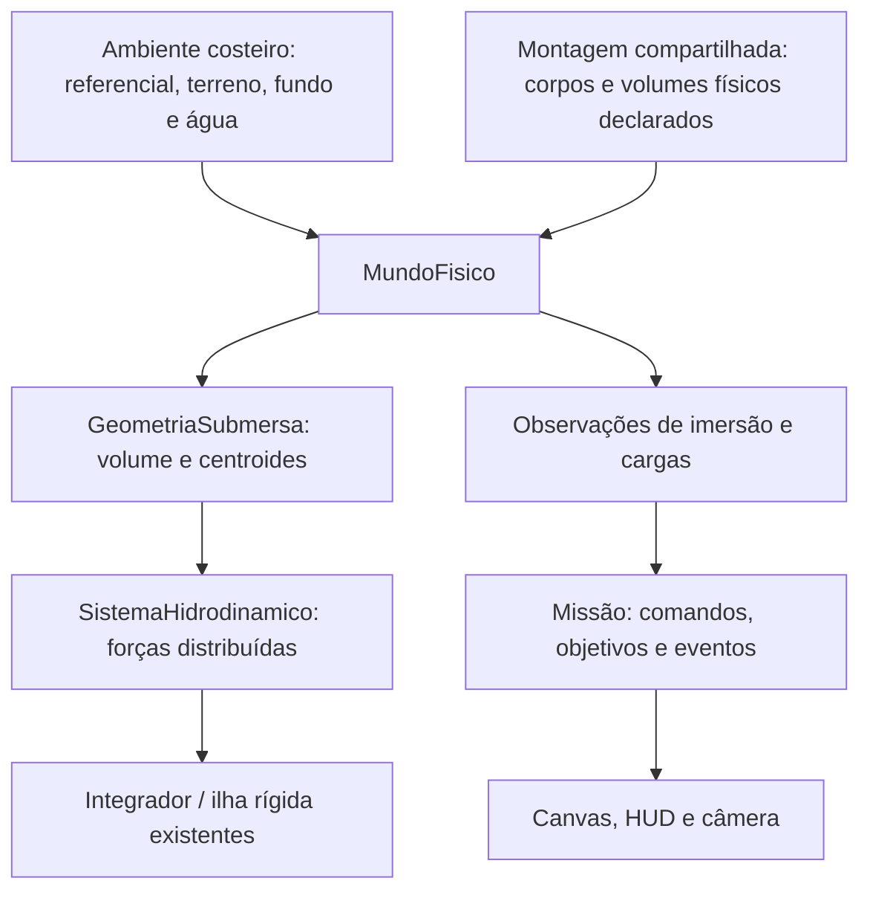

# M11 — Hidrodinâmica, oceano físico e amerissagem

Data: 2026-10-13. Base real: `1d74cfa`, `main` limpa e sincronizada com a referência local de `origin/main` no início. Complexidade estimada: **9/10**. Leitura integral das 2.306 linhas de `AGENTS.md` realizada antes de alterações. Execução incremental, commits locais; sem push ou deploy.

## Escopo recebido e estado

O pedido inicial chegou interrompido em `6. Profundidade fin`. A auditoria foi registrada em `ef634ce` antes da implementação. A especificação completa M11-A–H foi recebida posteriormente, com autorização autônoma. Este é o documento canônico solicitado; o primeiro relatório permanece como registro da auditoria inicial.

**M11-A–H concluídas e validadas localmente, em commits incrementais.** Campanha final: **518 testes / 78 arquivos aprovados**, sem erros RPC; TypeScript da aplicação e do domínio de missões e build de produção aprovados. CI M11 pendente do push pelo operador. A física histórica permanece em variante legada, sem migração silenciosa. Propriedades aquáticas são hipóteses explícitas, sem ajustes das massas/dimensões históricas. Os registros cronológicos A–G abaixo descrevem suas revisões na época de cada commit; a revisão aquática 2 e suas evidências M11-H substituem a revisão 1 para aprovação física final.

## M11-A — Inventário do núcleo existente

| Módulo / ponto de entrada | Situação encontrada | Integração necessária / risco |
|---|---|---|
| `src/physics/MundoFisico.ts`, `integrarPasso` e `integrarCorpos` | Prepara sistemas, térmica e vínculos; sincroniza ilhas; integra forças; resolve colisões e solo; atualiza sensores. Não registra regiões aquáticas. | Registrar o meio separadamente das superfícies. Gerar cargas hidrodinâmicas por subpasso e somá-las às forças dos corpos/ilhas; manter uma única integração. |
| `src/physics/solucionadores/IntegradorFisico.ts`, `integrarObjeto` | Usa massa instantânea, soma forças e `(ponto - posição) × força`, integra velocidades linear/angular e posição/orientação por Euler semi-implícito. | Reutilizar forças em pontos reais. Qualificar passo temporal para entrada e arrasto denso; não mudar globalmente o integrador para disfarçar instabilidade. |
| `src/physics/estruturas/ConjuntoEstruturalRigido.ts`, `integrar` | Uma massa, centro de massa e inércia por ilha; soma momentos de todas as forças em torno do centro composto. Projeta a geometria rígida com rotação em Z. Recalibra referências quando a massa muda. | Empuxo e resistência de cada região exposta devem atuar na mesma ilha, respeitando centros e braços. Nunca integrar cada módulo conectado independentemente. |
| `src/physics/objetos/base/Objeto.ts` | Dimensões XYZ, polígono XY de colisão, massa variável, integridade e API de dano energético. Não há volume estanque, permeabilidade, área molhada ou propriedade hidrodinâmica. | Declarar geometria deslocadora e parâmetros do meio explicitamente. Caixa de colisão não prova estanqueidade. Não aplicar água silenciosamente a todos os objetos. |
| `src/physics/SuperficieFisica.ts` | Material `agua` existe na enumeração, mas todas as instâncias seguem o contrato rígido de distância, normal, projeção, impacto e atrito. | O oceano não deve herdar esse comportamento. Preservar compatibilidade de superfícies históricas; não apresentá-las como água funcional. |
| `src/physics/SuperficieEsferica.ts` | Contato radial em secção circular XY, candidaturas por vértices e segmentos. Material concreto. `contemProjecao` herdado retorna verdadeiro em toda parte. | Limitar o terreno aos domínios sólidos; criar fundo real separado e com profundidade explícita. Não deixar esta esfera ao nível da água na área oceânica. |
| `src/physics/SuperficiePlanoLocal.ts` | Face superior plana finita; contém projeções por largura tangencial e inclui cruzamentos das bordas na geometria de contato. | Preservar para infraestrutura local. Evitar laje sobreposta ao terreno que duplique impulsos. Não usar como interface livre. |
| `src/physics/solucionadores/ResolvedorContatoSuperficie.ts` | Processa TODAS as superfícies registradas; corrige penetração, aplica impulso normal/atrito, dano e esforços nos vínculos. Não há exceção hidrodinâmica para `agua`. | Restringir a sólidos, inclusive fundo e costa. Interface livre nunca participa desse resolvedor. Tolerâncias de contato existentes permanecem. |
| `src/physics/solucionadores/ResolvedorColisoes.ts` | Colisões entre objetos, ignora membros da mesma ilha, aplica impulsos/torques, dano e esforços internos. | Preservar para colisões entre destroços e sólidos submersos. Água não é um corpo de colisão. |
| `src/physics/solucionadores/ResolvedorEsforcoEstrutural.ts` | Distribui esforço axial de impulso de contato por pontes da topologia; calcula todas as cargas antes de registrar rupturas. Não é um resolvedor geral de cargas distribuídas/flexão. | Investigar transmissão de cargas aquáticas contínuas e de entrada. Reaproveitar topologia, não converter artificialmente toda resistência da água em impacto rígido. |
| `src/physics/conexoes/FixadorEstrutural.ts` | Força operacional declarada e registros de tração/compressão podem romper o vínculo; mundo reconstrói ilhas. | Forças do fluido devem produzir esforço observável quando transmitidas. Preservar estado pós-ruptura e não fazer volume separado continuar pertencendo à ilha anterior. |
| `src/physics/ambiente/AmbienteFisico.ts`, `AmbienteTerrestre` | Campo central, Terra esférica estática e referencial inercial XY. Não conhece costa, fluido ou batimetria. | Reutilizar campo e referencial; geografia é composição do ambiente da missão, sem condicionais por nome de foguete. |
| `src/physics/ambiente/ReferencialFisico.ts` | Altitude radial, tangente/radial local, coordenadas por arco e conversões disponíveis em uma única API. | Definir costa, nível, profundidade e corrente nesses referenciais. Não voltar a tratar Y absoluto como altura em todos os locais. |
| `src/physics/solucionadores/SistemaAtmosferico.ts` | Arrasto sobre cada corpo pelo centro/centro de pressão; altitude negativa é limitada a zero no perfil atmosférico. | Um corpo submerso ainda receberia ar de nível do mar. Particionar exposição ao ar/água, evitando dois arrastos integrais simultâneos. |
| `src/physics/solucionadores/SistemaTermico.ts` | Convecção e aquecimento por arrasto do ar, jatos e calor de atrito; não consulta imersão. | Não representar água com densidade atmosférica. Separar exposição dos meios e contabilizar energia dissipada. Convecção aquática precisa de parâmetros próprios caso entre no escopo. |
| `src/veiculos/MontagemBss.ts` | Mesma fábrica para bancada e missão, 12 corpos no BSS-006; dimensões/massas históricas. Vínculos em estrela. Consulta um solo para o corte por sapatas. | Preservar montagem compartilhada; adicionar definição de exposição/deslocamento sem três veículos diferentes ou alteração de massa/dimensão. |
| `src/veiculos/DefinicaoBss006.ts` | Uma configuração de referência, sem propriedades aquáticas. | Versionar hipóteses de casco/tanques/peças expostas; não presumir que motor e grid fins deslocam a caixa envolvente inteira. |
| `src/missoes/AmbienteLancamento.ts` | Uma esfera rígida cobre todo o lançamento; plataforma é demarcação do mesmo solo. | Um ambiente costeiro novo precisa retirar terreno oceânico ao nível do mar, definir fundo e região fluida sem contatos redundantes. |
| `src/missoes/MissaoBss006.ts` | Perfil aos 300 m, eventos de toque por impulso rígido, repouso geométrico e apoio bilateral terrestre. Mundo privado, comandos sem escrita cinemática, observações congeladas. | Acrescentar eventos e observações aquáticos próprios. Toque na água, flutuação e contato com fundo são coisas distintas. Não converter apoio terrestre em sucesso de amerissagem. |
| `src/veiculos/MontagemBss.ts`, `configuracaoPousoBss04` | Altitude-alvo do casco 4,8 m; corte terminal BSS-006 retido por apoio bilateral nas sapatas. | A água não fornece esse apoio. Adaptar o domínio de retorno/corte por operações/sensores explícitos, sem inventar contato rígido. A versão terrestre deve preservar seu comportamento. |
| Controles de atitude, Fuzzy-PID, guia BSS-006, arbitragem | Produzem comandos/forças por permissivos e referencial local; não conhecem flutuação. | Investigar autoridade após entrada. Desligamento explícito precisa retirar empuxo; não adicionar torque para impor orientação. Controle ativo deve aparecer separadamente de estabilidade passiva. |
| Sensores e `src/veiculos/TelemetriaBss.ts` | Observam mundo, contato sólido e grandezas locais/orbitais. | Expor imersão pelo core; contato de água não deve acionar sensores de apoio sólido. Preservar leituras atrasadas/congeladas e integridade. |
| `src/missoes/TiposMissaoBss006.ts`, `RegistroMissao.ts`, `ReplayMissaoBss006.ts` | DTOs físicos e diário versionado com reexecução estrita. | Registrar parâmetros aquáticos, revisão, comandos e observações. Preservar diário M10 e caminho legado; física aquática muda a revisão. |
| `src/apresentacao/missao/RenderizadorMissao.ts`, `terreno` | Terreno desenha toda a esfera; água é faixa decorativa a 160 pixels da base. Não corresponde a limite geográfico em metros. | Desenhar costa, fundo, interface e objetos imersos a partir do ambiente/snapshots. Manter Canvas sem acesso a mundo mutável. |
| `CameraMissao`, `CenaMissao`, `EntradaMissao`, `ExecutorPassoFixo`, `ExecutorMissao` | Apresentação/tempo externos separados do domínio; executores usam passos fixos. | Preservar arquitetura. Só adaptar conteúdo de observação/controles quando necessário; câmera deve acompanhar queda/imersão sem parar na altitude zero. |

Módulos preserváveis: campo gravitacional M9, transformações compartilhadas, operações de forças/impulsos, composição de massa, integração rígida, colisões entre corpos, superfícies terrestres locais, permissivos de motor, alimentação e controladores existentes para seus envelopes terrestres, portas de missão, executor genérico e isolamento do navegador. Hidrodinâmica não justifica duplicar esses serviços.

### Evidência da montagem real

A fábrica compartilhada foi instanciada em Node sem navegador ou bancada, sem avançar o tempo nem modificar parâmetros. Evidência em `docs/validacoes/2026-10-13-m11-auditoria-montagem.json`:

- 12 corpos físicos; massa inicial total **5.349,1660309923745 kg**.
- Centro de massa inicial `(0,005234460818335352; 9,559970638541285; 0)` m no sítio de arco zero.
- Soma dos volumes das caixas geométricas: **108,532 m³**, antes de retirar sobreposições ou volumes permeáveis.
- Essa soma **não é volume deslocado validado**. Caixa envolve material/vazios; perna/sapata e peças conectadas podem ocupar regiões comuns. Não pode virar empuxo total automaticamente.
- Casco: caixa 3,2 × 6 × 2,4 m; tanques escalados pelo fator linear `cbrt(5)`, separados acima do casco; painel lateral existente torna o centro de massa ligeiramente assimétrico. Nenhuma dessas características será alterada para produzir tombamento.

Ainda não é possível afirmar que esse BSS flutua, afunda ou se estabiliza numa orientação específica: faltam propriedades físicas do volume que efetivamente exclui água. O diagnóstico deverá separar conclusão do modelo parametrizado de qualificação do veículo real.

### Referência do Protótipo 1

Inspecionados `../Starship/src/js/core/physical_core.js`, `getWaterForces`, e `../Starship/src/js/mission/mission_simulation.js`, ramo `waterLanding`.

O P1 calcula um ângulo-alvo horizontal, aceleração angular proporcional ao erro desse alvo e amortecimento parametrizado; o empuxo usa massa do veículo multiplicada por gravidade e fator dependente da atitude, além de correção proporcional da altura para um centro de flutuação escolhido. Esse caminho não calcula volume deslocado/centro de empuxo e contradiz as proibições da M11. Serve como referência de observações operacionais, não como implementação física reutilizável. Nenhum arquivo do P1 foi alterado.

## Arquitetura proposta

1. **Região aquática**: contrato de meio volumétrico separado de `SuperficieFisica`; identidade, domínio geográfico, nível livre, densidade kg/m³, fundo/profundidade e velocidade do fluido m/s consultáveis em posição/tempo simulado. Campos e leis determinísticos; sem relógio real. Nenhum valor concreto de profundidade/nível/densidade ainda escolhido nesta auditoria.
2. **Geometria deslocadora**: volumes exclusivos ligados a objetos reais, transformados pela pose atual. Para a dinâmica XY, polígonos/células extrudados por espessura física Z permitem volume m³ e centro de empuxo; não ampliar para dinâmica 3D. Declarar material estanque/permeável e regiões excluídas, sem contar duas vezes o mesmo fluido. Um componente desprendido mantém sua geometria associada ao próprio objeto.
3. **Geometria submersa**: interseção com o domínio real do fluido, não apenas um teste do centro ou dos vértices. Calcular volume, primeiro momento, fração, extensão molhada e pontos para aplicação das cargas. Tratar a interface radial terrestre. Se for usada aproximação tangente local, declarar seu domínio e provar convergência/erro de curvatura antes de qualificá-la; não transformar um plano infinito em oceano global.
4. **Sistema hidrodinâmico**: calcula empuxo hidrostático e resistência distribuída usando velocidade no ponto, incluindo rotação. Devolve `ForcaAplicada[]` ao core. Não atualiza pose, não usa ângulo-alvo e não produz torque de tombamento independente das forças.
5. **Estado de imersão**: observação imutável por objeto/região e agregado conectado, calculada pelo mundo. Expõe volume deslocado, centro de empuxo, forças, momentos, velocidade relativa e energia dissipada; entrada/saída não são contato rígido. Flutuação é janela de equilíbrio observada, afundamento é movimento/imersão observado, sem restrição cinemática.
6. **Missão costeira**: compõe sólidos e fluido; recebe a mesma definição BSS-006. Versão terrestre M10 e bancada permanecem disponíveis para reprodução. Apresentação usa configuração física e snapshots, inclusive geometria da linha costeira em metros; não fabrica trajetória.

Preferir registro explícito de propriedades aquáticas para objetos que participam do meio. A ausência de configuração deve ser diagnosticada, não interpretada como um casco estanque universal. Os parâmetros já fornecidos de resistência térmica do BSS permanecem; novos objetos físicos só poderão usar parâmetros declarados, conforme `AGENTS.md`.

### Equações e unidades

Para densidade uniforme e gravidade aproximadamente uniforme na escala do corpo:

`Vsub = integral sobre volume excluído de água e submerso de dV` (m³).

`B = integral(p * dV) / Vsub` (m), definido somente quando `Vsub > 0`.

`Femp = -rhoAgua * Vsub * agrav(B)` (N); gravidade vem do campo compartilhado, não de `g0` do impulso específico. Variação espacial relevante exige distribuição/integral, não uma direção global fixa.

`tauG = soma[(pAplicacao - G) × F]` (N·m), usando G e a massa/inércia da ilha. O peso já existe no core e não será reaplicado pelo sistema aquático.

`vrel(p) = vCM + omega × (p - G) - vAgua(p,t)` (m/s).

`Fd = -0,5 * rhoAgua * Cd * Aproj * |vrel| * vrel` (N) é uma aproximação quadrática com coeficiente/área declarados. Para resistência rotacional, distribuir elementos molhados e usar sua velocidade local; uma força única no centro não captura a dissipação do giro.

`Pdiss = -soma(Fd · vrel) >= 0` (W) para água estacionária e resistência passiva. Corrente pode transferir energia ao corpo; distinguir potência relativa dissipada de trabalho inercial. Registrar o destino energético no modelo, sem afirmar que toda a energia aquece o objeto.

Equilíbrio de flutuação requer forças e momentos resultantes nulos. A condição necessária de capacidade estática é `rhoAgua * Vmax >= massa`, mas não prova estabilidade. Para casos analíticos de pequena inclinação e superfície plana, usar `GM = KB + IlinhaAgua / Vsub - KG` e comparar o sinal do momento restaurador. Não usar GM como torque imposto nem como fórmula geral para toda orientação. Estabilidade deve emergir da mudança de B com a imersão.

Fontes técnicas de consulta: [MIT — Stability and Trim](https://ocw.mit.edu/courses/2-017j-design-of-electromechanical-robotic-systems-fall-2009/feba89aba74b6dbf71ead4f18284ccb5_MIT2_017JF09_stability.pdf), [MIT — Hydrostatics and Buoyancy](https://ocw.mit.edu/courses/1-060-engineering-mechanics-ii-spring-2006/resources/lecture4/), [NASA — Drag Equation](https://www1.grc.nasa.gov/beginners-guide-to-aeronautics/drag-equation/). A equação de arrasto é uma forma paramétrica; os coeficientes aerodinâmicos existentes não constituem calibração hidrodinâmica.

### Entrada na água, dano e vínculos

Empuxo e arrasto quase-estacionário não são, por si, um modelo completo de impacto de entrada/slamming. A M11 não pode declarar amerissagem rápida qualificada apenas porque o corpo desacelerou. Identificar separadamente volume emergente, velocidade normal de entrada, carga transitória, massa adicionada se modelada e distribuição de esforços.

A API atual `aplicarDanoPorImpacto(J)` usa resistência energética por evento; aplicar a energia de arrasto a cada subpasso como se fossem impactos independentes cria dependência de dt e pode esconder dano ao subdividir. A solução deve identificar o evento/carga física, justificar sua energia estrutural e testar convergência. Não reaproveitar restituição rígida ou remover toda velocidade ao cruzar a interface.

As cargas contínuas da água também precisam transmitir esforço nos vínculos. O resolvedor existente é axial e orientado a impulsos de contato, não flexão geral: essa limitação deve permanecer explícita. Ruptura não pode deixar a região deslocadora presa ao agregado antigo nem retirar destroços do mundo.

### Geografia e compatibilidade

Definir terra/oceano por coordenadas do referencial compartilhado, com partição coerente. Restringir candidatos de contato do terreno à terra; adicionar geometria nas bordas quando o casco atravessar a costa, para não depender só dos vértices. Fundo marinho é sólido real abaixo da interface livre; se existir limite lateral do domínio, não deve parecer uma parede invisível de água.

Plataforma deve apoiar no terreno sem segunda face coincidente. Linha costeira e fundo desenhados são a mesma geometria observada pelo core, não offsets de pixels. A especificação do item de profundidade e dos demais requisitos depende da continuação do pedido.

Preservar ausência de água como caminho legado e metadados antigos; cenário costeiro novo declara revisão e configurações aquáticas. Não editar resultados/diários M0–M10. Não misturar a pendência histórica de penetração ~34 mm ou apoio bilateral terrestre com uma tolerância nova do oceano.

## Riscos e limitações

| Risco | Consequência | Mitigação / evidência exigida |
|---|---|---|
| Volume de caixa tratado como volume estanque | Flutuabilidade fictícia, especialmente motor, fins e vazios | Geometria deslocadora explicitamente declarada e teste de volumes exclusivos |
| Sobreposição de módulos | Empuxo duplicado | Partição/unificação geométrica e teste com peças parcialmente sobrepostas |
| Esfera ao nível do mar sob oceano | Piso invisível, apoio nas sapatas e impossibilidade de afundar | Partição geográfica e corpo inerte que cruza a interface sem contato rígido |
| Arrasto aplicado só no centro | Giro persistente ou amortecimento angular improvisado | Elementos distribuídos, velocidade por ponto, potência passiva e teste de rotação pura |
| Passo explícito em água densa | Inversão de velocidade, ganho de energia ou explosão numérica | Envelope por massa/velocidade/geometria; comparar dt, subpassos e integração estável sem mudar Cd para aprovar |
| Controle terrestre tentando sustentar 4,8 m | Motor continua ligado ou estabilização ativa confundida com flutuação passiva | Política operacional e corte explícito observáveis; teste após desligamento real |
| Pressão de entrada ausente | Impacto destrutivo sem dano | Modelo de entrada e orçamento de energia/evento qualificados separadamente |
| Hidrocargas fora do resolvedor de esforços | Fixadores indestrutíveis na água | Testes de ruptura e topologia com cargas físicas transmitidas |
| Ar e água sobre todo o mesmo corpo | Resistência/aquecimento duplicados | Exposição consistente entre meios no mesmo passo e observações |
| Perturbação artificial para demonstrar tombamento | Resultado roteirizado | Simetria exata permanece simétrica quando aplicável; testes separados com perturbações iniciais declaradas ±theta e assimetrias existentes |
| Critério só de velocidade baixa | Fundo/afundamento confundidos com flutuação | Observar imersão, forças, momentos, apoio no fundo, integridade e janela temporal |
| Diário antigo reproduzido com água nova | Falsa equivalência histórica | Revisão/configuração e seleção explícita de ambiente; fixture M10 preservada |

Limitações a manter visíveis: dinâmica XY, espessura Z para volume e inércia apenas, Terra sem rotação. Ondas, ar aprisionado, inundação, cavitação, sloshing e convecção aquática não serão declarados disponíveis sem implementação/validação específica. Não prometer estabilidade real do BSS a partir de caixas aproximadas ou propriedades de estanqueidade assumidas.

## Estratégia de testes proposta

1. Geometria independente: seco, totalmente imerso, imersão parcial analítica, rotações 0/±45/90°, atravessamento da costa e da região limitada, sobreposições, centro fora da água com parte imersa e vice-versa; valores finitos, volume entre zero e máximo, convergência geométrica.
2. Hidrostática com corpos inertes: volume conhecido e empuxo de Arquimedes; corpo denso afunda, leve emerge até deslocar sua massa; estabilidade restauradora de bloco baixo e divergente de corpo alto, ambos com perturbações iniciais de sinais opostos; simetria sem torque espúrio. Sem necessidade de foguete/ignição.
3. Resistência: translação, rotação pura e corrente, sinal do trabalho relativo; velocidade terminal analítica em regime totalmente imerso; nenhum arrasto sem imersão. Comparação de passos e convergência sem amortecimento ou limites alterados para aprovar.
4. Ilha rígida: duas peças com centros de empuxo distintos, massa/inércia compostas, consumo de propelente, ruptura, separação e destroços; invariância da força/momento para subdivisão geométrica equivalente.
5. Costa: plataforma sólida, corpo cruzando água sem impulso rígido, fundo real na profundidade declarada, transição terra/água e ausência de contatos duplicados; regiões em dois locais radiais diferentes da Terra.
6. Entrada e limites: baixa/alta velocidade, inclinação, motor operando e desligamento, água insuficiente para flutuar, perda de sistema/vínculo. Caso destrutivo com dano mensurável e convergência do evento frente a dt.
7. BSS-006: registrar massa, volume/carga por componente, G/B, atitude, forças/momentos, consumo, integridade e eventos durante entrada/corte. Demonstrar orientação resultante sem impor horizontalidade. Configuração/perturbações claramente identificadas; flutuação/afundamento são resultados possíveis.
8. Compatibilidade: casos diretamente afetados de forças, fixadores, contato e colisão; ambiente sem água da M10; diário estrito e testes M9 orbitais se o caminho de integração for modificado. Referências históricas não serão regravadas para aceitar diferenças.
9. Apresentação: teste de fumaça de `missao.html` com costa em metros, entrada real, acompanhamento submerso, comandos, telemetria, pausa e reinício sem resíduo; preservação de `tests.html`, `orbitas.html` e landing page.

As tolerâncias hidrodinâmicas quantitativas serão definidas pelo erro analítico/convergência requerido, não por resultados convenientes. O passo padrão do voo continua 1/240 s; isso não constitui qualificação automática para qualquer velocidade de entrada. Build/typechecks e casos determinísticos pertinentes a cada mudança precedem seus commits.

## Sequência recomendada, sujeita aos requisitos faltantes

A auditoria recebida pode ser encerrada primeiro em commit somente documental. Em seguida: geometria/regionais com corpos inertes; forças e integração compartilhada; costa/fundo; propriedades explícitas do BSS e operações de retorno; observações/replay; demonstração visual e campanha comparativa. Essa ordem é uma proposta de dependências, não atribuição inventada de nomes M11-C em diante.

Antes de parametrizar o oceano/veículo, incorporar a continuação do pedido: profundidade finita e eventuais valores, geometria da costa, hipóteses de estanqueidade, correntes/ondas, danos/falhas exigidos, marcos restantes, caminhos de documentação e critérios finais. Não é necessário pedir nova autorização para etapas já autorizadas quando esses requisitos forem conhecidos.

## Validação desta auditoria

Coleta da montagem diretamente pela fábrica: aprovada, 12 corpos, tempo inicial zero e nenhuma alteração física. Evidência JSON dedicada; script transitório em `/tmp`, sem módulo de execução concorrente no projeto.

Validação local confirmada, todas as saídas zero:

- `npm test -- src/physics/conexoes/FixadorEstrutural.test.ts --maxWorkers=1`: **4 testes aprovados**, incluindo torque por força fora do centro, ruptura e dano da massa composta em contato.
- `npm run typecheck`: aprovado.
- `npm run typecheck:missoes`: aprovado, domínio sem APIs do navegador.
- `npm run build`: aprovado, 109 módulos e as quatro páginas existentes, 12,43 s.
- `git diff --check`: aprovado.

Nenhum teste aquático foi executado, pois hidrodinâmica ainda não foi implementada. Nenhuma experiência visual aquática foi declarada concluída. A suíte completa histórica não foi repetida neste marco documental, conforme seção 65 de `AGENTS.md`; os testes pertinentes acima verificam os mecanismos auditados.

CI da base exata `1d74cfae935e0440796351927dad0460413e06e2` consultado via GitHub: execução [38460625103](https://github.com/evertaraujo-lgtm/blackstarprototipo2/actions/runs/38460625103), `completed/success`. Evidência normalizada em `docs/validacoes/2026-10-13-m11-auditoria-validacao.json`. CI remoto desta auditoria local depende do push do operador; o resultado da base M10 não aprova código hidrodinâmico ainda inexistente.

## Pendências anteriores preservadas

Apoio bilateral contínuo terrestre não qualificado; penetração histórica ~34 mm; diário manual 15 km M5-B/C e contingências M8-B incompletos; pequena diferença de grandeza orbital derivada entre runtimes Chrome/Node no replay estrito M10; alta atmosfera/reentrada/rotação não qualificadas. M11 não altera relatórios anteriores nem desenvolve BSS-007/orbitador.

## M11-B — Geografia costeira

`GeografiaCosteira` define uma baía finita pelo arco terrestre: praia inicial, rampa, fundo e segunda praia. `SuperficieCosteira` usa altitude radial e gradiente do perfil para contato sólido, inclui as quebras da costa nos candidatos de contato e projeta por iteração geométrica. Não existe face rígida no nível do mar na baía. A futura água terá interface no raio do nível declarado e domínio restrito à baía. A plataforma continuará sobre o solo terrestre existente.

Configuração inicial dos ensaios: costa a +60 m da base, rampa de 50 m, fundo a -50 m por 2.000 m, segunda rampa de 50 m, nível 0 m. São condições explícitas de uma baía de estudo, não batimetria medida do litoral paulista. Nenhuma missão histórica passou a usar essa geografia automaticamente.

Quatro testes aprovados: praia/fundo/normal/projeção em arco zero e a 1.000 km; corpo que atravessa o nível do mar sem impulso rígido, mas toca o fundo; corpo que ocupa terra e água e inclui a quebra costeira entre vértices. Tolerância de projeção 1 µm verificada. O gradiente fornece distância normal local de primeira ordem, com projeção iterativa; em penetrações profundas atravessando uma quebra, a resposta ainda é uma aproximação do resolvedor de sólidos existente.

## M11-C — Volume e empuxo

`RegiaoAquatica` é um meio separado do solo. `GeometriaSubmersa` recorta prismas orientados em células por três regiões disjuntas da baía; integra área e primeiro momento em coordenadas relativas ao corpo e extruda em Z. Interface livre radial é aproximada pelo plano tangente na escala do corpo, não por um plano global. Erro vertical máximo de curvatura de uma forma de extensão D é aproximadamente D²/(8R); para 20 m, <8 µm. Marés/ondas ausentes. Recorte do fundo/próximo das praias usa a aproximação tangente local e precisa dos testes de refinamento específicos.

`SistemaHidrodinamico` rejeita regiões aquáticas e geometrias deslocadoras inicialmente sobrepostas. Componentes internos devem declarar região exclusiva ou deslocamento zero, sem duplicação do volume externo. As formas permanecem associadas ao objeto real após separação. Sobreposições transitórias entre destroços ainda dependem do resolvedor de colisões de sólidos; não há união booleana dinâmica de destroços interpenetrados.

O mundo registra formas explicitamente e soma empuxo no centro do volume imerso às forças do corpo ou da ilha existente. Usa a gravidade local de M9 e massa instantânea existente. Sem água, preserva o caminho e metadados anteriores. Observações aquáticas são consultas de forças/geometria, não estado cinemático paralelo.

Seis testes aprovados: seco/parcial/total em dois locais terrestres, rotação ±45°/90°, rejeição de sobreposição, integração real sem piso e independência do empuxo em relação à massa. Comparação de volume com solução analítica a 1e-6 m³; força com Arquimedes e campo local. Typecheck, typecheck de missões e build aprovados. Arrasto/entrada são os próximos marcos, não capacidades validadas neste commit.

## M11-D — Resistência distribuída e integração

Arrasto quadrático por elemento imerso, com velocidade translacional + omega×braço e corrente tangencial local. Área projetada do prisma é ponderada pela fração volumétrica de cada elemento: aproximação de resistência distribuída, não resolução de pressão em cada face. Cd declarado por forma. Esta ponderação mantém resistência contínua na entrada/saída, mas não representa slamming ou ar preso. Dissipação rotacional vem das forças locais; nenhum amortecimento angular constante.

Ar atmosférico, forças aerodinâmicas de componentes e convecção do ar recebem apenas a fração geométrica emersa. A fração molhada das formas permeáveis é geométrica, distinta do volume efetivamente deslocado. Convecção aquática detalhada não implementada. Cache geométrico usa apenas pose imutável e não altera o estado.

Além do dt máximo do mundo, a água impõe subpassos pela rigidez hidrostática e pela derivada de resistência translacional/angular. Limite da variação local de carga de 1% por passo; nenhuma velocidade é truncada. Inicialmente, o teste a 50 m/s mostrou diferença de 11,59 cm entre 1/240 e 1/480 s. O refinamento automático de precisão corrigiu o caso mantendo orçamento de erro de 5 cm. O bloco em equilíbrio ainda oscilava 6,34 mm aos 60 s com arrasto quadrático; prolongou-se a observação a 120 s, mantendo limite de 5 mm e Cd/massa/volume.

14 testes aquáticos aprovados: Arquimedes/geometria, resistência v²/área orientada, giro passivo, corrente, estabilidade com inclinações espelhadas, calado analítico a 5 mm (2% de 0,25 m), corpo denso afundando, exposição do ar e determinismo/refinamento. Typechecks e build aprovados. Testes não equivalem à qualificação de entrada rápida/dano, que pertence à M11-F.

## M11-E — BSS-006 passivo e variante geométrica explícita

`EnsaioAmerissagem` usa a mesma `MontagemBss`, com condição inicial ADM definida no construtor dos objetos. Nenhuma pose/velocidade é reescrita depois da inicialização. Casco em x local 200 m, h local 5 m; velocidade inicial -0,5 m/s, inclinação 0,005 rad e omega zero. Atmosfera padrão, água uniforme 1.025 kg/m³ sem corrente. A curvatura acrescenta ~3,14 mm à altitude radial da inicialização tangente, registrada na telemetria.

`HidrodinamicaBss006` declara uma **hipótese de engenharia de estanqueidade**, não uma propriedade historicamente validada: casco e ambos os tanques são prismas externos estanques nas dimensões existentes; caixa da bateria desloca 30% de seu invólucro como geometria permeável equivalente; painel é lâmina de 20 mm; motor aberto desloca 5% do prisma exposto, retirando 100 mm que sobrepunham o casco; grid fins deslocam 10% do prisma (90% de vazios); pernas têm seção de parede equivalente de 2 mm e trecho exclusivo de 3,15 m; sapatas são lâminas de 10 mm. Cd 1,1 por forma é parâmetro de estudo de resistência, sem calibração experimental. Frações equivalentes representam material/vazios explicitamente e não são calculadas por massa/densidade. Massa histórica, geometria de colisão, combustível, empuxo e ganhos não mudam.

Os volumes estanques são suficientes para sustentar 5.349,166 kg; a massa fica alta na vertical, enquanto o empuxo inicial atua na parte baixa. A perturbação faz crescer o braço entre G e B e o momento positivo. Após a rotação, o volume distribuído ao longo do veículo oferece estabilidade lateral. O equilíbrio não é imposto exatamente a 90°.

Coleta determinística de 120 s em `docs/validacoes/2026-10-13-m11-e-amerissagem.json` (antes do modelo energético M11-F):

| t (s) | Altitude casco (m) | Velocidade (m/s) | Atitude local (rad) | omega (rad/s) | V sub (m³) | Empuxo (N) | Momento aquático (N·m) |
|---:|---:|---:|---:|---:|---:|---:|---:|
| 0 | 5,003 | 0,500 | 0,00503 | 0 | 0 | 0 | 0 |
| 1 | 1,913 | 2,018 | 0,00683 | 0,00648 | 8,543 | 85.995 | 1.551 |
| 5 | 2,189 | 0,207 | 0,52639 | 0,48594 | 4,227 | 42.553 | 26.315 |
| 7 | 2,964 | 1,711 | 1,73746 | -0,01607 | 0,168 | 1.688 | 3.811 |
| 30 | 1,528 | 0,080 | 1,58454 | -0,00377 | 5,225 | 52.593 | -2.690 |
| 120 | 1,525 | 0,021 | 1,58358 | -0,000301 | 5,216 | 52.501 | 204 |

Aos 120 s: inclinação ~90,73°, erro da massa deslocada ~0,0556%, integridade 1, nenhum contato com fundo e nenhum consumo/empuxo propulsivo. Oscilação amortecida e deriva horizontal residual permanecem físicas; posição não foi congelada. A entrada das peças baixas é mais lenta que a entrada posterior do casco, cujo intervalo inclui queda por gravidade; esta condição inicial não qualifica controle de descida aquático.

Dois testes do BSS passivo aprovados: crescimento do momento físico e tombamento sem propulsão, e perturbação de sinal oposto com momento oposto. Testes de montagem histórica também passaram exatamente; 16 testes adicionais de geometria/arrasto/montagem aprovados. Typechecks e build aprovados. Otimização geométrica descarta regiões completamente secas e integra células totalmente molhadas sem recortes repetidos, mantendo as mesmas equações.

## M11-F — Carregamento de entrada e dano

Modelo inicial energético de entrada: integra o trabalho resistivo relativo `P = -sum(Fdrag · vrel)` durante o aumento de imersão e descida, encerrando o episódio na imersão completa, redução do volume ou inversão da descida. Usa trapézio e localiza os extremos cruzando a superfície livre, sem impulso de colisão, restituição ou força extra de slamming. O trabalho é medida equivalente de carregamento transmitido pela estrutura; dano usa a resistência energética existente. Não é uma solução de pressão de Wagner nem modela massa adicionada/ar preso. Entradas rápidas exibem dano nesse modelo, mas picos reais de pressão/slamming permanecem **não qualificados**.

`Objeto.aplicarDanoPorCarregamentoPeloCore` aplica somente o incremento do excesso de energia sobre a resistência por episódio. Não reaplica o total em cada subpasso nem transforma todo o trabalho em calor do casco. Corpo com resistência grande e pequena percorre a mesma cinemática de arrasto quando não fornece capacidades degradáveis: confirma ausência de segundo impulso. Capacidades como propulsão continuam degradando pela integridade real.

`ResolvedorEsforcoEstrutural.registrarCargasDistribuidas` calcula reação axial nos vínculos-ponte pela força externa de cada lado menos a aceleração comum/angular/centrípeta da ilha. Forças iguais por unidade de massa não criam ruptura fictícia. Empuxos diferentes transmitem tração/compressão e rompem vínculos fracos antes da integração; topologia reconstruída, destroços continuam físicos. Flexão e malhas redundantes ainda não são resolvidas.

Cinco testes aprovados: dano de entrada a 60 m/s em 0/45/90°, ausência de dano por mera imersão lenta, energia/dano acumulados sem duplicação, convergência energética a 2% com refinamento, cargas equilibradas e ruptura por empuxo desigual, e BSS com ignição/consumo e perda de >80% de integridade. O teste propulsivo coleta até o dano destrutivo observado (máximo 0,5 s); não força repouso nem executa toda a evolução dos destroços para repetir o mesmo critério. Limite de tempo do teste preservado em 60 s.

A primeira integração retangular mostrou erro de 3,59% na energia de entrada. Trapézio com cruzamentos dos extremos corrigiu o teste, mantendo tolerância de 2%. Typecheck, checagem de missões e build aprovados. Nenhuma referência histórica modificada.

## M11-G — Missão, diário e Canvas

Variante `BSS006_AMERISSAGEM_EXPERIMENTAL`, acionada somente por `ensaioAquatico` na configuração. Usa a definição e controladores históricos; a inicialização ADM sobre o oceano está identificada na missão e no painel. Não presume lançamento operacional nem controle de descida aquática qualificado. O padrão terrestre e seu formato de configuração/diário permanecem M10, sem novos campos quando água está ausente.

Porta de observação expõe volume/fração, G/B, empuxo, arrasto, momento, potência dissipada, energia/pico de entrada, componentes conectados e janela observacional de equilíbrio. Objetivos e eventos aquáticos são medidas, não transições que aplicam rotação/posição. Desligamento chama a mesma API de domínio, sem força fictícia. Partes rompidas continuam no mundo e na lista de corpos; saem das cargas/massa do agregado conectado. Snapshots copiados/congelados; registros M11 incluem geometria, região, densidade, Cd, estado inicial e revisão própria. Replay valida configuração e compara o diário inteiro estritamente.

Critério de equilíbrio observado: motor cortado, velocidade do casco <0,05 m/s, |omega| <0,005 rad/s, força de empuxo a 2% do peso e momento residual equivalente a braço <2 cm, contínuos por 3 s. Esses são critérios de observação, sem efeito na integração. Janela anterior não congela posição nem implica homologação de amerissagem. Estado atual pode voltar a oscilação. Afundamento exige imersão completa, sustentação insuficiente e velocidade radial negativa.

`missao.html` oferece seleção explícita da variante, perturbação inicial e velocidade do ensaio, controles existentes e telemetria aquática. Renderer usa o mesmo perfil radial do domínio para terra/praias/fundo e linha livre; camada transparente evidencia as partes submersas, usando as poses reais. Torre/plataforma não foram acrescentadas como colisores redundantes. As escalas e câmera permanecem locais, com zoom independente da física.

Smoke real no Chrome passou até 120,50 s: entrada em 0,1542 s, tombamento observado em ~4,05 s, equilíbrio observado em ~76,04 s, integridade 1, empuxo motor zero, combustível intacto, nenhum contato com fundo. Estado final `flutuacao-estavel`, V 5,22027 m³ e atitude 1,58369 rad (~90,74°). Controles foram operados numa instância reiniciada, com empuxo e consumo positivos; corte, pausa, zoom sem alteração física, reinício sem resíduo e viewport móvel sem overflow verificados. Zero erros JavaScript. Capturas da entrada/tombamento/flutuação/costa/mobile inspecionadas em `docs/validacoes/m11`; relatório `2026-10-13-m11-smoke-missao.json`.

Três testes da missão aquática e quatro de costa aprovados: variante isolada, massa histórica preservada, observações imutáveis, entrada, corte/pausa/reset, replay exato e geometria de extrusão Z sem expandir a dinâmica XY. Mais 28 testes aquáticos/integrados aprovados após a integração. Typechecks e build das quatro páginas aprovados. Cache usa igualdade exata da pose; reações são pré-somadas por corpo e reconstrução da ilha só ocorre quando há ruptura, reduzindo trabalho do Canvas sem mudar equações.

Mundos aquáticos exigem declaração geométrica para TODOS os corpos, inclusive volume/área zero para componentes internos: ausência é erro de configuração antes do avanço, não flutuabilidade presumida ou objeto silenciosamente transparente. Os testes analíticos de costa/GM/velocidade terminal/energia complementam a campanha M11-H.

Para executar sem navegador: `npm run missao:executar -- --amerissagem --segundos 120 --saida /tmp/amerissagem.json`. Motores nascem desligados nesse ensaio. Para a interface: `npm run dev`, abrir `/missao.html`, selecionar Amerissagem M11 e Iniciar. Reinício aplica as condições escolhidas. Replay: `npm run missao:executar -- --replay /tmp/amerissagem.json --saida /tmp/replay.json`.

## M11-H — Qualificação final, revisão aquática 2

### Correção encontrada durante a qualificação

Um corpo completamente imerso, inicialmente imóvel e com `massa = rho × volume`, revelou deriva na revisão 1. A gravidade recebia dois meio-passos KDK, enquanto o empuxo era aplicado inteiro antes do deslocamento. Apesar da soma de forças nula, a posição acumulava aproximadamente `g × dt² / 2` por passo. O teste de flutuação anterior não isolava esse equilíbrio neutro. A primeira execução da suíte completa foi interrompida para corrigir a composição; não foi registrada como aprovada.

Na revisão **`agua-incompressivel-prismas-m11-2`**, gravidade e empuxo hidrostático recebem ambos meio-passo antes/depois do deslocamento. Resistência e forças operacionais continuam no caminho explícito existente; nenhuma substituição global do integrador. Os impulsos hidrostáticos são `Femp × dt/2`, aplicados pelo core em B, com os braços e a inércia reais da ilha. Não há trava de posição, ajuste de velocidade ou torque independente. Mundos sem água retornam imediatamente da operação hidrostática e conservam a integração M9/M10.

O corpo neutro de 4.000 kg e 4 m³, a -5 m em água de 1.000 kg/m³, permaneceu com **deslocamento e velocidade exatamente zero após 10 s**. O teste exige erro <1e-8 m e <1e-8 m/s. Foi acrescentada também uma regressão que impede classificar como flutuação livre um corpo apoiado no fundo, mesmo quando o empuxo já corresponde a mais de 98% do peso. A observação expõe `apoio-solido-submerso`; o contato não afeta os critérios nem a integração por uma exceção aquática.

Essas correções mudaram a fase das oscilações passivas. O resultado anterior de equilíbrio aos ~76 s é **histórico da revisão 1**, não evidência de aprovação da revisão 2. Seus dados e capturas foram preservados. Não se alteraram Cd, massas, ganhos, dimensões ou limites observacionais para recuperar esse tempo. A revisão da missão passou a `m11-amerissagem-2`; replay incompatível não é aceito como equivalente.

Na inspeção de fronteiras encontrou-se ainda a forma explicitamente interna com fração deslocadora zero: a otimização de imersão completa criava elementos de volume zero e o arrasto tentava dividir 0/0. Uma regressão com giro reproduziu `Escalar deve ser finito`; a geometria agora devolve lista vazia para espessura deslocadora zero. O teste cobre seco/parcial/total, ausência de cargas e ausência de restrição temporal fictícia. Formas de volume positivo, incluindo todos os componentes do BSS deste ensaio, conservam a mesma lógica e trajetória da revisão 2.

A campanha iniciada antes dessa última correção manteve o módulo geométrico anterior no cache do processo: terminou com 517 aprovações, uma falha no caso zero e um erro RPC do runner. Não foi aprovada nem usada como resultado final. Log preservado em `m11/revisao2-regressao-cache-anterior.log`. Os oito casos de qualificação passaram em processo novo (`revisao2-qualificacao-fresca.log`); a repetição final completa usa fontes congelados desde o início.

O erro de comunicação do Vitest ocorreu numa campanha com replay de voo longo síncrono. O teste histórico M10 de replay passou a invocar o CLI real em processo filho aguardado assincronamente, mantendo o runner responsivo. Conservou o diário de referência, as verificações de 18.308 passos/repouso/integridade e a comparação integral, bem como o watchdog original de 120 s. Nenhuma API de domínio ou equação mudou por essa correção de infraestrutura de testes. Verificação isolada passou em 58,735 s sem erro RPC (`revisao2-replay-runner-responsivo.log`). Navegador e servidores temporários foram encerrados antes da repetição completa para evitar verificações concorrentes.

### Matriz quantitativa dos corpos de prova

Coletor reproduzível: `scripts/validar-hidrodinamica.ts`, executado com `npm run agua:validar -- --saida /tmp/hidrodinamica.json`. Usa objetos inertes no mesmo `MundoFisico`, atmosfera padrão de 1,225 kg/m³, gravidade central, água uniforme de 1.000 kg/m³ e geometria/condições iniciais declaradas. Os números são da revisão 2, em `docs/validacoes/2026-10-13-m11-2-hidrodinamica.json`.

| Ensaio obrigatório | Evidência / resultado | Orçamento de erro e justificativa |
|---|---|---|
| 1 — Arquimedes seco/parcial/total | Prisma 2×2×1 m: V = 0, 2 e 4 m³; empuxos 0, 19.640,5041 e 39.281,0266 N; coincidência com `rho × V × g(B)` | Volume 1e-6 m³, comparação algébrica do campo local e dois pontos da Terra; não exige g = g0 |
| 2 — Calado analítico | Bloco 4×1×1 m, 1.000 kg: calado previsto 0,25 m; erro de altura do centro após 120 s **2,107 mm** | 5 mm = 2% do calado. Continua oscilando: não se congela o estado nem se declara equilíbrio exato pelo instante final |
| Equilíbrio neutro | 4 m³, 4.000 kg, totalmente imerso: erro de posição **0 m** e velocidade **0 m/s** em 10 s | 1e-8 m / m/s; verifica composição conservativa, sem contato sólido |
| 3 — Afundamento | Bloco 4 m³, 6.000 kg continua descendo; velocidade terminal difere **0,2425%** da solução `sqrt(2(m-rho V)g/(rho Cd A))` | 2% para terminal, compatível com resistência quadrática e observação após o transiente; massa conservada |
| 4 — Estabilidade angular | Prismas largo/alto a 0,001 rad: sinal restaurador/desestabilizador e momento analítico por GM; erros relativos **8,69e-7 / 7,70e-7** | 1%, cobre linearização de pequena inclinação e curvatura local; casos espelhados verificam sinais |
| 5 — Arrasto | Velocidades 2/4 m/s: força -4.000/-16.000 N, relação v²; giro produz torque oposto e energia decrescente | Comparação algébrica, massa invariável e forças finitas. Energia de giro não cresce sem fonte |
| 6 — BSS-006 | Entrada, momento entre G/B, crescimento de rotação e oscilação lateral sem propulsão; ver trajetória abaixo | Momentos e cargas medidos, integridade 1, nenhum contato com fundo. Não basta atingir um ângulo |
| 7 — Costa | Terra/água/fundo, corpo ocupando ambos os domínios e extrusão Z; volume analítico costeiro 19,5 m³ | Erro <0,003 m³ incorpora aproximação tangente. Nenhum impulso rígido na interface livre |
| 8 — Determinismo e passo | Replay completo Node de 120 s byte a byte; caso inerte a 50 m/s: diferença de posição **25,68 µm** entre dt máximo 1/240 e 1/480 s, e **4,111 mm** entre 1/240 e 1/960 s | 5 cm para o deslocamento de alta velocidade. Subpassos internos pela derivada de carga, sem truncar velocidade; diferenças entre passos não são erro absoluto analítico |
| Entrada rápida / dano | 60 m/s em 0/45/90°, degradação estrutural real, BSS com ignição/consumo e integridade <0,2; diferença energética **1,2231%** ao refinar passo | 2% para trabalho de entrada. Não qualifica picos reais de pressão/slamming |
| 9 — Regressão M0–M10 | **518 testes / 78 arquivos aprovados** na campanha final, incluindo os 36 novos casos; órbitas inertes, seis BSS e missões independentes preservados | Limites e referências históricos preservados; sem água não há nova física |

Existem 36 testes novos em sete arquivos (costa, hidrostática, dinâmica, ensaio BSS, entrada/dano, missão e qualificação). Não se alteraram limites históricos para fazê-los passar. A hipótese física simplificada permanece limitada aos casos e passos examinados, sem promessa de estabilidade para qualquer entrada ou dimensão.

No refinamento a 50 m/s, as posições finais Y foram -17,01025313 / -17,01027881 / -17,01436453 m para os três dt máximos. O número inteiro de subdivisões adaptativas pode produzir passos internos iguais ou diferentes a partir desses máximos; não se infere ordem de convergência pelo par quase coincidente. Todos permaneceram dentro do orçamento de 5 cm. No teste de giro neutro totalmente imerso, energia cinética total caiu de 1.333,3333 para 858,3805 J em 1 s, sem aumento entre amostras; massa 4.000 kg constante.

### Geometria deslocadora e capacidade de sustentação

O volume deslocável declarado soma **100,7487792 m³**, separado dos 108,532 m³ de caixas de colisão encontrados na auditoria. Casco e dois tanques somam 100,08 m³, nas dimensões históricas, sob hipótese estanque. Os demais 0,6687792 m³ representam material exclusivo das peças permeáveis/lâminas, conforme M11-E e a definição versionada `HidrodinamicaBss006`. Não se soma o conteúdo interno de um tanque ao seu volume externo.

Massa total inicial: **5.349,1660309923745 kg**; água: **1.025 kg/m³**. O volume que equilibraria o peso em campo local aproximadamente uniforme é `m/rho = 5,2186985668 m³`. A capacidade máxima excede amplamente a massa, mas isso não demonstra estabilidade vertical: inicialmente B fica muito abaixo de G e a inclinação produz momento desestabilizador. Após a rotação, a distribuição ao longo do corpo oferece uma orientação lateral restauradora. A assimetria histórica e a gravidade radial impedem impor exatamente 90°.

### Trajetória final do BSS-006

Evidência integral no Chrome: `2026-10-13-m11-2-diario-browser.json`, 40.918 passos externos de 1/240 s, amostras por segundo mais o estado final; CSV `2026-10-13-m11-2-amerissagem.csv`. Uma única trajetória física originou esta tabela. As pausas usadas para capturar a cena não avançam tempo físico e constam no diário.

| Tempo (s) | Altitude casco (m) | Velocidade radial (m/s) | Atitude local (°) | omega (rad/s) | Volume submerso (m³) | Empuxo (N) | Momento aquático (N·m) | Estado observado |
|---:|---:|---:|---:|---:|---:|---:|---:|---|
| 0,000 | 5,003 | -0,500 | 0,29 | 0 | 0 | 0 | 0 | seco |
| 1,000 | 1,912 | -2,016 | 0,39 | 0,00646 | 8,5549 | 86.111,1 | 1.559,2 | entrada |
| 5,000 | 2,191 | -0,035 | 29,45 | 0,47653 | 4,2854 | 43.135,7 | 27.401,3 | tombamento |
| 7,000 | 2,922 | 1,565 | 99,68 | -0,01734 | 0,3345 | 3.366,5 | 2.774,9 | oscilação |
| 30,000 | 1,530 | -0,052 | 90,80 | -0,00232 | 5,1705 | 52.045,0 | -4.401,5 | oscilação |
| 60,000 | 1,525 | -0,020 | 90,72 | 0,00026 | 5,2066 | 52.408,6 | 567,9 | oscilação |
| 120,000 | 1,524 | -0,005 | 90,72 | -0,00190 | 5,2265 | 52.608,8 | 1.107,2 | oscilação |
| 170,000 | 1,525 | -0,006 | 90,72 | -0,00154 | 5,2098 | 52.440,2 | 548,6 | flutuação estável |

Eventos medidos: entrada na água a **0,1541667 s**, tombamento a **4,075 s**, janela de equilíbrio completada a **169,675 s**. Estado final capturado a **170,491667 s**: atitude **90,746°**, volume **5,212411976 m³**, empuxo **52.466,873 N**, momento **-651,938 N·m**, janela contínua **3,8167 s**, integridade **1**, motores **0 N**, metano **600 kg** e oxidante **2.400 kg**, sem contatos sólidos. A massa deslocada difere aproximadamente 0,121% da massa do veículo; há movimento residual e o core continua disponível para observação.

G final `(188,253398; 1,466485; 0)` m e B `(188,240944; -0,118013; 0)` m. Braço horizontal ~12,45 mm e forças nos elementos explicam o momento residual; ele não é definido por um objetivo de atitude. A entrada do casco e das peças durante o tombamento pode chegar a velocidades locais maiores que os 0,5 m/s iniciais: o campo gravitacional acelera a queda, e a rotação acrescenta velocidade nos pontos. O pico agregado de entrada de **15,309 m/s** não é velocidade de translação final.

O diário Node de 120 s (`2026-10-13-m11-2-diario-node.json`) foi reexecutado integralmente com as mesmas entradas; `cmp` confirmou igualdade byte a byte. Aos 120 s seu estado ainda é **oscilação**, sem janela de equilíbrio aprovada: momento ~1.107 N·m excede naquele instante o critério do braço de 2 cm. Não se usa esse diário como prova de flutuação estável. A amplitude angular/momento diminui em janelas sucessivas, sem motor, e a cena continuou até observar os critérios existentes.

Node usa perturbação exatamente 0,005 rad; a entrada em graus no Chrome converteu para 0,005000000042491582 rad. Não se afirma identidade estrita entre essas trajetórias/engines nem se misturam amostras para construir uma trajetória fictícia. O teste curto automatizado de replay também rejeita parâmetros/modelos adulterados.

### Apresentação validada

Smoke revisão 2 em `2026-10-13-m11-2-smoke-missao.json`: seleção da variante, avanço físico até flutuação observada, câmera, escalas, telemetria, pausa/continuação, zoom sem alteração física, reinício sem resíduo, preparação/ignição com empuxo e consumo efetivos em outra instância, corte, retorno à variante M10 e viewport 390 px sem overflow. **Zero erros JavaScript.** O cenário não encerra ao entrar na água, tombar ou completar a janela de equilíbrio.

Capturas de execução efetiva, inspecionadas: `docs/validacoes/m11/revisao2-entrada.png` a 1,1625 s, `revisao2-tombamento.png` a 5,825 s, `revisao2-flutuacao.png` a 170,491667 s, além de costa e mobile. Imagens são evidências do Canvas consultando a missão, sem movimentos independentes. Os arquivos sem prefixo `revisao2` permanecem como evidências cronológicas da revisão 1.

Build final também verificado em servidor preview local: quatro páginas carregaram, órbita avançou fisicamente, e os seis BSS da bancada receberam sistemas/ignição com consumo mensurável. Na variante aquática do bundle de produção, entrada ocorreu em 0,1541667 s; aos 1,166667 s havia 10,1377 m³ deslocados, empuxo ~102.043,8 N e nenhum contato sólido. Pausa/reinício sem resíduo e zero erros JavaScript confirmados. Evidências separadas em `2026-10-13-m11-2-smoke-paginas.json`, `-smoke-bancada.json` e `-smoke-agua-producao.json`; esse smoke curto não substitui a demonstração física longa da cena.

### Limitações e pendências preservadas

- Dinâmica XY, Terra esférica sem rotação, água de densidade uniforme, nível estático e corrente tangencial prescrita. Sem ondas/CFD, maré, cavitação, ar preso ou latitude 3D.
- Interface/fundo recortados por planos tangentes locais dentro de regiões radiais. Pequenos erros de curvatura documentados; extensão planetária de um corpo e batimetria real não qualificadas.
- Prismas equivalentes com frações de material/vazios e Cd de estudo. Nenhuma prova experimental de impermeabilidade do casco/tanques; avaria não inunda automaticamente. Geometria inicialmente sobreposta é rejeitada, mas não há união booleana dinâmica de destroços interpenetrados.
- Trabalho de arrasto durante entrada é uma aproximação energética de carregamento, sem impulso extra. Picos de pressão, massa adicionada e slamming detalhado não qualificados. Cargas nos vínculos são axiais em pontes; flexão e redes redundantes permanecem futuras.
- Ar/água não recebem simultaneamente arrasto integral. A parcela emersa controla a exposição ao ar; troca térmica aquática, pressão profunda e inundação progressiva não implementadas.
- Flutuação observada por 3 s é evidência operacional desta configuração, não certificação de equilíbrio assintótico ou amerissagem real. Apoio no fundo é excluído. Os veículos históricos não foram alterados para garantir um resultado visual.
- Penetração histórica ~34 mm, repouso bilateral contínuo terrestre, retorno de 15 km e etapas M8 ainda não qualificadas continuam nas referências anteriores. Esta migração não oculta essas pendências.
- CI da base M10 (`1d74cfa`) confirmado como `success`, run [38460625103](https://github.com/evertaraujo-lgtm/blackstarprototipo2/actions/runs/38460625103). Commits M11 somente locais: CI deles permanece pendente do push pelo operador; não se declara CI M11 aprovado. Nenhum deploy executado.

### Registro incremental e reprodução

| Marco | Commit local | Entrega |
|---|---|---|
| M11-A | `ef634ce` | Auditoria documental, inventário e riscos |
| M11-B | `04d4cf5` | Costa radial e fundo distinto da interface livre |
| M11-C | `9142316` | Volumes exclusivos, centro de empuxo e Arquimedes |
| M11-D | `ca110c4` | Resistência distribuída, exposição e subpassos |
| M11-E | `6d99d64` | Ensaio BSS passivo e hipótese geométrica explícita |
| M11-F | `4eff06c` | Carregamento energético de entrada, dano e vínculos |
| M11-G | `6d0dc38` | Missão independente, replay, telemetria e Canvas |
| M11-H — correções | `2da4331` | Equilíbrio neutro, geometria zero, runner responsivo e evidências aquáticas verificadas |
| M11-H — campanha final | Commit que contém este fechamento | Confirmação da suíte completa e registro de qualificação local |

Comandos finais de qualificação: `npm test -- --run --maxWorkers=1 --reporter=verbose`, `npm run typecheck`, `npm run typecheck:missoes`, `npm run build`. **Todos finalizaram com exit code 0.** Suíte completa em **2.238,44 s** (37 min 18 s), com 518 testes em 78 arquivos, nenhuma falha e nenhum erro não tratado. Build: quatro páginas, 117 módulos, 4,15 s. Um worker evita concorrência entre ensaios físicos prolongados nesta máquina, sem relaxar watchdogs dos testes; é também o modo usado no workflow existente.

Resumo verificável em `docs/validacoes/2026-10-13-m11-h-validacao.json`, incluindo hashes SHA-256 dos fontes M11, replay e logs. Logs finais preservados em `docs/validacoes/m11/revisao2-final-{regressao,typecheck,typecheck-missoes,build}.log`. CSVs usam o terminador CRLF padrão do exportador CSV; logs mantêm stdout original, incluindo linhas em branco. Dados não foram alterados para satisfazer uma checagem de whitespace de código. Checagem de whitespace dos fontes, scripts e documentação aprovada.

A campanha terminou na madrugada de 2026-10-14; os caminhos mantêm a data 2026-10-13 solicitada para o plano. GitHub consultado para o commit físico `2da4331`: nenhuma execução remota, pois não houve push. Não há marco bloqueado localmente. A qualificação se limita ao modelo e condições descritos, sem homologação de estanqueidade, entrada rápida real, retorno de 15 km ou apoio bilateral terrestre contínuo.

Reprodução do ensaio longo: `npm run missao:executar -- --amerissagem --segundos 180 --saida /tmp/amerissagem.json`; replay no mesmo runtime: `npm run missao:executar -- --replay /tmp/amerissagem.json --saida /tmp/replay.json`. Arquivos históricos versionados não são sobrescritos. O orçamento do CLI delimita a coleta, não define repouso ou sucesso.

Próximas atividades: medir estanqueidade/volumes e Cd com referência física; investigar entrada com massa adicionada/slamming quando necessário; modelar inundação/dano de compartimentos, flexão e troca térmica; campanhas com correntes e retorno controlado aquático. BSS-007, orbitador e deploy continuam fora do escopo.
