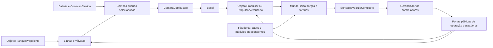
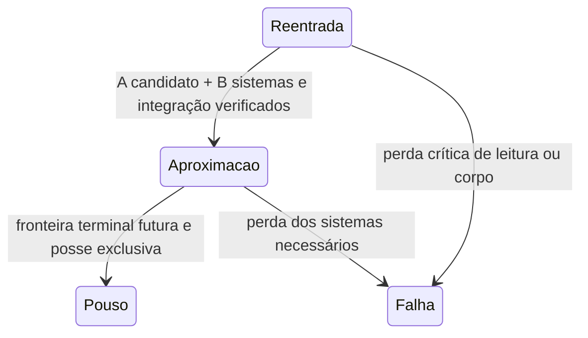

# RE-002E — Projeto da integração propulsiva e térmica futura

## Escopo e estado atual

Complexidade estimada: **6/10**, entrega documental. Não instala motor, tanque,
TPS ou RCS no RE-001 e não executa aproximação propulsiva ou pouso. Esta é uma
especificação de integração para revisão, não aprovação de hardware. O RE usa
corpos e fixadores reais no `MundoFisico`; o novo controlador de aproximação
implementa a porta do gerenciador e retorna nenhuma solicitação. Sua presença
não satisfaz a prontidão operacional.

Leitura de referência: P01–P12 consolidado, AGENTS, classes listadas abaixo e
fábrica RE atual. O Protótipo 2 já contém a cadeia propulsiva necessária para
composição. Não se cria uma alternativa exclusiva do orbitador.

## Composição física e fluxo de dependências



Os controladores recebem leituras e portas, nunca navegam pela instância
proprietária. Só o mundo integra cinemática. O agregado futuro declara módulos
sem copiar sua posição, velocidade, energia ou massa. `VeiculoComposto` exige
casco central com massa positiva: não pode ser inserido como segunda fachada
física por cima do mesmo casco RE.

### Contratos existentes a reutilizar

Caminhos relativos a `src/physics/`:

| Componente | API existente / responsabilidade | Condição para a próxima integração |
|---|---|---|
| `objetos/veiculos/VeiculoComposto.ts` | `adicionarModulo`, `adicionarFixador`, `instalarPropulsor`, `registrarNoMundo`; casco físico e computador por portas | Decidir migração do casco ou composição equivalente sem corpo central duplicado; preservar aerodinâmica e térmica do RE |
| `objetos/fontes-de-energia/TanquePropelente.ts` | Definição estende `DefinicaoObjeto`; tipo, capacidade kg, carga inicial kg; `fornecerPropelente(kg)` atualiza massa variável | Massa seca e pose reais; volume m³/densidade/condição de referência ainda não existem nessa API e requerem extensão validada |
| `objetos/propulsao/alimentacao/LinhaDePropelente.ts` | Tipo, comprimento m, vazão kg/s, válvula; `obterMassaFornecivelKg`, `fornecerMassa`, `romper`, `desconectar` | Comprimentos baseados em poses; separação rompe alimentação, não apaga tanques; não reconecta automaticamente |
| `objetos/propulsao/alimentacao/ValvulaPropelente.ts` | `definirAbertura`, `obterVazaoMaximaKgS` | Operador e automação usam a mesma semântica; fechamento impede vazão |
| `objetos/propulsao/alimentacao/BombaPropelente.ts` | `bombear`, `bombearMistura`; limites materiais/elétricos coordenados | Só instalar bomba se arquitetura escolhida a exigir. Modelo pressurizado alternativo requer projeto próprio, não bypass da cadeia |
| `objetos/propulsao/combustao/CamaraCombustao.ts` | `reagir(mComb, mOx, integridade)` e razão de mistura | Reagente limitante e eficiência; não representa transiente de pressão de câmara |
| `objetos/propulsao/combustao/Bocal.ts` | `calcularEmpuxo(resultado, integridade, fracao, dt)`; Isp nominal opcional | Empuxo/vazão calibrados declarados; Isp usa g₀ padrão, não gravidade local; não inferir parâmetros de voo reais |
| `objetos/propulsao/Propulsor.ts` | Operações de partida, permissivos, ignição explícita, corte e throttle; fornece forças operacionais | Nenhuma transferência de controlador deve contornar ignição, falha irreversível, alimentação ou integridade |
| `objetos/propulsao/PropulsorVetorizado.ts` | `solicitarVetorizacao`, `obterEstadoDaVetorizacao`, forças pela posição efetiva | Vetorização opcional, curso/taxa/energia e falhas reais; eixo fixo se ausente |
| `sensores/SensoresVeiculoComposto.ts` | Leituras SI, idade, validade, falhas por congelamento/atraso/desvio | Não usar leitura stale para autorizar posse; referencial radial/local compartilhado |
| `sistemas de controle/GerenciadorDeControladores.ts` | Registro, habilitação, arbitragem por atuador/recurso | Supervisor garante dono da fase; mesmo caminho operacional manual e automático |
| `sistemas de controle/ControladorPousoDePropulsores.ts` | Adaptador existente de pouso por IDs de motores | Permanece desabilitado no RE atual; integração terminal exige estudo separado |
| `conexoes/FixadorEstrutural.ts` / `estruturas/ConjuntoEstruturalRigido.ts` | Topologia, massa, CM, inércia composta e projeção rígida | Todo módulo participa pela conexão real; desprendidos permanecem no mundo |
| `solucionadores/SistemaTermico.ts` / `objetos/base/Objeto.ts` | Capacidade, energia recebida, dissipação/transferência e dano progressivo | Integrar futuro TPS por energia SI sem contabilizar o mesmo fluxo duas vezes |

## Tanques, montagem e propriedades de massa

A intenção P01 é tanques na região oposta ao motor. Não se presume resultado
estabilizante nem deslocamento artificial do CM. O próximo projeto precisa
fornecer, por corpo: massa seca kg, dimensões m, pose relativa de montagem,
propelente, capacidade kg e m³, densidade e referência térmica, carga inicial,
limite térmico °C, resistência/dissipação e limites dos fixadores.

O motor possui massa, pose, eixo e ponto de aplicação reais. O core calcula
M=Σm, G=Σmp/M e I=Σ(Ipróprio+m|p−G|²) no plano atual. Consumo e ruptura alteram
M/G/I, gravidade, torque e frenagem efetivos. Não somar novamente ao casco uma
massa já representada pelo tanque ou motor.

**Pré-requisito descoberto na leitura:**
`ConjuntoEstruturalRigido.atualizarReferenciasLocaisPelaMassaAtual` invalida suas
referências pela massa total. Uma futura transferência entre tanques mantendo
M constante pode mudar G sem disparar essa condição. Antes de habilitar esse
recurso, criar regressão de redistribuição com massa total constante e atualizar
a invalidação por massas dos membros, se necessário. O RE atual não transfere
material entre corpos; esta evolução não foi implantada antecipadamente.

Slosh, pressão interna, distribuição contínua de líquidos e propriedades
tridimensionais não são consequências automáticas do tanque concentrado. Devem
ser subprojetos com dados próprios.

## Contrato futuro da aproximação operacional



- **Leitura:** tempo simulado, validade/idade dos sensores, pose/orientação
  inercial e local, h/arco, vr/vt, alpha/ω, energia específica, q/carga/fluxo,
  temperaturas e integridades; massa/CM/I atuais; motores/linhas/fontes reais.
- **Planejamento:** alvo/geometria e distância remanescente; previsão com modelo
  e versão identificados; distinguir estado previsto, limite necessário e
  trajetória efetivamente alcançada. Não alterar estado para seguir previsão.
- **Capacidade:** empuxo útil e direção atingível, massa atual, throttle mínimo,
  capacidade de orientação, propelente disponível, reserva protegida e
  permissivos de partida/reignição. Todos por portas, não flags impostas na UI.
- **Atuação:** pedidos de throttle/gimbal/flaps via gerenciador e portas
  existentes; ignição explícita e intertravamentos mantidos. Nenhum `setVelocity`
  ou edição de orientação do casco por controle.
- **Posse:** reentrada deixa de emitir pedidos antes da aproximação; pouso só
  assume após fronteira terminal futura. Conflito detectado não deve ser
  resolvido silenciosamente apenas pela maior prioridade.
- **Falhas:** sensores stale, esgotamento, ruptura, perda elétrica, empuxo
  insuficiente, ignição recusada e integridade geram diagnóstico e retirada
  coerente das solicitações. Não criar sustentação/RCS invisível na contingência.

Nesta etapa `propulsaoDisponivel=false` e `integracaoCompativel=false` são fatos
da montagem. Não disponibilizar um checkbox que fabrique essas capacidades.
No teste unitário, portas de controladores falsas exercitam a arbitragem sob
B=true; isso não é demonstração de voo do protótipo sem atuação.

As hipóteses 1/2/5 m/s² da fronteira atual são **aceleração líquida útil**, não
F/m, Isp ou capacidade real. D=V²/(2a), t=V/a e queda radial ideal são filtros
necessários separados: satisfazê-los simultaneamente não demonstra que um
vetor de empuxo com limites reais possa cumprir a trajetória. Distância por arco
não resolve crossrange, relevo ou alinhamento. A velocidade limite varia com
distância/hipótese; não é uma velocidade alvo qualificada.

## TPS e atuadores — subprojetos preservados

O futuro TPS deve ser corpo/componente físico conforme relevância de colisão,
separação e massa, com capacidade térmica, temperatura, integridade, geometria,
emissividade/condutância e materiais declarados. A fonte deposita energia na
camada exposta; transferência para estrutura e internos usa caminhos físicos,
sem contar o mesmo calor novamente. Ablação, se modelada, retira massa/energia
com balanço verificável. Perda de proteção aumenta a exposição, nunca concede
imunidade à estrutura. Propriedades/limites da estrutura e componentes internos
são independentes dos limiares concentrados 1100/900 °C. Bateria permanece
isolada até que um caminho de calor explícito seja projetado e validado; seu
limiar provisório 60 °C não é fuga térmica ou certificação.

Nos flaps, a taxa prescrita com orçamento elétrico atual não qualifica torque
mecânico. A próxima extensão precisa porta de carga aerodinâmica no eixo,
curva torque×velocidade, transmissão, inércia/fricção, eficiência e potência
elétrica/mecânica. Não derivar torque de 300 W como P/ω em ω=0 ou inventar curva
sem dados. O diagnóstico atual informa torques indisponíveis como `null`.

Cargas axiais distribuídas usam o resolvedor compartilhado e resistência atual.
Cisalhamento, flexão e torção não são demonstrados por essa execução. Evolução
para essas componentes requer vínculos constitutivos/geométricos e regressões
independentes; alta pressão não pode ser transformada em ruptura por redução
artificial de resistência.

## Sequência de validação exigida antes de atuação propulsiva

1. Aprovar hardware, propelentes, sítio/alvo, montagem, limites térmicos,
   envelopes operacionais, reservas e condições de ignição/reignição.
2. Ensaios determinísticos da cadeia real: sem comando, válvula fechada,
   mistura ausente/incompatível, reserva esgotada, bomba sem energia,
   ruptura/desconexão, ignição recusada e motor danificado.
3. Validar M/G/I com consumo assimétrico, redistribuição com M constante,
   tanque/motor/TPS separados, forças excêntricas e conservações aplicáveis.
4. Medir empuxo e torque reais versus solicitações, curso/taxa/potência;
   verificar impacto destrutivo movido por empuxo e persistência dos destroços.
5. Testar previsão de frenagem versus trajetória integrada e convergência em
   dt, com margens declaradas e reserva, incluindo todos os casos malsucedidos.
6. Só então autorizar transferência operacional e campanha específica de
   aproximação; fronteira de pouso permanece outro marco.

Estas são dependências futuras explicitadas pelo STEER, não novas decisões
executadas sob autonomia. Nenhum desses parâmetros físicos foi escolhido em
nome do operador nesta execução.

## Esboço documental das portas de prontidão e planejamento

Este esboço **não está instalado na simulação**. Deve ser concretizado pelos
adaptadores dos componentes reais após definir hardware; valores desconhecidos
são `null` e bloqueiam autorização, nunca assumem disponibilidade.

```ts
interface CapacidadePropulsivaAproximacao {
  readonly idsMotores: readonly string[];
  readonly empuxoUtilDisponivelN: number | null;
  readonly massaInstantaneaKg: number;
  readonly propelenteUtilKg: number | null;
  readonly reservaProtegidaKg: number | null;
  readonly partidaPermitida: boolean;
  readonly reignicoesRestantes: number | null;
  readonly integridadeMinima: number;
  readonly impedimentos: readonly string[];
}
interface RequisitoProntidaoAproximacao {
  readonly id: string;
  readonly atendido: boolean;
  readonly motivo: string;
}
interface PrevisaoAproximacao {
  readonly revisaoModelo: string;
  readonly instanteLeituraS: number;
  readonly horizonteS: number;
  readonly alvoArcoM: number;
  readonly energiaAReduzirJPorKg: number;
  readonly distanciaFrenagemM: number | null;
  readonly tempoFrenagemS: number | null;
  readonly massaPrevistaConsumidaKg: number | null;
  readonly requisitos: readonly RequisitoProntidaoAproximacao[];
  readonly trajetoriaDemonstrada: boolean;
}
```

Contratos futuros a especializar, sem implementação antecipada:

- `lerCapacidadePropulsiva(): CapacidadePropulsivaAproximacao`: somente consulta
  tanques/linhas/bombas/motores/energia; não liga sistemas nem reserva material
  fictício. Capacidade útil considera direção e posição real de vetorização.
- `preverAproximacao(leituras: LeiturasVeiculoComposto, capacidade:
  CapacidadePropulsivaAproximacao, alvoArcoM: number): PrevisaoAproximacao`:
  planejamento sem edição do mundo. Deve incorporar gravidade, arrasto,
  orientação, consumo e margens; não substituir por apenas V²/(2a).
- `avaliarProntidaoAproximacao(previsao, capacidade): readonly
  RequisitoProntidaoAproximacao[]`: bloqueia dados desconhecidos/stale,
  reservas insuficientes, partida indisponível e previsão incompatível.
- A atuação continua em `ControladorDeVoo.calcularSolicitacoes(leituras, dtS)`
  com `SolicitacaoDeAtuador[]` arbitradas pelo gerenciador. Ignição usa a porta
  operacional explícita já existente; throttle não implica ignição.

O booleano final entregue ao supervisor será **resultado** desses requisitos.
Não deve ser uma propriedade editável do painel. Aceleração líquida escalar
hipotética da análise RE-002 não preenche automaticamente empuxo, reserva ou
partida dessas portas futuras.
